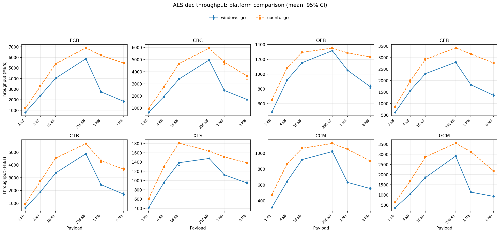
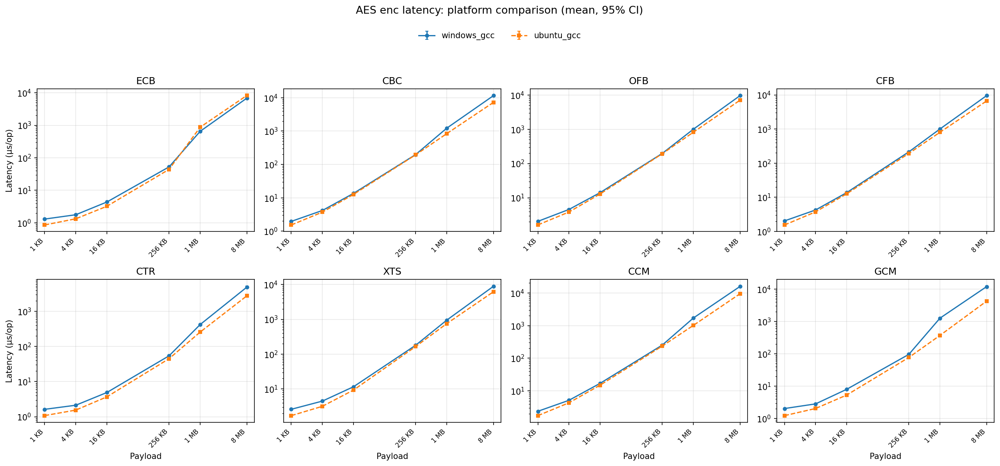
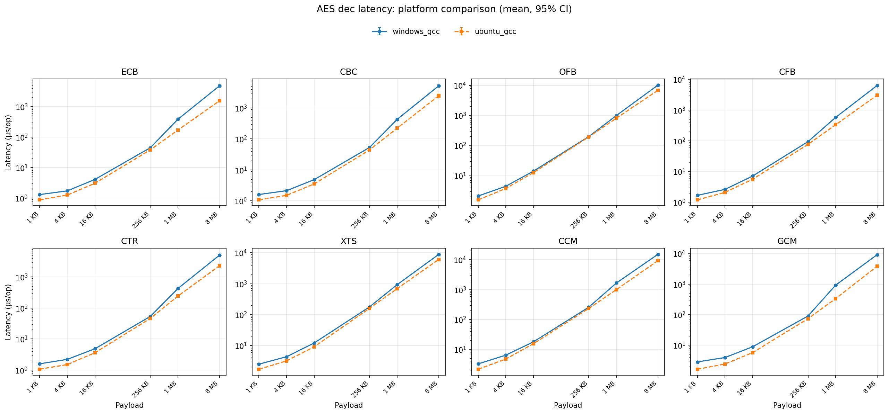
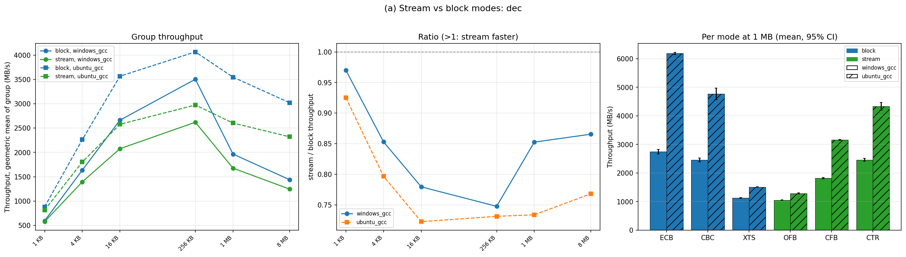
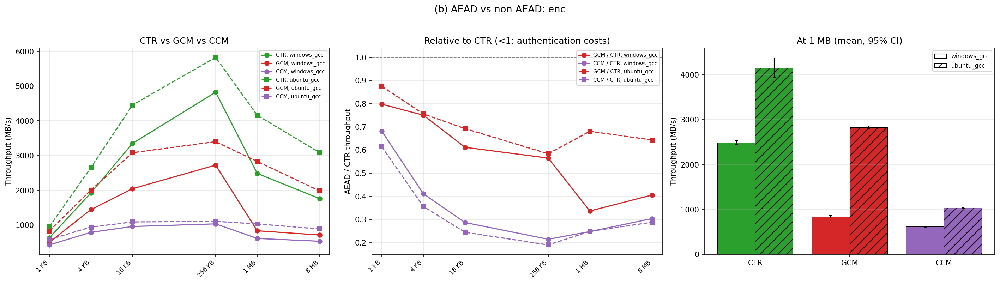
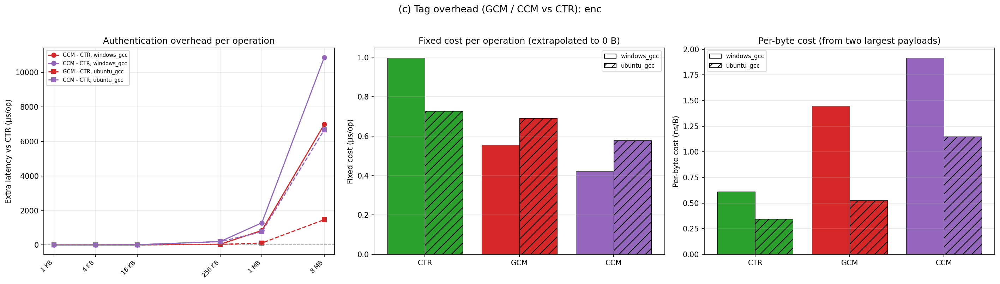
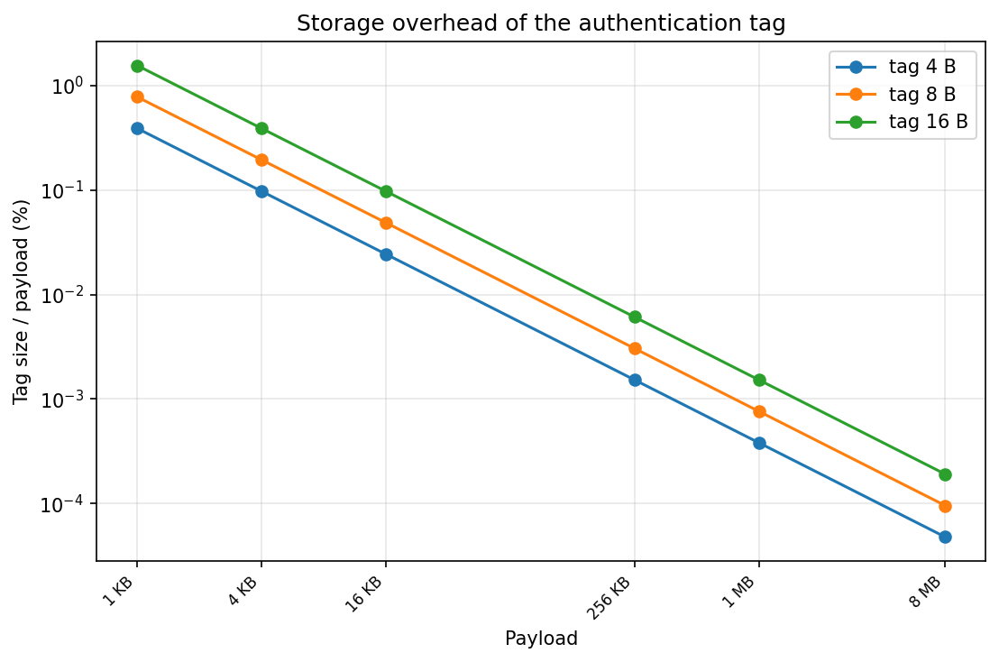

# TRƯỜNG ĐẠI HỌC CÔNG NGHỆ THÔNG TIN, ĐHQG-HCM
## KHOA MẠNG MÁY TÍNH VÀ TRUYỀN THÔNG

# BÁO CÁO THỰC HÀNH
## MÔN HỌC: MẬT MÃ HỌC VÀ ỨNG DỤNG (NT219)

# LAB 1: MÃ HÓA ĐỐI XỨNG VỚI CRYPTO++
### AES với 8 chế độ hoạt động (ECB, CBC, OFB, CFB, CTR, XTS, CCM, GCM)

**Thông tin sinh viên thực hiện:**
- **Họ và tên:** Trần Lâm Nguyên (Feph50)
- **Mã số sinh viên (MSSV):** 25521257
- **Lớp học phần:** NT219.P11.MMTT
- **Thời gian hoàn thành:** Học kỳ I - Năm học 2026–2027

<div class="pagebreak"></div>

# 1. Mục tiêu và chuẩn đầu ra (Objective & Outcomes)

**Đã xây dựng:** công cụ dòng lệnh `aestool` mã hóa/giải mã AES bằng thư viện **Crypto++ 8.9.0**, chọn mode lúc chạy bằng `--mode ecb|cbc|ofb|cfb|ctr|xts|ccm|gcm`, chạy trên Windows và Linux, build bằng CMake.
Công cụ cài đặt các kiểm tra chống dùng sai (ECB, IV/nonce, tái dùng nonce), xử lý AEAD (GCM, CCM) có kiểm tra thẻ xác thực, bộ chạy KAT với tệp vector JSON, bộ unit test và bộ benchmark theo giao thức chuẩn hóa.

**Ràng buộc của đề:** chỉ dùng Crypto++ cho các nguyên thủy mật mã (không OpenSSL, libsodium hay thư viện mật mã khác); STL được phép; biên dịch được trên Windows và Linux; bắt buộc CMake.

**Chuẩn đầu ra của đề và nơi đáp ứng:**

| Chuẩn đầu ra | Mục |
| :--- | :---: |
| Dùng Crypto++ an toàn qua nhiều mode khối và dòng | 2 |
| Xử lý IV/nonce đúng và ngăn dùng sai | 2.3, 2.4 |
| Thiết kế pipeline I/O và mã hóa chuỗi (encoding) vững | 2.2 |
| Kiểm chứng bằng vector kiểm thử chính thức của NIST | 3.1 |
| Đo hiệu năng mã hóa đối xứng | 4 |
| Phát hiện và xử lý lỗi dùng sai (ví dụ tái dùng nonce) | 2.4, 3.2, 5 |

# 2. Thiết kế và bảo mật (Design & Security)

## 2.1. Tham số và lựa chọn mode

| Mode | Loại | IV / nonce | Thẻ xác thực | Khóa AES | Ghi chú |
| :--- | :---: | :---: | :---: | :---: | :--- |
| ECB | Khối | không | không | 128/192/256 | Không an toàn; bị chặn trên 16 KiB |
| CBC | Khối | 16 byte | không | 128/192/256 | PKCS#7 padding |
| OFB | Dòng | 16 byte | không | 128/192/256 | |
| CFB | Dòng | 16 byte | không | 128/192/256 | CFB-128 |
| CTR | Dòng | 16 byte | không | 128/192/256 | Cấm tái dùng nonce |
| XTS | Lưu trữ | 16 byte (tweak) | không | 256 hoặc 512 bit (khóa đôi) | Cần ít nhất 16 byte dữ liệu |
| CCM | AEAD | 7–13 byte (mặc định 12) | 4, 8, 16 byte | 128/192/256 | Cấm tái dùng nonce |
| GCM | AEAD | 12 byte | 16 byte | 128/192/256 | Cấm tái dùng nonce |

Khóa mặc định của `keygen` là 256 bit. Mode không có giá trị mặc định: `--mode` là bắt buộc để không vô tình chọn mode yếu.

## 2.2. Cài đặt: giao diện dòng lệnh, I/O và mã hóa chuỗi

- **Cấu trúc mã nguồn:** lõi mật mã trong thư viện tĩnh `aescore` (`aescore.cpp`: mã hóa/giải mã, kiểm tra tham số, đăng ký nonce, nạp khóa), giao diện CLI trong `main.cpp`.
- **Lệnh:** `keygen`, `encrypt`, `decrypt`, `bench` và `--kat <vectors.json>`; các tùy chọn theo chuẩn CLI của đề: `--in`/`--text`, `--out`, `--key`/`--key-hex`, `--iv`/`--nonce`, `--mode`, `--aead`, `--aad`/`--aad-text`, `--encode hex|base64|raw`, `--threads`, `--verbose`.
- **Đầu vào/đầu ra:** `--in` là tệp nhị phân; `--text` là chuỗi UTF-8 (trên Windows, tham số dòng lệnh được đọc ở dạng UTF-16 rồi đổi sang UTF-8). Ciphertext ghi ra tệp ở dạng **raw**; hiển thị trên màn hình ở dạng **hex** (hoặc base64 theo `--encode`).
- **Khóa:** `--key-hex` hoặc `--key <tệp>`; tệp khóa là nhị phân thô hoặc hex có tiêu đề `AESKEY-HEX`. Độ dài khóa được kiểm tra theo mode.
- **IV/nonce:** `--iv` và `--nonce` nhận tệp hoặc chuỗi hex; nếu bỏ trống (trừ ECB), IV được sinh bằng `AutoSeededRandomPool` của Crypto++.
- **Sidecar JSON:** mỗi lần mã hóa ghi `<out>.json` gồm thuật toán, mode, IV/nonce, AAD và thẻ xác thực (với AEAD). Ví dụ:

```json
{"alg": "AES-256-GCM", "mode": "gcm", "iv": "c0e8c75db91b98e7402905dd", "aad": "", "tag": "680cc03b7e119caec5c73bef50b29fdc", "tag_len": "16"}
```

## 2.3. Kiểm tra chống dùng sai (Misuse prevention)

- **ECB:** in `WARNING`; chặn tệp lớn hơn 16 KiB; chỉ cho phép khi có `--allow-ecb`.
- **IV/nonce:** ép đúng độ dài theo mode (CBC/OFB/CFB/CTR/XTS: 16 byte; GCM: 12 byte; CCM: 7–13 byte); từ chối độ dài sai; tự sinh bằng `AutoSeededRandomPool` khi bỏ trống và lưu vào sidecar.
- **AEAD:** `ccm`/`gcm` yêu cầu cờ `--aead`; thẻ được kiểm tra khi giải mã, sai thì từ chối (fail closed).

## 2.4. Chống tái dùng nonce (CTR, CCM, GCM) và logic phát hiện

Với mỗi lần mã hóa bằng CTR, CCM hoặc GCM, công cụ tính định danh `SHA-256(khóa ‖ mode ‖ IV)` và đối chiếu với tệp đăng ký `.aestool_nonces` (đổi vị trí bằng `--nonce-db`). Nếu định danh đã tồn tại, thao tác bị **từ chối**
(`REJECTED: this (key, nonce) pair was already used`); nếu chưa, thao tác thực hiện rồi ghi định danh vào tệp. Tệp chỉ chứa giá trị băm, không chứa khóa. Cơ chế này không áp dụng cho CBC, OFB, CFB, ECB và XTS.

## 2.5. Build và môi trường

CMake, build ngoài cây nguồn (`mkdir build && cd build && cmake .. && cmake --build .`), C++17. Crypto++ được tìm tự động (gói hệ thống hoặc vcpkg), không cần sửa đường dẫn. Đã biên dịch và chạy kiểm thử trên Ubuntu LTS, Windows MSVC và Windows MinGW64 (kết quả ở mục 3.3). Phụ thuộc và phiên bản: CMake ≥ 3.20, Crypto++ 8.9.0, Catch2 v3.

# 3. Phương pháp và kết quả kiểm chứng (Test Methodology & Results)

## 3.1. Known Answer Tests (KAT)

`aestool --kat kat/vectors.json` đọc tệp JSON, chạy từng vector (mã hóa và giải mã), in **PASS/FAIL** cho từng vector và dòng tổng kết. Bộ vector gồm **29 vector**:

- NIST SP 800-38A: ECB, CBC, CFB128, OFB, CTR với AES-128/192/256 (phụ lục F.1–F.5);
- GCM (các test case của đặc tả McGrew & Viega / NIST, có AAD): AES-128/192/256;
- NIST SP 800-38C: CCM (Appendix C, các độ dài thẻ 4 và 8 byte) và một vector đối chiếu với thẻ 16 byte;
- IEEE 1619-2007: XTS-AES (vector 1, 2, 3 và vector 15 có ciphertext stealing) và một vector XTS-AES-256.

Hai vector ghi "cross-check" được tái tính bằng thư viện độc lập (pyca/cryptography) nên **không phải** vector nguyên văn của NIST. Danh sách đầy đủ ở Phụ lục C.

| Môi trường | Kết quả KAT |
| :--- | :---: |
| Windows, MinGW-w64 GCC 16.2 | 29/29 PASS |
| Windows, MSVC 19.51 | 29/29 PASS |
| Ubuntu, GCC | 29/29 PASS |

## 3.2. Kiểm thử âm tính (Negative tests)

Mỗi phép thử được chạy bằng lệnh `aestool` thật, ghi lại thông báo lỗi và mã thoát (bằng chứng ở `output/<hệ điều hành>/negative_*.txt`). Mã thoát: `0` thành công, `1` lỗi đầu vào/cú pháp, `2` lỗi giải mã/xác thực, `3` KAT thất bại.

| Tình huống (theo đề) | Cách thực hiện | Kết quả quan sát | Mã thoát |
| :--- | :--- | :--- | :---: |
| Sai khóa | CBC giải mã bằng khóa khác | Từ chối (`decryption failed`), không ghi tệp | 2 |
| Sai khóa (AEAD) | GCM giải mã bằng khóa khác | Từ chối, không ghi tệp plaintext | 2 |
| Sai IV | CTR giải mã bằng IV khác | Giải mã chạy được nhưng plaintext **sai** | 0 |
| Ciphertext bị sửa (non-AEAD) | CTR: lật 1 bit | Plaintext bị hỏng đúng 1 bit, **không bị phát hiện** | 0 |
| Ciphertext bị sửa (AEAD) | GCM: lật 1 bit | Lỗi xác thực, không ghi tệp | 2 |
| Thẻ xác thực bị sửa | GCM: sửa trường `tag` trong sidecar | Lỗi xác thực, không ghi tệp | 2 |
| Thẻ không hợp lệ | `--tag-hex` sai độ dài | Từ chối (`invalid tag length`) | 1 |
| Độ dài IV sai | CBC với IV 8 byte; GCM với nonce 2 byte | Từ chối (`invalid IV/nonce length`) | 1 |
| Đầu vào sai định dạng | hex hỏng, khóa sai độ dài, tệp khóa hỏng, tệp thiếu, mode lạ, XTS dưới 16 byte, sidecar hỏng, tệp KAT hỏng | Từ chối, không ghi tệp | 1 |
| Vi phạm chính sách | GCM thiếu `--aead`; ECB 20000 byte; tái dùng nonce | Từ chối | 1 |

Toàn bộ **34 phép thử** (cả đối chứng dương) cho kết quả giống nhau trên Windows MinGW, Windows MSVC và Ubuntu: 12 lệnh mã 0, 17 lệnh mã 1, 5 lệnh mã 2, và không có phép thử nào để lại tệp plaintext sau khi xác thực thất bại.

## 3.3. Unit test và ctest

Bộ unit test dùng **Catch2 v3**: 15 test case (62 assertion), danh sách ở Phụ lục D. `ctest` chạy ba test: `lab1_unit_tests`, `lab1_nist_kat` và `lab1_cli_negative`.

| Môi trường | Trình biên dịch | ctest | Catch2 |
| :--- | :--- | :---: | :---: |
| Windows | MinGW-w64 GCC 16.2.0 | 3/3 pass | 62 assertion, 15 test case |
| Windows | MSVC 19.51 | 3/3 pass | 62 assertion, 15 test case |
| Ubuntu | GCC (Crypto++ 8.9.0) | 3/3 pass | 62 assertion, 15 test case |

# 4. Hiệu năng (Performance)

## 4.1. Phần cứng và môi trường

Cả hai hệ điều hành chạy trên **cùng một máy vật lý** (cài song song, không dùng máy ảo), cùng mã nguồn, cùng tệp KAT, cùng lệnh `aestool bench --runs 30`, một luồng.

| Thông số | Windows | Ubuntu |
| :--- | :--- | :--- |
| CPU | Intel Core i7-11800H @ 2.30 GHz (turbo 4.6 GHz) | cùng CPU |
| Nhân / luồng | 8 / 16 | 8 / 16 |
| RAM | 31.7 GB | 31 GiB |
| Lưu trữ | Samsung MZVL2512HCJQ NVMe SSD 512 GB | cùng ổ |
| Hệ điều hành | Windows 11 Pro 10.0.26200, power plan High performance | Ubuntu 24.04.2 LTS, governor `performance` |
| Trình biên dịch và cờ | MinGW-w64 GCC 16.2.0, `-O3 -DNDEBUG`, liên kết tĩnh | GCC 15.2.0, `-O3 -DNDEBUG`, liên kết tĩnh |
| Crypto++ | 8.9.0 | 8.9.0 |

Máy: Lenovo ThinkPad P1 Gen 4i. AES-NI, PCLMULQDQ và AVX2 đều có trên CPU và được Crypto++ sử dụng (bộ cài đặt AES chọn là `AESNI`).

## 4.2. Giao thức đo

1. **Warm-up** 1,5 giây, chạy riêng cho từng mode và từng chiều, để ổn định cache, xung nhịp và bộ cấp phát.
2. Một **khối ~1000 thao tác** (giảm xuống cho payload lớn để không vượt ngân sách dữ liệu 256 MiB mỗi khối; số thao tác thực tế được ghi trong CSV: 1000 cho payload đến 256 KB, 256 cho 1 MB, 32 cho 8 MB).
3. Lặp **N = 30** lần độc lập; mỗi lần cho một giá trị thông lượng và một giá trị độ trễ.
4. Thống kê: **mean, median, độ lệch chuẩn (SD) và khoảng tin cậy 95%** (Student t, nửa độ rộng ±CI95).

Payload: 1 KB, 4 KB, 16 KB, 256 KB, 1 MB, 8 MB; 8 mode × 2 chiều = 96 trường hợp mỗi hệ điều hành. Dữ liệu và khóa lấy từ CSPRNG (không dùng PRNG cố định). Độ biến thiên (SD/Mean, trung vị trên 96 ô): 2.7% (Windows), 1.3% (Ubuntu).
Đơn vị: MB/s là 10^6 byte/s; độ trễ là thời gian cho một thao tác trên toàn payload.

## 4.3. Bảng thống kê tại payload 1 MB

**Windows (MinGW GCC)** (nguồn `bench_windows_gcc.csv`; N = 30, 256 thao tác mỗi khối):

| Mode | Chiều | Thông lượng Mean (MB/s) | Median | SD | ±CI95 | Độ trễ Mean (µs/op) | Median | SD | ±CI95 |
| :--- | :---: | ---: | ---: | ---: | ---: | ---: | ---: | ---: | ---: |
| ECB | Enc | 1,618.12 | 1,603.25 | 144.17 | ±53.77 | 653.2 | 654.0 | 59.9 | ±22.3 |
| ECB | Dec | 2,746.53 | 2,723.49 | 207.13 | ±77.25 | 384.0 | 385.0 | 30.8 | ±11.5 |
| CBC | Enc | 858.16 | 886.14 | 40.59 | ±15.14 | 1,224.6 | 1,183.3 | 59.8 | ±22.3 |
| CBC | Dec | 2,460.26 | 2,480.88 | 185.42 | ±69.15 | 428.7 | 422.7 | 35.0 | ±13.1 |
| OFB | Enc | 1,047.53 | 1,045.46 | 22.49 | ±8.39 | 1,001.4 | 1,003.0 | 21.6 | ±8.0 |
| OFB | Dec | 1,052.28 | 1,049.41 | 20.78 | ±7.75 | 996.9 | 999.2 | 19.7 | ±7.4 |
| CFB | Enc | 1,042.91 | 1,039.90 | 21.07 | ±7.86 | 1,005.8 | 1,008.3 | 20.3 | ±7.6 |
| CFB | Dec | 1,818.74 | 1,810.87 | 70.41 | ±26.26 | 577.4 | 579.0 | 22.8 | ±8.5 |
| CTR | Enc | 2,486.66 | 2,473.22 | 120.49 | ±44.94 | 422.6 | 424.0 | 20.7 | ±7.7 |
| CTR | Dec | 2,460.79 | 2,449.86 | 135.98 | ±50.71 | 427.4 | 428.0 | 23.8 | ±8.9 |
| XTS | Enc | 1,106.35 | 1,112.28 | 30.48 | ±11.37 | 948.5 | 942.7 | 26.6 | ±9.9 |
| XTS | Dec | 1,124.26 | 1,132.12 | 30.48 | ±11.37 | 933.4 | 926.2 | 26.1 | ±9.7 |
| CCM | Enc | 616.08 | 622.68 | 28.34 | ±10.57 | 1,705.6 | 1,684.0 | 81.6 | ±30.4 |
| CCM | Dec | 631.47 | 634.84 | 29.97 | ±11.18 | 1,664.3 | 1,651.7 | 83.2 | ±31.0 |
| GCM | Enc | 837.29 | 819.96 | 76.93 | ±28.69 | 1,262.5 | 1,278.8 | 115.2 | ±42.9 |
| GCM | Dec | 1,135.40 | 1,151.49 | 65.74 | ±24.52 | 926.6 | 910.6 | 55.8 | ±20.8 |

**Ubuntu (GCC)** (nguồn `bench_ubuntu_gcc.csv`; N = 30, 256 thao tác mỗi khối):

| Mode | Chiều | Thông lượng Mean (MB/s) | Median | SD | ±CI95 | Độ trễ Mean (µs/op) | Median | SD | ±CI95 |
| :--- | :---: | ---: | ---: | ---: | ---: | ---: | ---: | ---: | ---: |
| ECB | Enc | 1,200.40 | 1,205.53 | 17.06 | ±6.36 | 873.7 | 869.8 | 12.6 | ±4.7 |
| ECB | Dec | 6,187.88 | 6,216.67 | 101.65 | ±37.91 | 169.5 | 168.7 | 2.9 | ±1.1 |
| CBC | Enc | 1,250.23 | 1,267.06 | 40.05 | ±14.94 | 839.6 | 827.6 | 27.6 | ±10.3 |
| CBC | Dec | 4,775.55 | 4,929.52 | 541.01 | ±201.77 | 222.5 | 212.7 | 26.5 | ±9.9 |
| OFB | Enc | 1,285.37 | 1,308.74 | 49.20 | ±18.35 | 817.0 | 801.2 | 33.5 | ±12.5 |
| OFB | Dec | 1,288.60 | 1,302.06 | 38.10 | ±14.21 | 814.5 | 805.3 | 26.1 | ±9.7 |
| CFB | Enc | 1,301.56 | 1,304.28 | 6.73 | ±2.51 | 805.7 | 803.9 | 4.2 | ±1.6 |
| CFB | Dec | 3,160.56 | 3,168.77 | 34.24 | ±12.77 | 331.8 | 330.9 | 3.8 | ±1.4 |
| CTR | Enc | 4,159.77 | 4,172.87 | 584.17 | ±217.87 | 257.9 | 251.3 | 44.0 | ±16.4 |
| CTR | Dec | 4,335.16 | 4,354.83 | 360.09 | ±134.30 | 243.8 | 240.8 | 24.1 | ±9.0 |
| XTS | Enc | 1,393.66 | 1,409.54 | 48.78 | ±18.19 | 753.3 | 743.9 | 28.0 | ±10.4 |
| XTS | Dec | 1,511.40 | 1,515.14 | 14.33 | ±5.35 | 693.8 | 692.1 | 6.7 | ±2.5 |
| CCM | Enc | 1,034.06 | 1,038.41 | 13.12 | ±4.89 | 1,014.2 | 1,009.8 | 13.2 | ±4.9 |
| CCM | Dec | 1,049.17 | 1,054.86 | 15.45 | ±5.76 | 999.6 | 994.0 | 14.8 | ±5.5 |
| GCM | Enc | 2,831.91 | 2,846.89 | 64.59 | ±24.09 | 370.5 | 368.3 | 8.8 | ±3.3 |
| GCM | Dec | 3,127.81 | 3,151.22 | 77.78 | ±29.01 | 335.4 | 332.8 | 8.5 | ±3.2 |

Kết quả cho đủ 6 mức payload nằm trong các tệp CSV đi kèm; các hình ở mục 4.4 vẽ toàn bộ 6 mức.

## 4.4. Nghiên cứu so sánh bắt buộc

### 4.4.1. Windows vs. Linux

**Bảng 1: thông lượng tại 1 MB (Mean ± CI95) và tỷ lệ Ubuntu/Windows**

| Mode | Chiều | Windows (MB/s) | Ubuntu (MB/s) | Tỷ lệ Ubuntu/Windows | Khác biệt có ý nghĩa thống kê |
| :--- | :---: | ---: | ---: | :---: | :---: |
| ECB | Enc | 1,618.12 ± 53.77 | 1,200.40 ± 6.36 | 0.74 (-26%) | Có |
| ECB | Dec | 2,746.53 ± 77.25 | 6,187.88 ± 37.91 | 2.25 (+125%) | Có |
| CBC | Enc | 858.16 ± 15.14 | 1,250.23 ± 14.94 | 1.46 (+46%) | Có |
| CBC | Dec | 2,460.26 ± 69.15 | 4,775.55 ± 201.77 | 1.94 (+94%) | Có |
| OFB | Enc | 1,047.53 ± 8.39 | 1,285.37 ± 18.35 | 1.23 (+23%) | Có |
| OFB | Dec | 1,052.28 ± 7.75 | 1,288.60 ± 14.21 | 1.23 (+22%) | Có |
| CFB | Enc | 1,042.91 ± 7.86 | 1,301.56 ± 2.51 | 1.25 (+25%) | Có |
| CFB | Dec | 1,818.74 ± 26.26 | 3,160.56 ± 12.77 | 1.74 (+74%) | Có |
| CTR | Enc | 2,486.66 ± 44.94 | 4,159.77 ± 217.87 | 1.67 (+67%) | Có |
| CTR | Dec | 2,460.79 ± 50.71 | 4,335.16 ± 134.30 | 1.76 (+76%) | Có |
| XTS | Enc | 1,106.35 ± 11.37 | 1,393.66 ± 18.19 | 1.26 (+26%) | Có |
| XTS | Dec | 1,124.26 ± 11.37 | 1,511.40 ± 5.35 | 1.34 (+34%) | Có |
| CCM | Enc | 616.08 ± 10.57 | 1,034.06 ± 4.89 | 1.68 (+68%) | Có |
| CCM | Dec | 631.47 ± 11.18 | 1,049.17 ± 5.76 | 1.66 (+66%) | Có |
| GCM | Enc | 837.29 ± 28.69 | 2,831.91 ± 24.09 | 3.38 (+238%) | Có |
| GCM | Dec | 1,135.40 ± 24.52 | 3,127.81 ± 29.01 | 2.75 (+176%) | Có |


*Hình 1: Thông lượng tại payload 1 MB trên hai hệ điều hành (chiều mã hóa và giải mã), kèm thanh sai số CI95.*


*Hình 2: Thông lượng mã hóa (MB/s) theo kích thước payload, 8 mode, Windows và Ubuntu.*


*Hình 3: Thông lượng giải mã (MB/s) theo kích thước payload.*


*Hình 4: Độ trễ mỗi thao tác khi mã hóa theo kích thước payload.*


*Hình 5: Độ trễ mỗi thao tác khi giải mã theo kích thước payload.*

**Diễn giải.** Trong 96 trường hợp, Ubuntu nhanh hơn Windows ở **94/96**; chênh lệch có ý nghĩa thống kê (hai khoảng tin cậy 95% không giao nhau) ở 96/96; tỷ lệ Ubuntu/Windows có trung vị **1.36**.
Trung vị theo kích thước: 1 KB 1.49, 4 KB 1.35, 16 KB 1.29, 256 KB 1.14, 1 MB 1.67, 8 MB 1.64. Ngoại lệ (Windows nhanh hơn): ECB Enc 1 MB (0.74); ECB Enc 8 MB (0.80).
Chênh lệch lớn nhất ở GCM: tại 1 MB, GCM mã hóa đạt 2,832 MB/s trên Ubuntu so với 837 MB/s trên Windows (3.38 lần), trong khi CTR chỉ chênh 1.67 lần.
Nguyên nhân được phân tích ở mục 4.4.5 và 5.6.

### 4.4.2. Chế độ dòng (stream) vs. chế độ khối (block)

Nhóm khối: ECB, CBC, XTS. Nhóm dòng: OFB, CFB, CTR. So sánh bằng **trung bình nhân** thông lượng của từng nhóm theo kích thước payload.

**Bảng 2: thông lượng trung bình nhân của hai nhóm**

| Nền tảng | Chiều | Payload | Block (MB/s) | Stream (MB/s) | Stream / Block |
| :--- | :---: | :---: | ---: | ---: | :---: |
| Windows (MinGW GCC) | Enc | 1 KB | 544.38 | 541.50 | 0.99 |
| Windows (MinGW GCC) | Enc | 16 KB | 1,860.31 | 1,669.81 | 0.90 |
| Windows (MinGW GCC) | Enc | 1 MB | 1,153.87 | 1,395.33 | 1.21 |
| Windows (MinGW GCC) | Enc | 8 MB | 957.03 | 1,109.46 | 1.16 |
| Windows (MinGW GCC) | Dec | 1 KB | 593.98 | 576.17 | 0.97 |
| Windows (MinGW GCC) | Dec | 16 KB | 2,663.43 | 2,076.30 | 0.78 |
| Windows (MinGW GCC) | Dec | 1 MB | 1,965.82 | 1,676.20 | 0.85 |
| Windows (MinGW GCC) | Dec | 8 MB | 1,439.48 | 1,245.99 | 0.87 |
| Ubuntu (GCC) | Enc | 1 KB | 780.46 | 736.76 | 0.94 |
| Ubuntu (GCC) | Enc | 16 KB | 2,264.48 | 1,940.09 | 0.86 |
| Ubuntu (GCC) | Enc | 1 MB | 1,278.86 | 1,909.21 | 1.49 |
| Ubuntu (GCC) | Enc | 8 MB | 1,169.52 | 1,670.62 | 1.43 |
| Ubuntu (GCC) | Dec | 1 KB | 880.23 | 814.23 | 0.93 |
| Ubuntu (GCC) | Dec | 16 KB | 3,567.67 | 2,578.48 | 0.72 |
| Ubuntu (GCC) | Dec | 1 MB | 3,547.98 | 2,603.93 | 0.73 |
| Ubuntu (GCC) | Dec | 8 MB | 3,022.42 | 2,321.89 | 0.77 |


*Hình 6: Stream vs block, chiều mã hóa: (1) thông lượng trung bình nhân; (2) tỷ số Stream/Block; (3) từng mode tại 1 MB.*


*Hình 7: Stream vs block, chiều giải mã.*

**Diễn giải.** Tỷ số Stream/Block (> 1: nhóm dòng nhanh hơn) theo kích thước 1 KB → 8 MB: Windows mã hóa 1 KB 0.99, 4 KB 0.93, 16 KB 0.90, 256 KB 0.94, 1 MB 1.21, 8 MB 1.16; Ubuntu mã hóa 1 KB 0.94, 4 KB 0.89, 16 KB 0.86, 256 KB 0.95, 1 MB 1.49, 8 MB 1.43; Windows giải mã 1 KB 0.97, 4 KB 0.85, 16 KB 0.78, 256 KB 0.75, 1 MB 0.85, 8 MB 0.87; Ubuntu giải mã 1 KB 0.93, 4 KB 0.80, 16 KB 0.72, 256 KB 0.73, 1 MB 0.73, 8 MB 0.77.
Ở chiều mã hóa, nhóm dòng chỉ vượt nhóm khối từ 1 MB trở lên; ở chiều giải mã, nhóm khối nhanh hơn ở hầu hết kích thước.
Lý do là sự bất đối xứng của CBC: mã hóa $C_i = E_K(P_i \oplus C_{i-1})$ buộc xử lý **tuần tự**, còn giải mã $P_i = D_K(C_i) \oplus C_{i-1}$ xử lý **song song** được. Tại 1 MB, CBC giải mã nhanh gấp
2.87 lần CBC mã hóa trên Windows (2,460 so với 858 MB/s) và 3.82 lần trên Ubuntu (4,776 so với 1,250 MB/s).
Giải thích này là suy luận từ cấu trúc thuật toán, không được tách riêng bằng một thí nghiệm khác.

### 4.4.3. AEAD vs. non-AEAD

CTR làm mốc (GCM và CCM đều dùng lõi CTR để mã hóa dữ liệu); đồng thời so với trung bình nhân của 6 mode non-AEAD.

**Bảng 3: thông lượng AEAD so với non-AEAD**

| Nền tảng | Chiều | Payload | CTR (MB/s) | GCM (MB/s) | CCM (MB/s) | GCM / CTR | CCM / CTR | GCM / Non-AEAD |
| :--- | :---: | :---: | ---: | ---: | ---: | :---: | :---: | :---: |
| Windows (MinGW GCC) | Enc | 1 KB | 630.89 | 503.28 | 429.66 | 0.80 | 0.68 | 0.93 |
| Windows (MinGW GCC) | Enc | 16 KB | 3,348.39 | 2,048.01 | 960.45 | 0.61 | 0.29 | 1.16 |
| Windows (MinGW GCC) | Enc | 1 MB | 2,486.66 | 837.29 | 616.08 | 0.34 | 0.25 | 0.66 |
| Windows (MinGW GCC) | Enc | 8 MB | 1,761.91 | 715.06 | 535.61 | 0.41 | 0.30 | 0.69 |
| Windows (MinGW GCC) | Dec | 1 KB | 645.39 | 361.93 | 315.50 | 0.56 | 0.49 | 0.62 |
| Windows (MinGW GCC) | Dec | 16 KB | 3,372.08 | 1,851.15 | 918.97 | 0.55 | 0.27 | 0.79 |
| Windows (MinGW GCC) | Dec | 1 MB | 2,460.79 | 1,135.40 | 631.47 | 0.46 | 0.26 | 0.62 |
| Windows (MinGW GCC) | Dec | 8 MB | 1,715.31 | 924.27 | 554.34 | 0.54 | 0.32 | 0.69 |
| Ubuntu (GCC) | Enc | 1 KB | 951.02 | 832.32 | 583.81 | 0.88 | 0.61 | 1.10 |
| Ubuntu (GCC) | Enc | 16 KB | 4,451.86 | 3,082.58 | 1,090.38 | 0.69 | 0.24 | 1.47 |
| Ubuntu (GCC) | Enc | 1 MB | 4,159.77 | 2,831.91 | 1,034.06 | 0.68 | 0.25 | 1.81 |
| Ubuntu (GCC) | Enc | 8 MB | 3,084.13 | 1,983.74 | 889.10 | 0.64 | 0.29 | 1.42 |
| Ubuntu (GCC) | Dec | 1 KB | 964.79 | 629.82 | 475.95 | 0.65 | 0.49 | 0.74 |
| Ubuntu (GCC) | Dec | 16 KB | 4,535.32 | 2,868.45 | 1,060.98 | 0.63 | 0.23 | 0.95 |
| Ubuntu (GCC) | Dec | 1 MB | 4,335.16 | 3,127.81 | 1,049.17 | 0.72 | 0.24 | 1.03 |
| Ubuntu (GCC) | Dec | 8 MB | 3,673.93 | 2,182.29 | 902.23 | 0.59 | 0.25 | 0.82 |


*Hình 8: AEAD vs non-AEAD, chiều mã hóa: (1) thông lượng CTR/GCM/CCM; (2) tỷ số so với CTR; (3) tại 1 MB.*


*Hình 9: AEAD vs non-AEAD, chiều giải mã.*

**Diễn giải.** Tại 1 MB, GCM mã hóa đạt 34% thông lượng CTR trên Windows và 68% trên Ubuntu (giải mã: 46% và 72%). So với trung bình nhân các mode non-AEAD, GCM mã hóa ở mức 0.66 lần (Windows) và 1.81 lần (Ubuntu).
Phép nhân GHASH trong $\mathrm{GF}(2^{128})$ được tăng tốc bằng PCLMULQDQ, nên GCM có thể nhanh hơn các mode non-AEAD tuần tự (CBC mã hóa, CFB mã hóa) dù phải tính thêm thẻ xác thực.
CCM mã hóa chỉ đạt 25% (Windows) và 25% (Ubuntu) thông lượng CTR; đây là mode chậm nhất trong 8 mode ở 1 MB, ở cả hai hệ điều hành và cả hai chiều.
Nguyên nhân kỹ thuật: CCM là thuật toán **hai lượt** (một lượt CBC-MAC tuần tự để tạo thẻ, một lượt CTR để mã hóa), nên số phép mã hóa khối gấp đôi và một nửa số đó không thể xếp chồng.

### 4.4.4. Chi phí của thẻ xác thực (GCM/CCM)

Mô hình hóa độ trễ bằng $\text{Latency}(\text{Size}) \approx a + b \cdot \text{Size}$: **a** là chi phí cố định mỗi thao tác (ngoại suy về 0 byte), **b** là chi phí biên theo byte, tính từ độ dốc giữa hai payload lớn nhất (1 MB và 8 MB).

**Bảng 4: chi phí cố định và chi phí biên (so với CTR)**

| Nền tảng | Chiều | Mode | Chi phí cố định a (µs/op) | Chi phí biên b (ns/B) | Δb so với CTR (ns/B) | Δb so với CTR (%) |
| :--- | :---: | :---: | ---: | ---: | ---: | ---: |
| Windows (MinGW GCC) | Enc | CTR | 0.998 | 0.612 | (mốc) | (mốc) |
| Windows (MinGW GCC) | Enc | GCM | 0.554 | 1.449 | +0.837 | +137% |
| Windows (MinGW GCC) | Enc | CCM | 0.421 | 1.917 | +1.306 | +213% |
| Windows (MinGW GCC) | Dec | CTR | 0.937 | 0.634 | (mốc) | (mốc) |
| Windows (MinGW GCC) | Dec | GCM | 1.675 | 1.128 | +0.494 | +78% |
| Windows (MinGW GCC) | Dec | CCM | 1.366 | 1.840 | +1.206 | +190% |
| Ubuntu (GCC) | Enc | CTR | 0.726 | 0.343 | (mốc) | (mốc) |
| Ubuntu (GCC) | Enc | GCM | 0.691 | 0.527 | +0.184 | +54% |
| Ubuntu (GCC) | Enc | CCM | 0.579 | 1.148 | +0.805 | +235% |
| Ubuntu (GCC) | Dec | CTR | 0.775 | 0.280 | (mốc) | (mốc) |
| Ubuntu (GCC) | Dec | GCM | 1.136 | 0.478 | +0.198 | +71% |
| Ubuntu (GCC) | Dec | CCM | 0.994 | 1.131 | +0.851 | +303% |


*Hình 10: Chi phí phụ trội của thẻ (GCM/CCM so với CTR), chiều mã hóa: độ trễ gia tăng, chi phí cố định, chi phí biên (ns/B).*

**Chi phí tính toán.** GCM mã hóa thêm +0.837 ns/B (Windows) và +0.184 ns/B (Ubuntu) so với CTR; CCM thêm +1.306 và +0.805 ns/B.
CCM luôn có chi phí biên cao hơn GCM, phù hợp với kiến trúc hai lượt. Chi phí cố định chỉ vào khoảng 0.42–1.68 µs mỗi thao tác. Mô hình chỉ dùng hai điểm lớn nhất nên chi phí biên còn gồm chi phí cấp phát và sao chép bộ nhớ của công cụ, không phải chi phí thuần của thuật toán xác thực.

**Chi phí lưu trữ.** Thẻ có độ dài cố định nên tỷ lệ so với payload là $\text{Tag} / \text{Payload} \times 100\%$:

**Bảng 5: tỷ lệ dung lượng thẻ so với payload**

| Payload | Tag 4 B | Tag 8 B | Tag 16 B |
| :---: | ---: | ---: | ---: |
| 1 KB | 0.3906% | 0.7812% | 1.5625% |
| 4 KB | 0.0977% | 0.1953% | 0.3906% |
| 16 KB | 0.0244% | 0.0488% | 0.0977% |
| 256 KB | 0.0015% | 0.0031% | 0.0061% |
| 1 MB | 0.0004% | 0.0008% | 0.0015% |
| 8 MB | 0.0000% | 0.0001% | 0.0002% |


*Hình 11: Tỷ lệ dung lượng thẻ xác thực theo kích thước payload (thang log-log).*

Thẻ 16 byte chiếm 1.56% ở payload 1 KB, dưới 0.098% từ 16 KB trở lên và 0.0015% ở 1 MB: chi phí lưu trữ chỉ đáng chú ý với thông điệp rất ngắn.

### 4.4.5. Lập lịch hệ điều hành và chi phí lời gọi hệ thống

Vòng đo của `bench` chạy hoàn toàn trong bộ nhớ, không đọc hay ghi tệp trong khoảng được đo; vì vậy chi phí lời gọi hệ thống chủ yếu là cấp phát bộ nhớ (`mmap`/`VirtualAlloc`, page fault) và đọc đồng hồ.
Với payload nhỏ (1 KB, 4 KB), một thao tác chỉ kéo dài vài micro giây nên chi phí cố định (khởi tạo bộ lọc Crypto++, cấp phát, lịch khóa) và nhiễu của bộ lập lịch chiếm tỷ trọng lớn; đó là nơi độ biến thiên và chênh lệch giữa hai hệ điều hành rõ nhất (tỷ lệ Ubuntu/Windows trung vị 1.49 ở 1 KB).
Để định vị nguyên nhân chênh lệch ở GCM, tác giả dùng một chương trình dò độc lập gọi trực tiếp Crypto++ (1 MiB, AES-256): bộ cài đặt AES là `AESNI` và `HasCLMUL = 1` ở cả bản MinGW và bản Linux, nên **không phải một bên thiếu tăng tốc phần cứng**. Khi tái sử dụng bộ đệm, hai bên gần bằng nhau
(CTR ≈ 5.8 GB/s trên Windows, ≈ 6.0 GB/s trên Linux); nhưng khi mỗi thao tác cấp phát chuỗi đầu ra mới và sao chép thêm một lần (đúng cách `encrypt()` của `aestool` làm), GCM tụt xuống ≈ 0.9 GB/s (Windows) so với ≈ 1.9 GB/s (Linux).
Như vậy phần lớn chênh lệch đo được nằm ở chi phí cấp phát và sao chép bộ nhớ trong vòng đo, và hệ điều hành xử lý chi phí đó khác nhau. *(Hạn chế: phép dò phía Linux chạy trong WSL2, không phải Ubuntu cài trực tiếp dùng cho số đo chính; chỉ là bằng chứng hỗ trợ.
Bộ lập lịch, đồng hồ đo và runtime C/C++ khác nhau cũng có thể đóng góp nhưng không được đo riêng.)*

# 5. Thảo luận bảo mật (Security Engineering Discussion)

## 5.1. Mô hình mối đe dọa (Threat model)

Đối thủ được giả định có thể: (1) **nghe lén** mọi ciphertext và sidecar; (2) **chủ động sửa** ciphertext hoặc tiêu đề sidecar trên đường truyền hoặc trên đĩa; (3) thu thập **nhiều ciphertext dùng chung (khóa, nonce)** nếu người dùng tái dùng; (4) quan sát **thông báo lỗi** của hệ thống giải mã (oracle).
Ngoài phạm vi: đối thủ có quyền thực thi mã trên máy người dùng, đọc bộ nhớ tiến trình hoặc tệp khóa, và tấn công kênh kề cục bộ.

## 5.2. Kịch bản dùng sai (Misuse scenarios) và biện pháp của công cụ

| Kịch bản dùng sai | Hậu quả | Biện pháp trong `aestool` |
| :--- | :--- | :--- |
| Dùng ECB cho dữ liệu có cấu trúc | Lộ mẫu dữ liệu (khối giống nhau cho ciphertext giống nhau) | WARNING, chặn trên 16 KiB, cần `--allow-ecb` |
| Tái dùng (khóa, nonce) với CTR/CCM/GCM | Lộ XOR của hai plaintext; với GCM còn lộ khóa xác thực | Đăng ký nonce từ chối lần dùng lại (mục 2.4) |
| Chạy GCM/CCM mà không kiểm thẻ | Mất toàn vẹn | `--aead` bắt buộc; giải mã sai thẻ thì từ chối |
| Dùng CBC/CTR rồi tin rằng dữ liệu không bị sửa | Kẻ tấn công lật bit hoặc sửa dữ liệu mà không bị phát hiện | Tài liệu và test âm tính chứng minh (mục 3.2); khuyến nghị AEAD |
| Đặt IV sai độ dài hoặc tự đặt IV yếu | Lỗi hoặc IV dễ đoán | Kiểm tra độ dài; IV tự sinh bằng CSPRNG |
| Truyền khóa bằng `--key-hex` | Khóa nằm trong lịch sử shell và danh sách tiến trình | Hỗ trợ `--key <tệp>`; ghi rõ trong Limitations |
| Dùng XTS cho thông điệp mạng | Không có toàn vẹn, cho phép hoán đổi/phát lại | Ghi rõ XTS chỉ dùng cho lưu trữ |

## 5.3. Bảo mật mức mode (Mode-level security) và các tấn công liên quan

- **Vì sao ECB không an toàn.** Cùng một khối plaintext luôn cho cùng một khối ciphertext, nên ECB không che được mẫu dữ liệu (như ảnh có vùng đồng màu) và không đạt tính an toàn ngữ nghĩa (IND-CPA). Đây là lý do công cụ chặn ECB trên 16 KiB.
- **Rủi ro padding oracle của CBC.** Với PKCS#7, nếu hệ thống giải mã trả lời khác nhau giữa "padding sai" và "dữ liệu sai", kẻ tấn công có thể khôi phục plaintext từng byte bằng cách gửi nhiều ciphertext chỉnh sửa (Vaudenay, 2002).
  Công cụ chỉ trả về một thông báo trung tính (`decryption failed`) cho mọi lỗi giải mã, và khuyến nghị dùng AEAD thay cho CBC.
- **Thảm họa tái dùng nonce của CTR.** Hai bản mã cùng (khóa, nonce) cho $C_1 \oplus C_2 = P_1 \oplus P_2$ (two-time pad): kẻ tấn công thu được XOR của hai plaintext mà không cần khóa; biết một plaintext là suy ra được plaintext còn lại.
- **Bảo đảm của AEAD so với non-AEAD.** Mode non-AEAD (CBC, CTR...) chỉ bảo mật; ciphertext có tính dẻo (malleable): lật bit ở ciphertext CTR lật đúng bit tương ứng ở plaintext và không bị phát hiện (đã chứng minh ở mục 3.2). AEAD (GCM, CCM) thêm tính toàn vẹn và xác thực dữ liệu cùng AAD:
  ciphertext, tag hoặc AAD bị sửa đều làm giải mã thất bại, không trả plaintext.
- **Vì sao GCM bắt buộc nonce duy nhất.** GCM mã hóa bằng CTR nên tái dùng nonce gây lộ XOR của plaintext như trên; ngoài ra, hai thông điệp cùng nonce cho phép kẻ tấn công khôi phục khóa con xác thực $H$ của GHASH và từ đó giả mạo thẻ cho thông điệp tùy ý (tấn công "forbidden attack" của Joux).
- **Hạn chế của XTS (không có toàn vẹn).** XTS được thiết kế cho mã hóa lưu trữ nên không có thẻ xác thực. Kẻ tấn công ghi được lên đĩa có thể làm hỏng một khối 16 byte thành dữ liệu rác khó đoán, hoán đổi hoặc phát lại cả sector;
  cùng plaintext tại cùng vị trí dưới cùng khóa luôn cho cùng ciphertext (lộ việc có thay đổi hay không). XTS chỉ phù hợp cho mã hóa lưu trữ, không dùng cho thông điệp mạng.

## 5.4. Bảo mật mức cài đặt (Implementation-level security)

- **Sinh ngẫu nhiên đúng cách.** Khóa, IV và nonce dùng `AutoSeededRandomPool` của Crypto++ (CSPRNG được gieo từ nguồn entropy của hệ điều hành); không dùng `rand()` hay `std::random`.
- **Lưu IV an toàn.** IV không bí mật nên lưu trong sidecar JSON cạnh bản mã. Với AEAD, sửa IV, AAD hoặc thẻ trong sidecar đều làm giải mã thất bại (đã kiểm thử ở mục 3.2); với mode non-AEAD, sidecar không được xác thực.
- **Kiểm tra thẻ xác thực.** Thẻ được kiểm bởi `AuthenticatedDecryptionFilter` của Crypto++ (so sánh thẻ do thư viện thực hiện, không dùng `==` của ứng dụng); plaintext chỉ được ghi ra sau khi kiểm thẻ thành công.
- **Xử lý lỗi (fail closed).** Mọi đầu vào sai định dạng hoặc xác thực thất bại đều dừng với mã thoát riêng và thông báo trung tính, không tạo tệp đầu ra; mọi lỗi của thư viện được bắt và chuyển thành lỗi của công cụ.
- **Rủi ro lưu trữ khóa.** Khóa lưu dạng tệp thô hoặc hex không mã hóa bằng mật khẩu; `--key-hex` lộ khóa qua lịch sử shell; công cụ không xóa trắng bộ nhớ chứa khóa sau khi dùng; không có quản lý khóa (phân phối, xoay vòng, thu hồi).

## 5.5. Cấu hình mặc định an toàn (Secure defaults) và hành vi fail-closed

| Mặc định | Hành vi |
| :--- | :--- |
| Chọn mode | Không có mode mặc định; `--mode` bắt buộc |
| AEAD | `ccm`/`gcm` từ chối chạy nếu thiếu `--aead` |
| IV/nonce | Tự sinh bằng `AutoSeededRandomPool` và lưu vào sidecar khi bỏ trống |
| ECB | WARNING; chặn trên 16 KiB trừ khi có `--allow-ecb` |
| Nonce CTR/CCM/GCM | Từ chối tái sử dụng |
| Ghi tệp đầu ra | Chỉ ghi plaintext sau khi giải mã/xác thực thành công |
| Thông báo lỗi | Trung tính, không phân biệt "sai padding" và "sai dữ liệu" |
| Khóa | Không bao giờ in ra; `keygen` nhắc bảo vệ tệp khóa; kích thước mặc định 256 bit |
| Encoding | Màn hình: hex; tệp: nhị phân thô |

**Fail-closed:** khi gặp độ dài khóa/IV sai, hex hỏng, tệp khóa hỏng, tệp thiếu, mode lạ, thẻ sai hoặc ciphertext bị sửa, công cụ dừng với mã thoát khác 0 (`1` lỗi đầu vào, `2` lỗi giải mã/xác thực) và không ghi tệp plaintext. Bằng chứng ở mục 3.2.

## 5.6. Cân nhắc đa nền tảng (Cross-platform considerations)

- **Khác biệt RNG giữa các hệ điều hành.** `AutoSeededRandomPool` lấy entropy từ API của hệ điều hành: trên Windows qua thư viện mật mã của hệ thống (CryptoAPI/CNG), trên Linux qua `getrandom(2)` hoặc `/dev/urandom`. Chúng chỉ ảnh hưởng thời gian sinh khóa/IV, không ảnh hưởng thông lượng mã hóa.
- **Hành vi hệ thống tệp.** Windows và Linux khác nhau về ký tự xuống dòng (`\r\n` và `\n`), đường dẫn và quyền tệp (ACL so với `chmod 600` cho tệp khóa). Công cụ mở mọi tệp ở chế độ nhị phân nên dữ liệu không bị đổi trên cả hai nền tảng.
- **Nguyên nhân dao động hiệu năng.** Đã phân tích ở mục 4.4.5: chi phí cố định mỗi thao tác và nhiễu của bộ lập lịch ở payload nhỏ; chi phí cấp phát và sao chép bộ nhớ khác nhau giữa hai hệ điều hành; áp lực bộ nhớ đệm và băng thông RAM ở payload lớn (thông lượng đạt đỉnh ở kích thước trung bình rồi giảm ở 8 MB);
  cùng sự khác biệt về trình biên dịch/runtime (GCC 16.2 và 15.2).

## 5.7. Hạn chế của bản cài đặt (Limitations)

- Tệp đầu vào được đọc hoàn toàn vào bộ nhớ (không xử lý theo luồng), nên tệp rất lớn cần tương ứng lượng RAM.
- Đăng ký nonce chỉ có hiệu lực cục bộ: xóa tệp `.aestool_nonces`, chạy ở thư mục khác hoặc trên máy khác sẽ bỏ qua kiểm tra; tệp không có khóa tiến trình nên hai tiến trình đồng thời có thể cùng vượt qua kiểm tra.
- Không có quản lý khóa; không xóa trắng bộ nhớ chứa khóa; `--key-hex` lộ khóa qua tiến trình/shell.
- Với mode non-AEAD, sidecar JSON không được xác thực; XTS không có toàn vẹn; ECB chỉ để minh họa.
- Không có biện pháp chống tấn công kênh kề ngoài những gì Crypto++ cung cấp.
- Số liệu hiệu năng phụ thuộc máy và phiên bản compiler/thư viện; chỉ GCC được so sánh giữa hai hệ điều hành.

# 6. Thảo luận (Discussion)

## 6.1. Lỗi về tính đúng đắn và cách khắc phục

- **Bộ KAT ban đầu quá hẹp** (9 vector, chủ yếu AES-128): mở rộng lên 29 vector phủ AES-192/256, GCM có AAD, CCM, XTS (kể cả ciphertext stealing).
- **Phụ thuộc OpenSSL trái ràng buộc Lab 1:** hệ thống build ban đầu yêu cầu OpenSSL dù Lab 1 chỉ cho phép Crypto++; đã loại bỏ hoàn toàn.
- **Đường dẫn thư viện cố định theo máy tác giả:** máy khác không build được; đã chuyển sang tìm Crypto++ tự động và kiểm tra bằng bản build sạch trên MSVC, MinGW và Ubuntu.
- **Lẫn thư viện giữa các toolchain qua biến `PATH`:** khi `PATH` chứa thư mục MinGW, CMake lấy nhầm Crypto++ của MinGW cho bản build MSVC; trên Linux chạy trong WSL cũng lấy nhầm thư viện của Windows. Đã bỏ qua các thư mục suy ra từ `PATH` ở các trường hợp này.
- **Giao thức đo không đúng chuẩn:** warm-up chỉ chạy một lần và số thao tác mỗi khối không bám ~1000; đã chuẩn hóa (warm-up riêng cho từng mode/chiều, khối ~1000 thao tác, 30 lần lặp) và đo lại.
- **Tham số dòng lệnh UTF-8 trên Windows:** `argv` của Windows dùng bảng mã ANSI nên chưa đảm bảo yêu cầu "nhận đầu vào UTF-8"; đã đọc tham số ở dạng UTF-16 rồi đổi sang UTF-8 và kiểm tra bằng chuỗi `--text` tiếng Việt.

## 6.2. So sánh giữa các hệ điều hành

Ubuntu nhanh hơn Windows ở 94/96 trường hợp (trung vị 1.36 lần), chênh lệch mạnh nhất ở GCM (1 MB: 3.38 lần) và ở payload nhỏ; ECB mã hóa là ngoại lệ nơi Windows nhanh hơn ở 1 MB và 8 MB.
Thứ tự tương đối giữa các mode (CTR/GCM/CBC giải mã nhanh; CCM, CBC mã hóa và XTS chậm) giống nhau trên cả hai hệ điều hành, nên kết luận về mode không phụ thuộc nền tảng; chỉ độ lớn tuyệt đối thay đổi.

## 6.3. Đánh đổi bảo mật và hiệu năng

CTR cho thông lượng cao (4,160 MB/s trên Ubuntu, 2,487 MB/s trên Windows tại 1 MB) nhưng không có toàn vẹn; GCM giữ 68% (Ubuntu) và 34% (Windows) thông lượng của CTR và bổ sung xác thực; CCM chỉ còn 25% (Ubuntu) do hai lượt.
Chi phí lưu trữ của thẻ không đáng kể với payload từ vài chục KB.

## 6.4. Bài học rút ra (Lessons learned)

- Cài đặt đúng chưa đủ: các lỗi nghiêm trọng thường nằm ở cách dùng (IV, nonce, thiếu xác thực), nên công cụ phải chủ động chặn dùng sai thay vì chỉ cung cấp chức năng.
- Phải chọn AEAD khi cần toàn vẹn; CTR/CBC/XTS không phát hiện được việc sửa dữ liệu.
- Kết quả đo hiệu năng chỉ đáng tin khi giao thức đo cố định (warm-up, số thao tác, số lần lặp, cùng máy, cùng cấu hình) và được báo cáo kèm khoảng tin cậy.
- Môi trường build phải tái lập được: đường dẫn cố định và biến môi trường (`PATH`) dễ làm lẫn thư viện giữa các toolchain.

# 7. Kết luận và hướng phát triển (Conclusion)

Lab 1 đã hoàn thành công cụ `aestool` với 8 mode AES bằng Crypto++, các kiểm tra chống dùng sai, xử lý AEAD fail-closed, 29 vector KAT đều đạt trên Windows (MinGW, MSVC) và Ubuntu, 34 phép thử âm tính cho kết quả nhất quán và bộ so sánh hiệu năng theo giao thức chuẩn hóa với khoảng tin cậy 95%.
Các kết luận chính: Ubuntu nhanh hơn Windows ở phần lớn các trường hợp; mode dòng chỉ vượt mode khối ở payload lớn khi mã hóa; GCM giữ phần lớn thông lượng của CTR trong khi CCM chậm nhất; chi phí thẻ xác thực không đáng kể từ vài chục KB.

**Hướng phát triển:** xử lý tệp theo luồng thay vì đọc cả vào bộ nhớ; khóa tệp (file lock) cho đăng ký nonce; nhập khóa từ biến môi trường hoặc stdin thay cho `--key-hex`; xóa trắng bộ nhớ chứa khóa; xác thực sidecar cho mode non-AEAD.

# Tài liệu tham khảo

1. NIST, FIPS 197: *Advanced Encryption Standard (AES)*, 2001 (cập nhật 2023).
2. NIST, SP 800-38A: *Recommendation for Block Cipher Modes of Operation: Methods and Techniques*, 2001.
3. NIST, SP 800-38C: *Recommendation for Block Cipher Modes of Operation: The CCM Mode for Authentication and Confidentiality*, 2004.
4. NIST, SP 800-38D: *Recommendation for Block Cipher Modes of Operation: Galois/Counter Mode (GCM) and GMAC*, 2007.
5. D. McGrew, J. Viega, *The Galois/Counter Mode of Operation (GCM)*, 2004 (các test case GCM).
6. IEEE Std 1619-2007: *Cryptographic Protection of Data on Block-Oriented Storage Devices* (XTS-AES).
7. S. Vaudenay, *Security Flaws Induced by CBC Padding*, EUROCRYPT 2002.
8. A. Joux, *Authentication Failures in NIST version of GCM*, 2006.
9. Crypto++ Library 8.9.0, tài liệu và mã nguồn: <https://www.cryptopp.com>.
10. Catch2 v3: <https://github.com/catchorg/Catch2>; pyca/cryptography: <https://cryptography.io> (dùng để tái tính giá trị KAT).

<div class="pagebreak"></div>

# Phụ lục A. Ví dụ sử dụng CLI

```
aestool keygen --bits 256 --out key.bin
aestool encrypt --mode gcm --aead --key key.bin --in msg.txt --out ct.bin        # ghi ct.bin và ct.bin.json (IV, tag)
aestool decrypt --mode gcm --aead --key key.bin --in ct.bin --out msg.txt
aestool encrypt --mode gcm --aead --key key.bin --aad-text "v1" --in msg.txt --out ct.bin
aestool encrypt --mode ctr --key-hex <hex> --text "xin chào" --encode base64     # hiển thị trên màn hình
aestool encrypt --mode ecb --allow-ecb --key key.bin --in big.bin --out ct.bin   # WARNING + cần --allow-ecb nếu > 16 KiB
aestool --kat kat/vectors.json
aestool bench --runs 30 --out bench.csv
```

# Phụ lục B. Nhật ký build và ctest (tóm tắt)

Trích từ `output/<hệ điều hành>/ctest_*.txt` (toàn văn trong các tệp đó):

```
Windows MinGW-w64 GCC 16.2.0, Crypto++ 8.9.0-2, Catch2 3.16:
  1/3 lab1_unit_tests ... Passed   2/3 lab1_nist_kat ... Passed   3/3 lab1_cli_negative ... Passed
  100% tests passed out of 3;  All tests passed (62 assertions in 15 test cases)
Windows MSVC 19.51 (/MT, Crypto++ 8.9.0 vcpkg):
  100% tests passed out of 3;  All tests passed (62 assertions in 15 test cases)
Ubuntu GCC, Crypto++ 8.9.0, Catch2 3.4.0:
  100% tests passed out of 3;  All tests passed (62 assertions in 15 test cases)
```

# Phụ lục C. Độ phủ KAT (29 vector)

| STT | Mode | Nguồn / mô tả vector | Khóa (bit) | Plaintext (byte) |
| ---: | :---: | :--- | :---: | ---: |
| 1 | ECB | SP800-38A F.1.1 ECB-AES128 (4 blocks) | 128 | 64 |
| 2 | CBC | SP800-38A F.2.1 CBC-AES128 | 128 | 64 |
| 3 | CFB | SP800-38A F.3.13 CFB128-AES128 | 128 | 64 |
| 4 | OFB | SP800-38A F.4.1 OFB-AES128 | 128 | 64 |
| 5 | CTR | SP800-38A F.5.1 CTR-AES128 | 128 | 64 |
| 6 | GCM | GCM Test Case 2 (AES-128, 1 block zero) | 128 | 16 |
| 7 | GCM | GCM Test Case 4 (AES-128, AAD) | 128 | 60 |
| 8 | CCM | SP800-38C Appendix C Example 1 (CCM, Tlen=4) | 128 | 4 |
| 9 | XTS | IEEE 1619 XTS-AES128 vector 1 | 128+128 | 32 |
| 10 | ECB | SP800-38A F.1.3 ECB-AES192 | 192 | 64 |
| 11 | ECB | SP800-38A F.1.5 ECB-AES256 | 256 | 64 |
| 12 | CBC | SP800-38A F.2.3 CBC-AES192 | 192 | 64 |
| 13 | CBC | SP800-38A F.2.5 CBC-AES256 | 256 | 64 |
| 14 | CFB | SP800-38A F.3.15 CFB128-AES192 | 192 | 64 |
| 15 | CFB | SP800-38A F.3.17 CFB128-AES256 | 256 | 64 |
| 16 | OFB | SP800-38A F.4.3 OFB-AES192 | 192 | 64 |
| 17 | OFB | SP800-38A F.4.5 OFB-AES256 | 256 | 64 |
| 18 | CTR | SP800-38A F.5.3 CTR-AES192 | 192 | 64 |
| 19 | CTR | SP800-38A F.5.5 CTR-AES256 | 256 | 64 |
| 20 | GCM | GCM Test Case 14 (AES-256, 1 block zero) | 256 | 16 |
| 21 | GCM | GCM Test Case 15 (AES-256, 64-byte plaintext) | 256 | 64 |
| 22 | GCM | GCM Test Case 16 (AES-256, AAD) | 256 | 60 |
| 23 | GCM | GCM Test Case 10 (AES-192, AAD) | 192 | 60 |
| 24 | CCM | SP800-38C Appendix C Example 3 (CCM, Tlen=8) | 128 | 24 |
| 25 | CCM | CCM cross-check (AES-256, Tlen=16) vs pyca/cryptography | 256 | 16 |
| 26 | XTS | IEEE 1619 XTS-AES128 vector 2 | 128+128 | 32 |
| 27 | XTS | IEEE 1619 XTS-AES128 vector 3 | 128+128 | 32 |
| 28 | XTS | IEEE 1619 XTS-AES128 vector 15 (17 bytes, ciphertext stealing) | 128+128 | 17 |
| 29 | XTS | XTS-AES256 cross-check (64-byte key) vs pyca/cryptography | 256+256 | 48 |

# Phụ lục D. Tóm tắt unit test (Catch2)

1. round trip all modes
2. wrong key -> wrong plaintext or failure
3. wrong IV -> wrong plaintext
4. tampered ciphertext (non-AEAD) -> corrupted output, no detection
5. AEAD: tampered ct / tag / aad / wrong key -> failure
6. invalid key / IV lengths rejected
7. CBC: truncated ciphertext fails closed
8. malformed encodings rejected
9. nonce registry detects reuse
10. key file: raw binary and hex-with-header are both accepted
11. key file: corrupted hex header fails closed
12. nonce registry only tracks CTR / CCM / GCM (the modes where reuse is catastrophic)
13. CCM: tag lengths 4, 8 and 16 round-trip; other lengths are rejected
14. XTS: input shorter than one block is rejected; key must be 256 or 512 bit
15. UTF-8 text survives a round trip byte for byte
