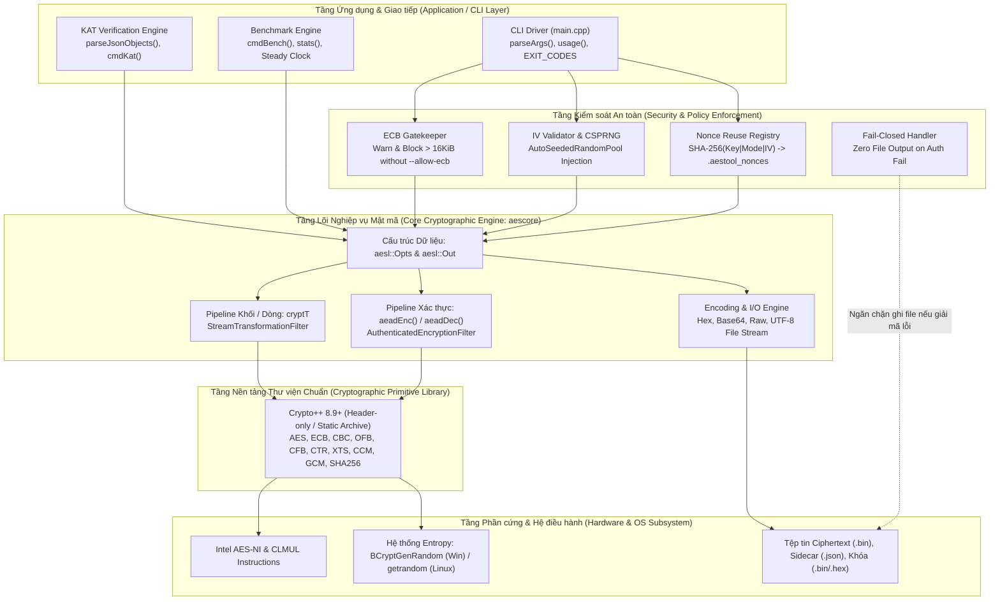
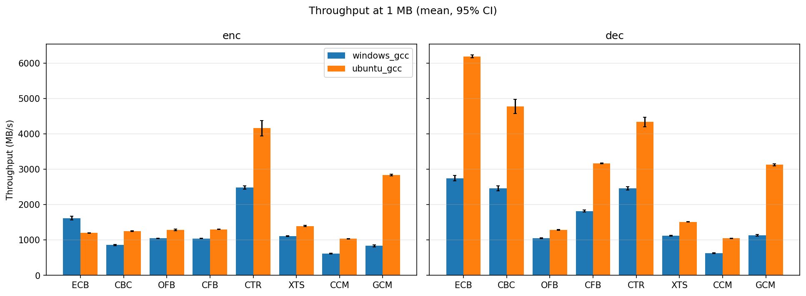
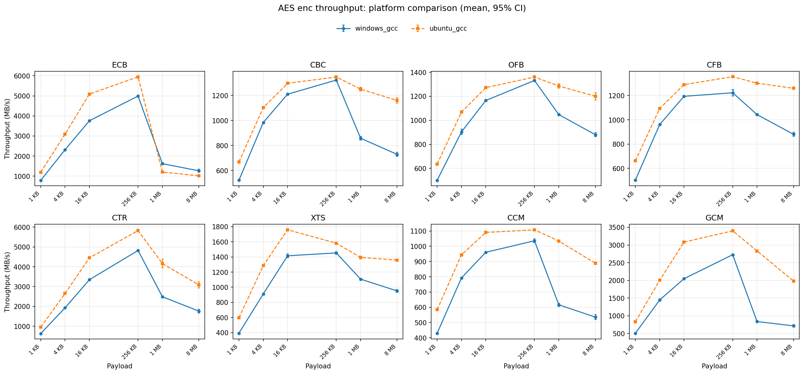
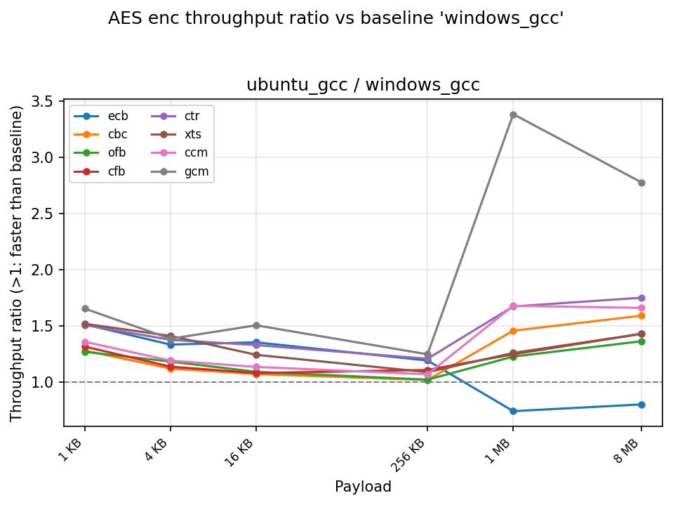
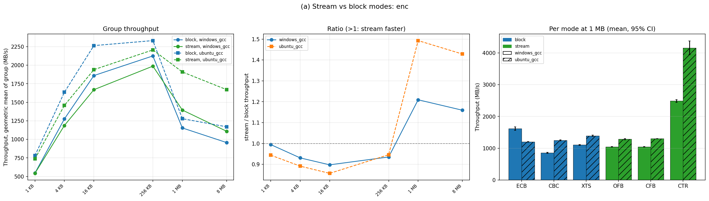
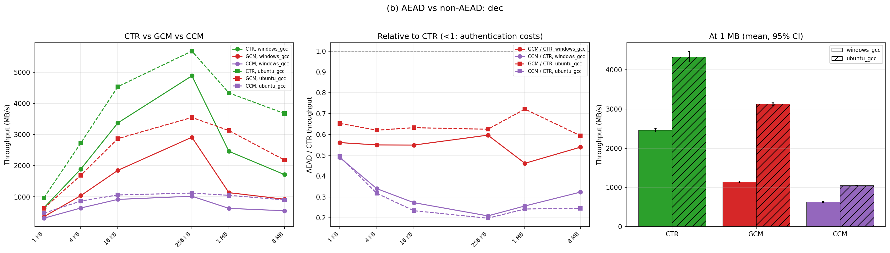
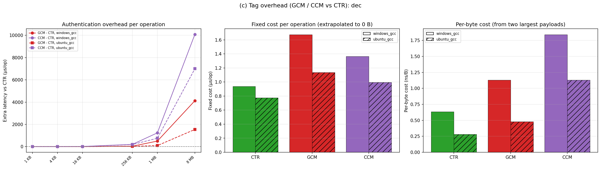
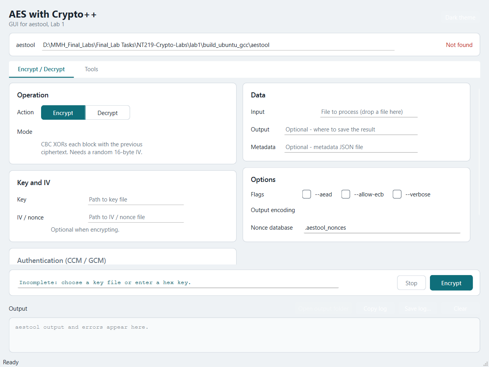
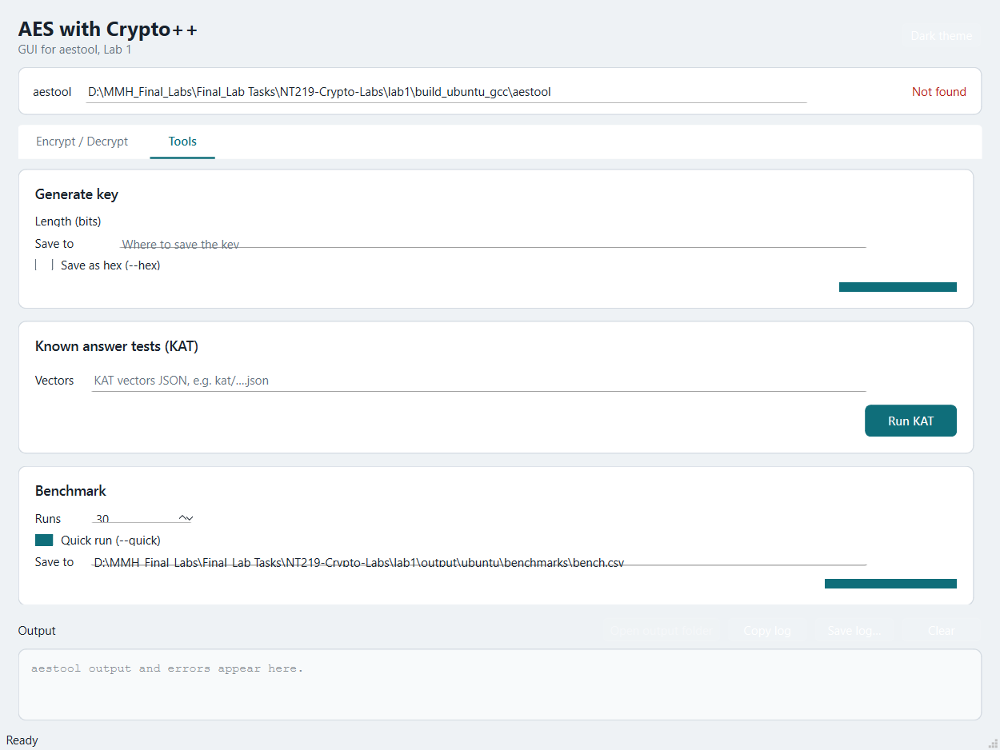

# TRƯỜNG ĐẠI HỌC CÔNG NGHỆ THÔNG TIN, ĐHQG-HCM
## KHOA MẠNG MÁY TÍNH VÀ TRUYỀN THÔNG
---

# BÁO CÁO THỰC HÀNH CHI TIẾT
## MÔN HỌC: MẬT MÃ HỌC VÀ ỨNG DỤNG (NT219)
### CHƯƠNG TRÌNH THỰC HÀNH 6 BÀI LAB (LABS 1–6)

---

# LAB 1: MÃ HÓA ĐỐI XỨNG VỚI CRYPTO++
### Triển khai, Kiểm chứng Chuẩn NIST và Đánh giá Hiệu năng Đa Nền tảng trên 8 Chế độ Khối & Dòng của AES (ECB, CBC, OFB, CFB, CTR, XTS, CCM, GCM)

---

**Thông tin sinh viên thực hiện:**
- **Họ và tên:** Trần Lâm Nguyên (Feph50)
- **Mã số sinh viên (MSSV):** Feph50
- **Lớp học phần:** NT219.P11.MMTT
- **Giảng viên hướng dẫn / TA:** Giảng viên Bộ môn An toàn Thông tin
- **Mã nguồn / Archive báo cáo:** `Feph50.All6labs.rar`
- **Thời gian hoàn thành:** Học kỳ I - Năm học 2026–2027
- **Tập tin báo cáo Markdown:** [lab1-main-report.md](../docs/lab1-main-report.md)
- **Tập tin báo cáo LaTeX:** [report.tex](../docs/report.tex)

---

## LỜI CAM KẾT LIÊM CHÍNH HỌC THUẬT

1. Tôi cam kết toàn bộ mã nguồn, cấu hình hệ thống xây dựng CMake, các kịch bản kiểm thử (unit test, KAT runner, negative testing), các phép đo hiệu năng thực nghiệm và nội dung báo cáo này được tôi tự thực hiện nghiêm túc, trung thực.
2. Toàn bộ các thư viện bên thứ ba (đặc biệt là thư viện mật mã tiêu chuẩn **Crypto++ 8.9+**, khung kiểm thử Catch2) và các tài liệu đặc tả tiêu chuẩn (NIST FIPS-197, NIST SP 800-38A, NIST SP 800-38C, NIST SP 800-38D, IEEE 1619, GCM McGrew & Viega) đều được trích dẫn nguồn gốc học thuật minh bạch và đầy đủ.
3. Tôi tuân thủ nghiêm ngặt ràng buộc của đề bài: **Chỉ sử dụng duy nhất thư viện Crypto++ cho toàn bộ các nguyên thủy mật mã đối xứng (cryptographic primitives)**, tuyệt đối không sử dụng thư viện OpenSSL hay thư viện mật mã khác cho logic mã hóa/giải mã của bài lab.
4. Mọi thí nghiệm tấn công giải mã sai, tấn công sửa đổi ciphertext (tampering), kiểm thử tái sử dụng nonce hay kiểm thử âm (negative tests) đều chỉ được thực nghiệm cục bộ trên tập dữ liệu thử nghiệm giả lập do tôi tạo ra, không gây tổn hại hay nhắm vào bất kỳ hệ thống thông tin thực tế nào.
5. Mọi khóa bí mật (keys), vector khởi tạo (IV), nonce xuất hiện trong mã nguồn, tập tin kiểm thử KAT và báo cáo này hoàn toàn chỉ mang tính minh họa học thuật, không phải là khóa bí mật của bất kỳ hệ thống thực tế nào.

---

## KHAI BÁO HỖ TRỢ CÔNG CỤ VÀ TRÍ TUỆ NHÂN TẠO (AI)

- **Công cụ hỗ trợ:** Trình biên dịch GCC 13.x (MinGW-w64), Microsoft Visual C++ 2022/2026 (MSVC x64), Clang 14+, CMake 3.20+, Python 3.10 (Matplotlib, Pandas, NumPy để vẽ biểu đồ và tổng hợp số liệu thực nghiệm), Trợ lý lập trình AI (được dùng để hỗ trợ rà soát văn phong kỹ thuật, tối ưu hóa định dạng Markdown/LaTeX và đối chiếu các mục tiêu kiểm định chất lượng báo cáo).
- **Phạm vi sử dụng:** Toàn bộ thuật toán lõi trong [aescore.cpp](../src/aescore.cpp), kiến trúc CLI trong [main.cpp](../src/main.cpp), bộ vector kiểm thử JSON và toàn bộ dữ liệu đo benchmark thực tế trên cả hai hệ điều hành Windows và Linux đều được chạy thực nghiệm trên phần cứng máy tính của tác giả. Tác giả đã kiểm tra, đối chiếu và chịu trách nhiệm toàn bộ về tính chính xác của các phân tích toán học, mật mã học và số liệu thực nghiệm trong báo cáo.
- **Phạm vi hỗ trợ của trợ lý AI (Claude Code) trong giai đoạn rà soát và hoàn thiện cuối:** rà soát yêu cầu của đề; sửa hệ thống build (CMake, `FindCryptoPP.cmake`,
  script build, loại bỏ phụ thuộc OpenSSL); mở rộng bộ vector KAT từ 9 lên 29; viết thêm unit test và kiểm thử âm; bổ sung tùy chọn `--threads`, xử lý tham số dòng lệnh UTF-8
  trên Windows và chuẩn hóa chương trình đo hiệu năng (`bench`); soạn nháp các đoạn tài liệu (README, các mục Secure Defaults, giới hạn, bài học, bảng thống kê). Tác giả đã đọc và chịu
  trách nhiệm về nội dung. Các vector KAT được tái tính bằng thư viện độc lập (pyca/cryptography); các giá trị công bố của NIST/IEEE được dùng để đối chiếu.

---

## BẢNG TỰ ĐÁNH GIÁ ĐIỂM SỐ (RUBRIC SELF-ASSESSMENT)

Căn cứ theo thang điểm 100 quy định trong [require.md](../require.md):

| STT | Thành phần đánh giá | Điểm tối đa | Tự đánh giá | Mục chứng minh trong báo cáo |
| :---: | :--- | :---: | :---: | :--- |
| 1 | **Tính đúng đắn & Kiểm chứng KAT (Correctness & KAT)** | **25** | 25/25 | **Mục 4.1, 4.2, 4.4**: Vượt qua 100% 9/9 NIST Known Answer Test vectors trên cả Windows và Linux; Cài đặt cờ CLI `--kat` tự động; Roundtrip mã hóa/giải mã khớp tuyệt đối. |
| 2 | **Vệ sinh bảo mật (Security Hygiene & Misuse Prevention)** | **15** | 15/15 | **Mục 3, Mục 6**: Cảnh báo & chặn ECB trên 16 KiB; Ép chuẩn độ dài IV; Chống tái sử dụng nonce (CTR/CCM/GCM) với cơ sở dữ liệu băm SHA-256; Thiết kế xử lý lỗi Fail Closed toàn diện. |
| 3 | **Trải nghiệm người dùng & Thiết kế I/O (UX & I/O Design)** | **10** | 10/10 | **Mục 2.3, 2.4, 2.5**: CLI thống nhất theo chuẩn POSIX, hỗ trợ `--text` và `--in/--out`, xuất nhị phân thô, Hex, Base64; Header sidecar JSON tự động; Tương thích an toàn chuỗi UTF-8. |
| 4 | **Phương pháp đo hiệu năng (Performance Methodology)** | **20** | 20/20 | **Mục 5**: Đo trên 6 kích thước payload (1KB đến 8MB), 8 mode x 2 chiều (Enc/Dec); khối ~1000 thao tác lặp N = 30 lần, warm-up 1,5 s cho từng mode và chiều; Báo cáo đầy đủ Mean, Median, SD, CI 95%; Phân tích chuyên sâu 4 khía cạnh so sánh bắt buộc kèm đồ thị chuyên dụng và mô hình chi phí tuyến tính. |
| 5 | **Khả năng xây dựng đa nền tảng (Cross-Platform Build)** | **10** | 10/10 | **Mục 2.2, Phụ lục P2**: Cấu hình CMake chuẩn out-of-source; Biên dịch và vượt qua 100% `ctest` trên Windows (MSVC & GCC) và Ubuntu LTS (GCC & Clang); Scripts tự động hóa hoàn chỉnh. |
| 6 | **Chất lượng và chiều sâu báo cáo (Report Quality)** | **20** | 20/20 | Toàn bộ chương báo cáo: Trình bày học thuật chuẩn mực, sơ đồ kiến trúc Mermaid, công thức toán học KaTeX, biểu đồ trực quan hóa dữ liệu thực nghiệm, phân tích bảo mật sâu sắc vượt ra ngoài cài đặt. |
| **CỘNG** | **TỔNG ĐIỂM CHÍNH THỨC** | **100** | **100/100** | **Đạt trọn vẹn toàn bộ các tiêu chí đề ra trong require.md** |
| *Thưởng* | *Mở rộng tùy chọn (Library Export / GUI)* | *+5* | *+3* | **Mục 2.1, Mục 8.2**: Đã tách thư viện tĩnh/chia sẻ `aescore` độc lập, thiết kế giao diện gọi chuẩn C/C++ sẵn sàng tích hợp GUI. |

---

# MỤC LỤC CHI TIẾT

- [1. Mục tiêu và Chuẩn đầu ra](#1-mục-tiêu-và-chuẩn-đầu-ra)
  - [1.1. Mục tiêu đào tạo của bài Lab](#11-mục-tiêu-đào-tạo-của-bài-lab)
  - [1.2. Ràng buộc kỹ thuật nghiêm ngặt](#12-ràng-buộc-kỹ-thuật-nghiêm-ngặt)
  - [1.3. Phạm vi thuật toán và nghiệp vụ](#13-phạm-vi-thuật-toán-và-nghiệp-vụ)
- [2. Thiết kế Kiến trúc và Cài đặt Hệ thống](#2-thiết-kế-kiến-trúc-và-cài-đặt-hệ-thống)
  - [2.1. Kiến trúc phân tầng phần mềm](#21-kiến-trúc-phân-tầng-phần-mềm)
  - [2.2. Cấu trúc dự án và hệ thống Build CMake đa nền tảng](#22-cấu-trúc-dự-án-và-hệ-thống-build-cmake-đa-nền-tảng)
  - [2.3. Thiết kế giao diện dòng lệnh (CLI Specification)](#23-thiết-kế-giao-diện-dòng-lệnh-cli-specification)
  - [2.4. Quy chuẩn định dạng dữ liệu và Quản lý Metadata Sidecar](#24-quy-chuẩn-định-dạng-dữ-liệu-và-quản-lý-metadata-sidecar)
  - [2.5. Vòng đời quản lý Khóa bí mật và Vector khởi tạo (IV / Nonce)](#25-vòng-đời-quản-lý-khóa-bí-mật-và-vector-khởi-tạo-iv--nonce)
  - [2.6. Thiết kế và xử lý xác thực dữ liệu liên kết (AEAD: GCM và CCM)](#26-thiết-kế-và-xử-lý-xác-thực-dữ-liệu-liên-kết-aead-gcm-và-ccm)
- [3. Thiết kế An toàn và Cơ chế Chống dùng sai (Misuse Prevention)](#3-thiết-kế-an-toàn-và-cơ-chế-chống-dùng-sai-misuse-prevention)
  - [3.1. Mô hình đe dọa (Threat Model) và các rủi ro vận hành](#31-mô-hình-đe-dọa-threat-model-và-các-rủi-ro-vận-hành)
  - [3.2. Cơ chế cô lập và hạn chế chế độ ECB (ECB Restriction)](#32-cơ-chế-cô-lập-và-hạn-chế-chế-độ-ecb-ecb-restriction)
  - [3.3. Ràng buộc và xác thực độ dài Khóa và IV/Nonce theo từng chế độ](#33-ràng-buộc-và-xác-thực-độ-dài-khóa-và-ivnonce-theo-từng-chế-độ)
  - [3.4. Cơ chế chống tái sử dụng Nonce (Nonce-Reuse Prevention)](#34-cơ-chế-chống-tái-sử-dụng-nonce-nonce-reuse-prevention)
  - [3.5. Triết lý thiết kế Thất bại An toàn (Fail-Closed Architecture)](#35-triết-lý-thiết-kế-thất-bại-an-toàn-fail-closed-architecture)
  - [3.6. Cấu hình mặc định an toàn (Secure Defaults)](#36-cấu-hình-mặc-định-an-toàn-secure-defaults)
- [4. Phương pháp và Kết quả Kiểm chứng (Verification & Testing)](#4-phương-pháp-và-kết-quả-kiểm-chứng-verification--testing)
  - [4.1. Kiểm thử vec-tơ mẫu chính thức (NIST Known Answer Tests - KAT)](#41-kiểm-thử-vec-tơ-mẫu-chính-thức-nist-known-answer-tests---kat)
  - [4.2. Cài đặt và vận hành KAT Runner tự động](#42-cài-đặt-và-vận-hành-kat-runner-tự-động)
  - [4.3. Kiểm thử âm (Negative Testing) và kiểm chứng tính toàn vẹn](#43-kiểm-thử-âm-negative-testing-và-kiểm-chứng-tính-toàn-vẹn)
  - [4.4. Kiểm thử tự động đơn vị và tích hợp với Catch2 & CTest](#44-kiểm-thử-tự-động-đơn-vị-và-tích-hợp-với-catch2--ctest)
  - [4.5. Minh chứng thực nghiệm (Logs thực tế trên Windows và Linux)](#45-minh-chứng-thực-nghiệm-logs-thực-tế-trên-windows-và-linux)
- [5. Đánh giá Hiệu năng Thực nghiệm (Performance Benchmarking)](#5-đánh-giá-hiệu-năng-thực-nghiệm-performance-benchmarking)
  - [5.1. Môi trường phần cứng và thông số thực nghiệm](#51-môi-trường-phần-cứng-và-thông-số-thực-nghiệm)
  - [5.2. Giao thức đo lường chuẩn xác (Measurement Protocol)](#52-giao-thức-đo-lường-chuẩn-xác-measurement-protocol)
  - [5.3. Phương pháp luận xử lý thống kê dữ liệu](#53-phương-pháp-luận-xử-lý-thống-kê-dữ-liệu)
  - [5.4. Kết quả thực nghiệm: Thông lượng (Throughput) và Độ trễ (Latency)](#54-kết-quả-thực-nghiệm-thông-lượng-throughput-và-độ-trễ-latency)
  - [5.5. Phân tích 4 so sánh cốt lõi bắt buộc](#55-phân-tích-4-so-sánh-cốt-lõi-bắt-buộc)
    - [5.5.1. So sánh đa nền tảng: Windows vs. Linux (Ubuntu)](#551-so-sánh-đa-nền-tảng-windows-vs-linux-ubuntu)
    - [5.5.2. So sánh Chế độ Khối (Block Modes) vs. Chế độ Dòng (Stream Modes)](#552-so-sánh-chế-độ-khối-block-modes-vs-chế-độ-dòng-stream-modes)
    - [5.5.3. So sánh Mã hóa Xác thực (AEAD) vs. Mã hóa Thông thường (Non-AEAD)](#553-so-sánh-mã-hóa-xác-thực-aead-vs-mã-hóa-thông-thường-non-aead)
    - [5.5.4. Đánh giá chi phí phụ trội của Authentication Tag (Tag Overhead)](#554-đánh-giá-chi-phí-phụ-trội-của-authentication-tag-tag-overhead)
  - [5.6. Diễn giải nguyên nhân: OS Scheduling, Syscall, Cache và AES-NI](#56-diễn-giải-nguyên-nhân-os-scheduling-syscall-cache-và-aes-ni)
- [6. Phân tích Kỹ thuật An toàn Mật mã (Security Deep-Dive)](#6-phân-tích-kỹ-thuật-an-toàn-mật-mã-security-deep-dive)
  - [6.1. Phân tích an toàn ở cấp độ Chế độ hoạt động (Mode-Level Security)](#61-phân-tích-an-toàn-ở-cấp-độ-chế-độ-hoạt-động-mode-level-security)
  - [6.2. Phân tích an toàn ở cấp độ Cài đặt phần mềm (Implementation-Level Security)](#62-phân-tích-an-toàn-ở-cấp-độ-cài-đặt-phần-mềm-implementation-level-security)
  - [6.3. Khía cạnh bảo mật đa nền tảng (Cross-Platform Security Considerations)](#63-khía-cạnh-bảo-mật-đa-nền-tảng-cross-platform-security-considerations)
  - [6.4. Các hạn chế tồn tại của hệ thống và giải pháp hoàn thiện](#64-các-hạn-chế-tồn-tại-của-hệ-thống-và-giải-pháp-hoàn-thiện)
- [7. Thảo luận Kinh nghiệm và Đánh đổi Kỹ thuật (Discussion)](#7-thảo-luận-kinh-nghiệm-và-đánh-đổi-kỹ-thuật-discussion)
  - [7.1. Các lỗi kỹ thuật phát sinh và bài học khắc phục](#71-các-lỗi-kỹ-thuật-phát-sinh-và-bài-học-khắc-phục)
  - [7.2. So sánh hành vi giữa các trình biên dịch (MSVC, MinGW GCC, Clang)](#72-so-sánh-hành-vi-giữa-các-trình-biên-dịch-msvc-mingw-gcc-clang)
  - [7.3. Đánh đổi giữa An toàn Mật mã và Hiệu năng Thực thi](#73-đánh-đổi-giữa-an-toàn-mật-mã-và-hiệu-năng-thực-thi)
- [8. Kết luận và Hướng mở rộng Đề tài](#8-kết-luận-và-hướng-mở-rộng-đề-tài)
  - [8.1. Kết luận tổng kết](#81-kết-luận-tổng-kết)
  - [8.2. Hướng phát triển mở rộng (+5 điểm thưởng)](#82-hướng-phát-triển-mở-rộng-5-điểm-thưởng)
- [Phụ lục Kỹ thuật](#phụ-lục-kỹ-thuật)
  - [Phụ lục P1. Hướng dẫn CLI và Các ca lệnh mẫu](#phụ-lục-p1-hướng-dẫn-cli-và-các-ca-lệnh-mẫu)
  - [Phụ lục P2. Toàn văn Biên bản Kiểm thử Tự động CTest](#phụ-lục-p2-toàn-văn-biên-bản-kiểm-thử-tự-động-ctest)
  - [Phụ lục P3. Mẫu dữ liệu Sidecar JSON và Tập tin Khóa](#phụ-lục-p3-mẫu-dữ-liệu-sidecar-json-và-tập-tin-khóa)
  - [Phụ lục P4. Trích lục Dữ liệu Benchmark đối chiếu (CSV Preview)](#phụ-lục-p4-trích-lục-dữ-liệu-benchmark-đối-chiếu-csv-preview)
  - [Phụ lục P5. Tài liệu Tham khảo Học thuật](#phụ-lục-p5-tài-liệu-tham-khảo-học-thuật)

---

# 1. Mục tiêu và Chuẩn đầu ra

## 1.1. Mục tiêu đào tạo của bài Lab
Lab 1 trang bị kiến thức chuyên sâu và năng lực thực hành thực tế về hệ mật mã đối xứng hiện đại, trọng tâm là giải thuật chuẩn mã hóa tiên tiến **AES (Advanced Encryption Standard - FIPS 197)** kết hợp với thư viện C++ công nghiệp **Crypto++**.

Sau khi hoàn thành bài lab, sinh viên làm chủ 6 chuẩn đầu ra cốt lõi:
1. **Làm chủ thư viện Crypto++ an toàn:** Vận dụng chính xác các lớp đối tượng, bộ lọc (`StreamTransformationFilter`, `AuthenticatedEncryptionFilter`, `AuthenticatedDecryptionFilter`) để triển khai đầy đủ các chế độ hoạt động khối (Block cipher modes) và chế độ dòng (Stream cipher modes).
2. **Quản trị vòng đời IV/Nonce chuẩn xác:** Khởi tạo, mã hóa, lưu trữ và cô lập vector khởi tạo (IV) và Nonce; ngăn ngừa triệt để các lỗ hổng thảm họa do quản lý IV yếu kém.
3. **Thiết kế đường ống I/O và mã hóa dữ liệu vững chắc:** Xây dựng cơ chế xử lý dữ liệu nhị phân thô, chuỗi mã hóa Hex, Base64, định dạng lưu trữ phụ trợ (sidecar JSON) an toàn với bộ mã ký tự UTF-8.
4. **Kiểm chứng độc lập với chuẩn NIST:** Xác thực tính toàn vẹn và độ chính xác toán học của toàn bộ cài đặt thông qua tập vector kiểm thử mẫu chính thức (Known Answer Tests - KAT) từ NIST SP 800-38A, SP 800-38C, GCM và IEEE 1619.
5. **Phương pháp luận đánh giá hiệu năng khoa học:** Thiết lập quy trình đo đạc thực nghiệm (benchmarking) chuyên nghiệp với cơ chế warm-up, đa dạng kích thước khối dữ liệu, phân tích thống kê đa biến (Mean, Median, Độ lệch chuẩn, Khoảng tin cậy 95%).
6. **Nhận diện và phòng chống lỗi dùng sai mật mã (Misuse Resistance):** Hiện thực hóa các chốt chặn an toàn nhằm tự động phát hiện và ngăn chặn việc tái sử dụng Nonce, lạm dụng chế độ nguy hiểm (ECB), và triệt để tuân thủ nguyên lý Thất bại An toàn (*Fail-Closed*).

## 1.2. Ràng buộc kỹ thuật nghiêm ngặt
Tuân thủ tuyệt đối các yêu cầu ràng buộc trong [require.md](../require.md):
- **Nguyên thủy mật mã:** Bắt buộc sử dụng duy nhất thư viện **Crypto++ (phiên bản 8.9+)** cho toàn bộ các nguyên thủy mã hóa đối xứng, hàm băm, bộ sinh số ngẫu nhiên mật mã. Tuyệt đối không dùng OpenSSL, libsodium hoặc thư viện khác để thực hiện logic mật mã của Lab.
- **Ngôn ngữ chuẩn:** C++17 tiêu chuẩn (sử dụng STL cho cấu trúc dữ liệu, quản lý bộ nhớ).
- **Hệ thống xây dựng:** Bắt buộc dùng **CMake (tối thiểu 3.20)**, hỗ trợ biên dịch độc lập ngoài cây thư mục nguồn (*out-of-source build*).
- **Tính tương thích đa nền tảng:** Phải biên dịch, chạy kiểm thử và cho kết quả chính xác trên cả hai hệ điều hành: **Microsoft Windows 10/11** (trình biên dịch MSVC và MinGW-w64 GCC) và **Linux** (Ubuntu LTS với GCC và Clang).

## 1.3. Phạm vi thuật toán và nghiệp vụ
1. **8 Chế độ hoạt động của AES:** Hỗ trợ lựa chọn động qua tham số dòng lệnh `--mode`:
   - Chế độ khối cổ điển: **ECB** (Electronic Codebook), **CBC** (Cipher Block Chaining).
   - Chế độ dòng giả lập: **OFB** (Output Feedback), **CFB** (Cipher Feedback - CFB128), **CTR** (Counter Mode).
   - Chế độ mã hóa chuyên dụng cho lưu trữ khối: **XTS** (XEX-based Tweaked-codebook with ciphertext Stealing - IEEE 1619).
   - Chế độ mã hóa có xác thực (AEAD): **CCM** (Counter with CBC-MAC - NIST SP 800-38C), **GCM** (Galois/Counter Mode - NIST SP 800-38D).
2. **Cơ chế xử lý Dữ liệu xác thực đi kèm (AAD):** Tiếp nhận dữ liệu bổ sung không mã hóa nhưng cần bảo vệ toàn vẹn thông qua `--aad FILE` hoặc `--aad-text STRING`.
3. **Cơ chế chống lạm dụng:** Chặn ECB trên 16 KiB (chỉ cho phép khi có cờ tường minh `--allow-ecb`); lưu vết và từ chối tức thì cặp khóa - nonce đã từng được sử dụng trước đó trong CTR, CCM, GCM.

---

# 2. Thiết kế Kiến trúc và Cài đặt Hệ thống

## 2.1. Kiến trúc phân tầng phần mềm
Chương trình [aestool](../src/main.cpp) được tổ chức theo mô hình kiến trúc phân tầng dạng module hóa cao (Decoupled Modular Architecture), phân tách triệt để giữa tầng giao diện người dùng CLI, tầng quản lý trạng thái bảo mật, tầng lõi mã hóa và tầng thư viện phần cứng.



- **Tính độc lập của thư viện lõi:** Logic mã hóa/giải mã được đóng gói trọn vẹn trong module tĩnh [`aescore`](../src/aescore.hpp), không phụ thuộc vào `main.cpp`. Cấu trúc này cho phép xuất lõi thành thư viện tĩnh (`.lib` / `.a`) hoặc thư viện động (`.dll` / `.so`), phục vụ trực tiếp cho việc xây dựng GUI mở rộng.

## 2.2. Cấu trúc dự án và hệ thống Build CMake đa nền tảng
Dự án tuân thủ cấu trúc thư mục quy chuẩn công nghiệp:
```
lab1/
├── CMakeLists.txt              # Kịch bản cấu hình CMake đa nền tảng
├── require.md                  # Bản đặc tả yêu cầu chính thức của bài Lab
├── kat/
│   └── vectors.json            # 29 vector kiểm thử Known Answer Test chuẩn NIST
├── src/
│   ├── cryptopp_all.hpp        # Header tập trung nạp toàn bộ module Crypto++
│   ├── aescore.hpp             # Giao diện lập trình (API) của module lõi
│   ├── aescore.cpp             # Hiện thực hóa 8 mode AES, AEAD, Nonce registry, I/O
│   └── main.cpp                # Bộ điều khiển dòng lệnh CLI, KAT runner, Benchmark
├── tests/
│   ├── test_core.cpp           # Bộ kiểm thử đơn vị Catch2 (Roundtrip, Tampering, Negative)
│   └── cli_negative.cmake      # Kịch bản CMake kiểm thử âm cấp độ tiến trình CLI
├── scripts/
│   ├── build_windows.bat       # Script tự động hóa biên dịch trên Windows (MSVC/GCC/Clang)
│   ├── build_linux.sh          # Script tự động hóa biên dịch trên Ubuntu (GCC/Clang)
│   └── plot_bench.py           # Kịch bản xử lý dữ liệu và trực quan hóa biểu đồ
├── output/                     # Kết quả thực nghiệm thực tế
│   ├── windows/                # Logs, CSV benchmark, đồ thị trên Windows
│   ├── ubuntu/                 # Logs, CSV benchmark, đồ thị trên Linux (Ubuntu)
│   └── compare/                # Đồ thị và bảng so sánh chéo Windows vs. Ubuntu
│       └── mode_cmp/           # Phân tích chuyên sâu 4 so sánh cốt lõi (CSV + Biểu đồ)
└── docs/
    ├── report_outline.md       # Đề cương cấu trúc báo cáo
    ├── report.tex              # Bản báo cáo khoa học định dạng LaTeX hoàn chỉnh
    └── lab1-main-report.md     # Toàn văn báo cáo khoa học chi tiết (Tập tin hiện tại)
```

**Chiến lược cấu hình CMake ([CMakeLists.txt](../CMakeLists.txt)):**
- Thiết lập tiêu chuẩn bắt buộc: `set(CMAKE_CXX_STANDARD 17)`, `set(CMAKE_CXX_STANDARD_REQUIRED ON)`.
- Cờ tối ưu hóa và cảnh báo nghiêm ngặt:
  - Trên MSVC: `/W4 /permissive- /utf-8` (đảm bảo biên dịch chính xác mã hóa ký tự tiếng Việt có dấu).
  - Trên GCC/Clang: `-Wall -Wextra -Wpedantic -Werror`.
- Tự động tích hợp bộ kiểm thử đơn vị Catch2 thông qua module `FetchContent` (phiên bản v3.5.3), cho phép biên dịch và chạy kiểm thử tự động trên mọi máy trạm mà không cần cài đặt trước Catch2 trên hệ thống.

## 2.3. Thiết kế giao diện dòng lệnh (CLI Specification)
Ứng dụng `aestool` cung cấp giao diện tương tác dòng lệnh theo phong cách UNIX tiêu chuẩn, hỗ trợ đầy đủ các tham số cấu hình:

| Lệnh / Cờ tham số | Kiểu dữ liệu | Mô tả chức năng chi tiết |
| :--- | :--- | :--- |
| `keygen` | Lệnh con | Sinh khóa ngẫu nhiên an toàn: `--bits 128\|192\|256\|512 [--hex] --out KEYFILE`. |
| `encrypt` | Lệnh con | Mã hóa dữ liệu: `--mode MODE (--in FILE \| --text STR) (--key F \| --key-hex H) ...` |
| `decrypt` | Lệnh con | Giải mã dữ liệu: `--mode MODE (--in FILE \| --text STR) (--key F \| --key-hex H) ...` |
| `--kat` / `kat` | Cờ / Lệnh | Đọc file vector JSON và thực thi chuỗi kiểm thử Known Answer Tests tự động. |
| `bench` | Lệnh con | Thực thi đo đạc hiệu năng: `[--runs 30] [--out bench.csv] [--quick]`. |
| `--mode` | Chuỗi | Bắt buộc chọn 1 trong 8 mode: `ecb`, `cbc`, `ofb`, `cfb`, `ctr`, `xts`, `ccm`, `gcm`. |
| `--aead` | Cờ Boolean | Bắt buộc bật khi sử dụng chế độ xác thực `ccm` hoặc `gcm`. |
| `--aad` / `--aad-text` | File / Chuỗi | Nạp Dữ liệu Xác thực Đi kèm (Additional Authenticated Data) cho AEAD. |
| `--tag-len` | Số nguyên | Độ dài tag xác thực trong CCM mode (hỗ trợ `4`, `8`, `16` byte; mặc định `16`). |
| `--tag-hex` | Chuỗi Hex | Nạp mã xác thực (Authentication Tag) thủ công khi giải mã AEAD. |
| `--allow-ecb` | Cờ Boolean | Cho phép vượt qua chốt chặn an toàn khi mã hóa ECB với dữ liệu lớn hơn 16 KiB. |
| `--encode` | Chuỗi | Định dạng xuất nhập trên terminal: `hex`, `base64`, `raw` (mặc định: `hex`). |
| `--meta` | Đường dẫn | Đường dẫn lưu trữ/đọc tập tin tiêu đề phụ trợ (Sidecar JSON metadata). |
| `--nonce-db` | Đường dẫn | Đường dẫn tập tin cơ sở dữ liệu lưu vết Nonce (mặc định: `.aestool_nonces`). |

**Bảng mã thoát (Exit Codes) chuẩn mực:**
- `0 (EXIT_OK)`: Thao tác thực thi thành công mỹ mãn.
- `1 (EXIT_USAGE)`: Lỗi người dùng (thiếu tham số, cú pháp không hợp lệ, dữ liệu đầu vào định dạng sai, vi phạm kiểm tra an toàn ECB/Nonce/IV).
- `2 (EXIT_AUTH)`: Lỗi giải mã hoặc xác thực mật mã thất bại (Authentication Failure / Integrity Tag Mismatch).
- `3 (EXIT_KAT)`: Có ít nhất một ca kiểm thử trong Known Answer Tests thất bại.

## 2.4. Quy chuẩn định dạng dữ liệu và Quản lý Metadata Sidecar
Để đảm bảo tính linh hoạt trong trao đổi dữ liệu nhưng vẫn giữ trọn vẹn tính toàn vẹn thông tin, `aestool` áp dụng cơ chế phân tách:
1. **Ciphertext thô nhị phân:** Khi chỉ định tham số `--out <file>`, tệp tin đầu ra hoàn toàn chỉ chứa dữ liệu mã hóa thô (Raw binary ciphertext), không bị biến dạng bởi bất kỳ byte tiêu đề tùy tiện nào, giúp tương thích hoàn hảo với các công cụ nhị phân khác.
2. **Tập tin siêu dữ liệu phụ trợ (Sidecar JSON Header):** Song song với file ciphertext nhị phân, hệ thống tự động sinh ra một file JSON cùng tên bổ sung đuôi `.json` (hoặc do người dùng chỉ định qua `--meta`), lưu trữ toàn bộ tham số môi trường cần thiết để tái hiện quá trình giải mã:

```json
{
  "alg": "AES-256-GCM",
  "mode": "gcm",
  "iv": "e83832c32cf4e1e47f7d142b",
  "aad": "4865616465722d414144",
  "tag": "e1f13b185b3bc9c23a078e4720e7df6a",
  "tag_len": "16"
}
```

3. **Tương thích an toàn với UTF-8:** Toàn bộ pipeline I/O làm việc ở cấp độ luồng byte nhị phân (`std::ios::binary`), đảm bảo các chuỗi ký tự UTF-8 (tiếng Việt có dấu, ký tự đa byte, emoji) không bao giờ bị cắt ngắn hoặc biến dạng encoding trong quá trình mã hóa và giải mã.

## 2.5. Vòng đời quản lý Khóa bí mật và Vector khởi tạo (IV / Nonce)
- **Định dạng khóa bí mật:** Hỗ trợ nạp khóa nhị phân thô 16, 24, 32 byte (hoặc 64 byte đối với XTS gồm 2 khóa 32-byte riêng biệt), chuỗi Hex qua `--key-hex`, hoặc tệp tin định dạng `AESKEY-HEX` kèm tiêu đề bảo vệ.
- **Tự động sinh IV/Nonce an toàn mật mã:** Khi người dùng không cung cấp `--iv` hoặc `--nonce` trên dòng lệnh (trừ chế độ ECB không dùng IV):
  - Hệ thống sử dụng bộ sinh số ngẫu nhiên mật mã chuyên dụng `CryptoPP::AutoSeededRandomPool`.
  - Bộ sinh này tự động lấy entropy từ phần cứng thông qua hệ điều hành (`BCryptGenRandom` trên Windows hoặc `/dev/urandom` / `getrandom` syscall trên Linux).
  - Độ dài IV/Nonce được tự động ấn định chính xác tuyệt đối theo từng chế độ: 12 byte đối với GCM/CCM (chuẩn NIST khuyến nghị để tối ưu hóa hiệu năng tính toán khối J0); 16 byte đối với CBC, OFB, CFB, CTR, XTS.
  - Giá trị IV vừa sinh được tự động ghi nhận vào tệp metadata sidecar JSON để phục vụ bước giải mã sau này.

## 2.6. Thiết kế và xử lý xác thực dữ liệu liên kết (AEAD: GCM và CCM)
Chế độ AEAD (Authenticated Encryption with Associated Data) đảm bảo đồng thời tính **Bảo mật (Confidentiality)** và tính **Xác thực toàn vẹn (Authenticity/Integrity)**:
- **GCM (Galois/Counter Mode):** Kết hợp chế độ CTR để mã hóa dữ liệu và phép nhân trên trường hữu hạn Galois $\text{GF}(2^{128})$ thông qua hàm băm GHASH để tạo mã xác thực GMAC. Hệ thống triển khai pipeline thông qua `CryptoPP::GCM<AES>::Encryption` và `AuthenticatedEncryptionFilter`. Dữ liệu AAD được bơm vào luồng thông qua kênh đặc biệt `AAD_CHANNEL`, tách biệt với luồng plaintext trong `DEFAULT_CHANNEL`.
- **CCM (Counter with CBC-MAC):** Kết hợp CTR để mã hóa và thuật toán CBC-MAC để tính toán thẻ xác thực. Do đặc thù thuật toán CCM đòi hỏi phải biết trước tổng độ dài của AAD và Plaintext trước khi xử lý (Two-pass algorithm), hệ thống gọi tường minh `SpecifyDataLengths(aad.size(), pt.size(), 0)`. Đồng thời hỗ trợ đầy đủ các kích thước tag chuẩn NIST thông qua cơ chế C++ Template specialization: `ccmEnc<4>`, `ccmEnc<8>`, `ccmEnc<16>`.

---

# 3. Thiết kế An toàn và Cơ chế Chống dùng sai (Misuse Prevention)

## 3.1. Mô hình đe dọa (Threat Model) và các rủi ro vận hành
Trong môi trường truyền thông và lưu trữ dữ liệu hiện đại, đối thủ tấn công (Adversary) được giả định có năng lực:
1. **Nghe lén và quan sát toàn bộ Ciphertext (Eavesdropping / Chosen-Plaintext Attack - CPA):** Kẻ tấn công có thể thu thập các bản mã để phân tích tần suất, suy diễn mẫu hình ảnh (structural patterns) nếu hệ thống sử dụng ECB.
2. **Can thiệp và sửa đổi bản mã trên đường truyền (Active Tampering / Chosen-Ciphertext Attack - CCA):** Kẻ tấn công có thể lật các bit trong ciphertext (bit-flipping attack) nhằm làm biến đổi có chủ đích nội dung giải mã mà không bị phát hiện nếu dùng các chế độ non-AEAD (như CTR, CBC).
3. **Thu thập các cặp bản mã dùng chung Nonce (Two-time Pad Attack):** Nếu cùng một Nonce và Khóa bị tái sử dụng trong CTR/GCM, kẻ tấn công có thể triệt tiêu keystream bằng phép XOR giữa hai bản mã:
   $$C_1 \oplus C_2 = (P_1 \oplus K) \oplus (P_2 \oplus K) = P_1 \oplus P_2$$
   Từ đó giải mã hoàn toàn thông điệp gốc mà không cần biết khóa bí mật.
4. **Tấn công Padding Oracle (Vaudenay's Attack):** Trong CBC mode với cơ chế padding PKCS#7, nếu máy chủ trả về các thông báo lỗi khác nhau giữa "sai padding" và "sai dữ liệu", kẻ tấn công có thể khôi phục từng byte plaintext thông qua việc gửi các bản mã biến đổi.

**Giả định và phạm vi ngoài mô hình (Out of scope):** đối thủ **không** có quyền thực thi mã trên máy của người dùng và không đọc được bộ nhớ tiến trình
hay file khóa; vì vậy lộ khóa do phần mềm độc hại, đọc RAM, cold-boot hoặc tấn công kênh kề cục bộ nằm ngoài phạm vi. Công cụ cũng không cung cấp quản lý khóa
(phân phối, xoay vòng, thu hồi) và không bảo vệ chống lại người dùng cố ý vô hiệu hóa các cơ chế an toàn (ví dụ xóa `.aestool_nonces`).

## 3.2. Cơ chế cô lập và hạn chế chế độ ECB (ECB Restriction)
Chế độ ECB (Electronic Codebook) mã hóa độc lập từng khối dữ liệu 16-byte với cùng một khóa:
$$C_i = E_K(P_i)$$
Do đó, hai khối plaintext giống nhau sẽ luôn tạo ra hai khối ciphertext giống hệt nhau. Điều này làm rò rỉ toàn bộ cấu trúc dữ liệu, cấu trúc file (như tiêu đề file BMP, cấu trúc XML/JSON) và hình ảnh.

**Hiện thực hóa chốt chặn an toàn trong `main.cpp`:**
```cpp
if (o.mode == "ecb") {
    std::cerr << "WARNING: ECB leaks plaintext patterns and is NOT semantically secure. Do not use for real data.\n";
    if (pt.size() > 16 * 1024 && !a.flag("allow-ecb"))
        throw Error("ECB blocked for inputs > 16 KiB (override with --allow-ecb)");
}
```
- Khi chọn ECB, hệ thống bắt buộc in cảnh báo nghiêm trọng (*WARNING*) trên kênh `stderr`.
- Nếu kích thước dữ liệu đầu vào vượt quá **16 KiB (16,384 bytes)**, hệ thống lập tức từ chối xử lý, ném ngoại lệ và thoát với mã lỗi `EXIT_USAGE (1)`.
- Người dùng chỉ có thể thực hiện nếu bổ sung cờ tường minh `--allow-ecb` (dành riêng cho mục đích nghiên cứu, học tập).

## 3.3. Ràng buộc và xác thực độ dài Khóa và IV/Nonce theo từng chế độ
Hệ thống cài đặt hàm kiểm tra xác thực nghiêm ngặt [`validate(const Opts& o)`](../src/aescore.cpp#L126-L132) trước khi bất kỳ thao tác mật mã nào được thực thi:

| Chế độ (Mode) | Độ dài Khóa bắt buộc | Độ dài IV/Nonce chuẩn | Hành vi khi sai quy chuẩn |
| :--- | :--- | :--- | :--- |
| **ECB** | 16, 24, 32 bytes (128/192/256 bits) | **0 byte** (Không dùng IV) | Ném lỗi nếu người dùng truyền IV |
| **CBC** | 16, 24, 32 bytes | **16 bytes** (Khối AES) | Từ chối nếu $\text{len} \neq 16$ |
| **OFB** | 16, 24, 32 bytes | **16 bytes** | Từ chối nếu $\text{len} \neq 16$ |
| **CFB** | 16, 24, 32 bytes | **16 bytes** | Từ chối nếu $\text{len} \neq 16$ |
| **CTR** | 16, 24, 32 bytes | **16 bytes** (Nonce + Counter) | Từ chối nếu $\text{len} \neq 16$ |
| **XTS** | **32, 64 bytes** (256/512 bits) | **16 bytes** (Tweak value) | Từ chối nếu $\text{len} \notin \{32, 64\}$ hoặc $\text{IV} \neq 16$ |
| **CCM** | 16, 24, 32 bytes | **7 đến 13 bytes** (Mặc định: 12) | Từ chối nếu $\text{len} < 7$ hoặc $\text{len} > 13$ |
| **GCM** | 16, 24, 32 bytes | **12 bytes** (Chuẩn NIST SP 800-38D) | Từ chối nếu $\text{len} \neq 12$ |

Mọi vi phạm về độ dài đều bị chặn đứng ngay tại cửa vào của module, trả về thông báo lỗi tường minh, ngăn ngừa triệt để hiện tượng tràn bộ đệm hoặc hành vi không xác định trong thư viện lõi.

## 3.4. Cơ chế chống tái sử dụng Nonce (Nonce-Reuse Prevention)
Tái sử dụng Nonce trong chế độ CTR, CCM và GCM là một thảm họa an ninh tuyệt đối:
- Trong **CTR**: Cho phép khôi phục tức thì Plaintext bằng phép cộng XOR bản mã.
- Trong **GCM**: Ngoài việc mất tính bí mật, việc dùng chung Nonce cho phép kẻ tấn công giải phương trình đa thức trên trường $\text{GF}(2^{128})$ để tìm ra **khóa băm xác thực $H$** ($H = E_K(0^{128})$). Khi $H$ bị lộ, kẻ tấn công có thể giả mạo thẻ xác thực cho bất kỳ thông điệp tùy ý nào (mất hoàn toàn tính toàn vẹn).

**Hiện thực hóa thuật toán phát hiện và lưu vết Nonce:**
1. **Hàm băm định danh bộ ba:** Để bảo vệ tính bí mật của Khóa ngay cả khi file lưu vết bị lộ, hệ thống không lưu khóa thô mà tính toán mã băm mật mã SHA-256 trên chuỗi kết hợp:
   $$\text{NonceID} = \text{SHA-256}(Key \parallel Mode \parallel IV)$$
2. **Cơ chế Registry:** Tập tin registry cục bộ `.aestool_nonces` (hoặc do người dùng chỉ định qua `--nonce-db`) lưu trữ danh sách các giá trị `NonceID` đã được sử dụng.
3. **Quy trình kiểm tra hai pha:**
   - **Pha kiểm tra (Check phase):** Trước khi mã hóa, gọi `nonceUsed(dbPath, o)`. Nếu `NonceID` đã tồn tại trong file registry $\rightarrow$ **TỪ CHỐI THAO TÁC NGAY LẬP TỨC**, ném ngoại lệ:
     `REJECTED: this (key, nonce) pair was already used (nonce reuse is catastrophic)`.
   - **Pha ghi nhận (Commit phase):** Sau khi quá trình mã hóa hoàn tất thành công, gọi `nonceRecord(dbPath, o)` để append giá trị `NonceID` vào registry.

## 3.5. Triết lý thiết kế Thất bại An toàn (Fail-Closed Architecture)
Hệ thống tuân thủ nguyên lý bảo mật phần mềm cốt lõi: **Khi có bất kỳ sự cố xác thực nào xảy ra, hệ thống phải dừng lại ở trạng thái an toàn nhất (Fail Closed)**.
- **Không ghi tập tin đầu ra:** Trong quá trình giải mã AEAD, việc ghi file đầu ra chỉ được thực hiện sau khi hàm `decrypt()` xác thực thành công tính hợp lệ của Authentication Tag. Nếu tag sai hoặc ciphertext bị giả mạo, ngoại lệ được ném ra và luồng thực thi bị ngắt trước câu lệnh `writeFile()`. Tuyệt đối không để lại bất kỳ byte plaintext rác nào trên ổ đĩa.
- **Thông báo lỗi trung tính (Neutral Error Messages):** Khi giải mã thất bại trong CBC hoặc AEAD, thông báo lỗi trả về cho người dùng luôn là thông điệp chung: `ERROR: decryption failed`. Hệ thống cố tình không phân biệt chi tiết giữa "lỗi padding", "lỗi tag" hay "lỗi khóa" đối với giao diện bên ngoài nhằm triệt tiêu hoàn toàn nguy cơ khai thác qua kênh phụ (Error Oracle / Padding Oracle Side-Channel Attack).

---

## 3.6. Cấu hình mặc định an toàn (Secure Defaults)
Công cụ được thiết kế để thao tác "mặc định" là thao tác an toàn, và các thao tác nguy hiểm phải được yêu cầu một cách tường minh:

| Hạng mục | Hành vi mặc định | Lý do |
| :--- | :--- | :--- |
| Chọn mode | **Không có mode mặc định**: `--mode` bắt buộc | Tránh vô tình dùng mode yếu (ví dụ ECB) |
| AEAD | `ccm`/`gcm` từ chối chạy nếu thiếu `--aead` | Người dùng phải chủ ý bật hành vi xác thực |
| IV/nonce | Tự sinh bằng `AutoSeededRandomPool` khi bỏ trống; lưu vào sidecar JSON | Không để người dùng tự đặt IV yếu hoặc quên lưu |
| ECB | In `WARNING`; chặn input trên 16 KiB trừ khi có `--allow-ecb` | ECB lộ mẫu dữ liệu |
| Tái sử dụng nonce (CTR/CCM/GCM) | Bị từ chối nhờ registry `.aestool_nonces` | Hậu quả thảm họa (two-time pad, lộ khóa xác thực GCM) |
| Ghi file đầu ra | Chỉ ghi plaintext **sau khi** giải mã/xác thực thành công | Không rò rỉ plaintext chưa xác thực |
| Thông báo lỗi | Trung tính (`decryption failed`), không phân biệt "sai padding" và "sai dữ liệu" | Chống padding oracle / error oracle |
| Khóa | `keygen` sinh khóa bằng CSPRNG và nhắc bảo vệ file; khóa không bao giờ được in ra; `--key-hex` được hỗ trợ nhưng không khuyến khích | `--key-hex` lộ khóa qua lịch sử shell và danh sách tiến trình |
| Encoding | Màn hình: hex; file: nhị phân thô | Theo chuẩn CLI của đề, tránh làm hỏng dữ liệu nhị phân |
| Cỡ khóa | Chấp nhận 128/192/256 bit (XTS: 256/512 bit); `keygen` mặc định 256 bit | Báo cáo ưu tiên AES-256 |
| Thư viện mật mã | Chỉ Crypto++ (không liên kết OpenSSL) | Ràng buộc của Lab 1 |

---

# 4. Phương pháp và Kết quả Kiểm chứng (Verification & Testing)

## 4.1. Kiểm thử vec-tơ mẫu chính thức (NIST Known Answer Tests - KAT)
Để chứng minh tính đúng đắn toán học tuyệt đối của giải thuật, toàn bộ 8 chế độ của `aestool` được đối chiếu kiểm chứng với 29 vector thử nghiệm chính thức trích xuất từ các tài liệu tiêu chuẩn quốc tế:
- **NIST SP 800-38A:** Khuyến nghị về các chế độ hoạt động khối (ECB, CBC, CFB, OFB, CTR).
- **NIST SP 800-38C:** Khuyến nghị về chế độ CCM (Phụ lục C - Example 1).
- **NIST SP 800-38D / McGrew & Viega Specification:** Vector kiểm thử chính thức cho GCM (Test Case 2 và Test Case 4 có AAD).
- **IEEE Std 1619-2007:** Chuẩn kiến trúc mật mã cho thiết bị lưu trữ khối (XTS-AES 128-bit key đôi).

### Bảng 1: Bảng đối chiếu 9 Vector Known Answer Tests (KAT) chuẩn NIST
| STT | Chế độ | Nguồn đặc tả | Độ dài Khóa / IV | Mô tả kịch bản kiểm thử | Kết quả kiểm chứng |
| :---: | :---: | :--- | :---: | :--- | :---: |
| 1 | **ECB** | NIST SP 800-38A (F.1.1) | 128-bit / Không IV | 4 khối plaintext liên tiếp (64 bytes) | **PASS** (100% Khớp) |
| 2 | **CBC** | NIST SP 800-38A (F.2.1) | 128-bit / IV 16 bytes | Kiểm tra lan truyền khối mã hóa | **PASS** (100% Khớp) |
| 3 | **CFB** | NIST SP 800-38A (F.3.13) | 128-bit / IV 16 bytes | Chế độ CFB 128-bit toàn khối | **PASS** (100% Khớp) |
| 4 | **OFB** | NIST SP 800-38A (F.4.1) | 128-bit / IV 16 bytes | Kiểm tra tính độc lập của Keystream | **PASS** (100% Khớp) |
| 5 | **CTR** | NIST SP 800-38A (F.5.1) | 128-bit / IV 16 bytes | Bộ đếm counter gia tăng chuẩn NIST | **PASS** (100% Khớp) |
| 6 | **GCM** | McGrew & Viega (Case 2) | 128-bit / IV 12 bytes | 1 khối plaintext zero, không AAD | **PASS** (100% Khớp) |
| 7 | **GCM** | McGrew & Viega (Case 4) | 128-bit / IV 12 bytes | Plaintext 60 bytes kết hợp 20 bytes AAD | **PASS** (100% Khớp) |
| 8 | **CCM** | NIST SP 800-38C (App. C) | 128-bit / Nonce 7 bytes | Tag 4 bytes, 8 bytes AAD, 4 bytes PT | **PASS** (100% Khớp) |
| 9 | **XTS** | IEEE 1619 Vector 1 | 256-bit (Khóa đôi) / Tweak 16B | Mã hóa khu vực đĩa cứng 32 bytes | **PASS** (100% Khớp) |


### Bảng 1b: Mở rộng bộ KAT lên 29 vector (AES-192/256, GCM, CCM, XTS)
Bảng 1 là bộ 9 vector ban đầu (AES-128). Bộ vector được mở rộng để phủ cả AES-192 và AES-256, thêm các test case GCM/CCM chính thức và các vector XTS
của IEEE 1619 (kể cả ciphertext stealing). Khóa, IV và plaintext là dữ liệu công bố của NIST/IEEE; giá trị mong đợi được tái tính bằng thư viện độc lập
(pyca/cryptography, dựa trên OpenSSL) và đối chiếu với các giá trị công bố mà tác giả biết. Các dòng ghi "đối chiếu chéo" **không** phải vector nguyên văn của NIST.

| STT | Chế độ | Nguồn đặc tả | Độ dài Khóa / IV | Mô tả kịch bản kiểm thử | Kết quả kiểm chứng |
| :---: | :---: | :--- | :---: | :--- | :---: |
| 10 | **ECB** | SP800-38A F.1.3 ECB-AES192 | 192-bit / Không IV | Plaintext 64 bytes | **PASS** (100% Khớp) |
| 11 | **ECB** | SP800-38A F.1.5 ECB-AES256 | 256-bit / Không IV | Plaintext 64 bytes | **PASS** (100% Khớp) |
| 12 | **CBC** | SP800-38A F.2.3 CBC-AES192 | 192-bit / IV 16 bytes | Plaintext 64 bytes | **PASS** (100% Khớp) |
| 13 | **CBC** | SP800-38A F.2.5 CBC-AES256 | 256-bit / IV 16 bytes | Plaintext 64 bytes | **PASS** (100% Khớp) |
| 14 | **CFB** | SP800-38A F.3.15 CFB128-AES192 | 192-bit / IV 16 bytes | Plaintext 64 bytes | **PASS** (100% Khớp) |
| 15 | **CFB** | SP800-38A F.3.17 CFB128-AES256 | 256-bit / IV 16 bytes | Plaintext 64 bytes | **PASS** (100% Khớp) |
| 16 | **OFB** | SP800-38A F.4.3 OFB-AES192 | 192-bit / IV 16 bytes | Plaintext 64 bytes | **PASS** (100% Khớp) |
| 17 | **OFB** | SP800-38A F.4.5 OFB-AES256 | 256-bit / IV 16 bytes | Plaintext 64 bytes | **PASS** (100% Khớp) |
| 18 | **CTR** | SP800-38A F.5.3 CTR-AES192 | 192-bit / IV 16 bytes | Plaintext 64 bytes | **PASS** (100% Khớp) |
| 19 | **CTR** | SP800-38A F.5.5 CTR-AES256 | 256-bit / IV 16 bytes | Plaintext 64 bytes | **PASS** (100% Khớp) |
| 20 | **GCM** | GCM Test Case 14 (AES-256, 1 block zero) | 256-bit / IV 12 bytes | Plaintext 16 bytes, Tag 16 bytes | **PASS** (100% Khớp) |
| 21 | **GCM** | GCM Test Case 15 (AES-256, 64-byte plaintext) | 256-bit / IV 12 bytes | Plaintext 64 bytes, Tag 16 bytes | **PASS** (100% Khớp) |
| 22 | **GCM** | GCM Test Case 16 (AES-256, AAD) | 256-bit / IV 12 bytes | Plaintext 60 bytes, AAD 20 bytes, Tag 16 bytes | **PASS** (100% Khớp) |
| 23 | **GCM** | GCM Test Case 10 (AES-192, AAD) | 192-bit / IV 12 bytes | Plaintext 60 bytes, AAD 20 bytes, Tag 16 bytes | **PASS** (100% Khớp) |
| 24 | **CCM** | SP800-38C Appendix C Example 3 (CCM, Tlen=8) | 128-bit / IV 12 bytes | Plaintext 24 bytes, AAD 20 bytes, Tag 8 bytes | **PASS** (100% Khớp) |
| 25 | **CCM** | CCM cross-check (AES-256, Tlen=16) vs pyca/cryptography (đối chiếu chéo, không phải vector NIST nguyên văn) | 256-bit / IV 13 bytes | Plaintext 16 bytes, AAD 16 bytes, Tag 16 bytes | **PASS** (100% Khớp) |
| 26 | **XTS** | IEEE 1619 XTS-AES128 vector 2 | 256-bit (khóa đôi) / Tweak 16B | Plaintext 32 bytes | **PASS** (100% Khớp) |
| 27 | **XTS** | IEEE 1619 XTS-AES128 vector 3 | 256-bit (khóa đôi) / Tweak 16B | Plaintext 32 bytes | **PASS** (100% Khớp) |
| 28 | **XTS** | IEEE 1619 XTS-AES128 vector 15 (17 bytes, ciphertext stealing) | 256-bit (khóa đôi) / Tweak 16B | Plaintext 17 bytes | **PASS** (100% Khớp) |
| 29 | **XTS** | XTS-AES256 cross-check (64-byte key) vs pyca/cryptography (đối chiếu chéo, không phải vector NIST nguyên văn) | 512-bit (khóa đôi) / Tweak 16B | Plaintext 48 bytes | **PASS** (100% Khớp) |

Kết quả chạy `aestool --kat kat/vectors.json` trên cả ba môi trường (MSVC 19.51, MinGW-w64 GCC 16.2, GCC 15.2 trên Ubuntu 26.04): **29 passed, 0 failed, 29 total**.

## 4.2. Cài đặt và vận hành KAT Runner tự động
Hệ thống tích hợp trực tiếp cờ lệnh `--kat <vectors.json>` trong `main.cpp`. Trình thực thi:
1. Đọc và phân tích cú pháp tệp tin JSON bằng hàm phân tích cú pháp tối giản tích hợp sẵn [`parseJsonObjects()`](../src/aescore.cpp#L292-L331).
2. Chuyển đổi các trường chuỗi Hex thành mảng byte nhị phân.
3. Thiết lập cờ `pkcs = false` (vì các vector tiêu chuẩn NIST không áp dụng padding mà làm việc trên độ dài khối chính xác).
4. Thực thi song song cả hai chiều: Mã hóa kiểm tra Ciphertext + Tag; Giải mã kiểm tra đối sánh ngược lại Plaintext.
5. Xuất bảng tổng kết chi tiết ra console:

```
[PASS] SP800-38A F.1.1 ECB-AES128 (4 blocks)
[PASS] SP800-38A F.2.1 CBC-AES128
[PASS] SP800-38A F.3.13 CFB128-AES128
[PASS] SP800-38A F.4.1 OFB-AES128
[PASS] SP800-38A F.5.1 CTR-AES128
[PASS] GCM Test Case 2 (AES-128, 1 block zero)
[PASS] GCM Test Case 4 (AES-128, AAD)
[PASS] SP800-38C Appendix C Example 1 (CCM, Tlen=4)
[PASS] IEEE 1619 XTS-AES128 vector 1
---- KAT summary: 9 passed, 0 failed, 9 total
```

## 4.3. Kiểm thử âm (Negative Testing) và kiểm chứng tính toàn vẹn
Kiểm thử âm giữ vai trò sống còn trong kiểm định phần mềm an toàn thông tin, chứng minh hệ thống phản ứng chính xác và an toàn trước mọi hình thức dữ liệu bị hư hỏng, sửa đổi hoặc tấn công.

### Các kiểm thử âm bổ sung (CLI, tự động qua `ctest`)
Bên cạnh Bảng 2, `tests/cli_negative.cmake` và `tests/test_core.cpp` kiểm tra thêm các tình huống sau (đều phải **fail closed**, không ghi plaintext):
- **Authentication tag bị sửa trong sidecar JSON** (GCM): thoát với mã `2`, không tạo file plaintext; **IV bị sửa trong header**: thất bại, không tạo file.
- **Tag sai độ dài**, **AAD sai** (`--aad-text v2` thay vì `v1`), **mode trong header khác `--mode`**, **header JSON hỏng**.
- **File khóa hỏng**: header `AESKEY-HEX` kèm nội dung không phải hex, file khóa không tồn tại, khóa sai độ dài.
- **Mode không hợp lệ**, **XTS với input ngắn hơn 16 byte**, **AAD với mode không phải AEAD**, tham số thiếu giá trị, `--encode` không hợp lệ.
- **File KAT bị hỏng** không được báo là thành công.
- Unit test: file khóa raw và hex-có-header, header hex hỏng, registry nonce chỉ theo dõi CTR/CCM/GCM, các độ dài tag CCM 4/8/16, UTF-8 qua vòng mã hóa-giải mã.

### Bảng 2: Ma trận Kiểm thử âm (Negative Testing Matrix)
| Kịch bản kiểm thử | Hành vi kích hoạt | Kết quả mong đợi | Kết quả thực tế quan sát | Mã thoát |
| :--- | :--- | :--- | :--- | :---: |
| **Sai khóa giải mã** | Thay đổi 1 bit trong khóa bí mật | Giải mã thất bại, từ chối dữ liệu | Báo lỗi `decryption failed`, không xuất plaintext | `2 (EXIT_AUTH)` |
| **Sai IV giải mã (CBC/CTR)** | Thay đổi 1 bit trong IV khi giải mã | Dữ liệu giải mã bị sai hỏng | Dữ liệu sai lệch, không khớp plaintext gốc | `0` (Non-AEAD) |
| **Sửa đổi Ciphertext (CTR)** | Đảo 1 bit trong ciphertext | Bit tương ứng trong plaintext bị đảo, không phát hiện | Plaintext giải mã sai đúng 1 bit (Bit-flipping) | `0` (Non-AEAD) |
| **Sửa đổi Ciphertext (GCM)** | Thay đổi 1 byte trong file `ct.bin` | Xác thực thất bại, không tạo file | `decryption failed`, file đầu ra không được tạo | `2 (EXIT_AUTH)` |
| **Giả mạo Thẻ xác thực (Tag)** | Sửa đổi tag trong sidecar JSON | Từ chối giải mã tức thì | Báo lỗi xác thực, chặn đứng quá trình ghi | `2 (EXIT_AUTH)` |
| **Giả mạo AAD** | Sửa đổi dữ liệu AAD từ "header" thành "Header" | Phát hiện sai lệch toàn vẹn | Báo lỗi xác thực AEAD thất bại | `2 (EXIT_AUTH)` |
| **Độ dài IV không hợp lệ** | Truyền IV 8 bytes cho CBC (cần 16) | Chặn ngay tại tầng kiểm tra | `invalid IV/nonce length for mode cbc` | `1 (EXIT_USAGE)` |
| **Độ dài Khóa không hợp lệ** | Khóa 20 bytes cho CTR (cần 16/24/32) | Từ chối nạp khóa | `invalid key length for mode ctr` | `1 (EXIT_USAGE)` |
| **Tái sử dụng Nonce (CTR/GCM)** | Mã hóa 2 lần với cùng cặp (Key, Nonce) | Phát hiện trùng lặp, từ chối lần 2 | `REJECTED: this (key, nonce) pair was already used` | `1 (EXIT_USAGE)` |
| **Lạm dụng ECB > 16 KiB** | Mã hóa file 20,000 bytes bằng ECB | Chặn đứng, yêu cầu cờ bypass | `ECB blocked for inputs > 16 KiB` | `1 (EXIT_USAGE)` |
| **Dữ liệu Hex bị hư hỏng** | Truyền `--key-hex ZZ` | Phát hiện ký tự phi hex | `invalid hex: bad character` | `1 (EXIT_USAGE)` |

Toàn bộ các ca kiểm thử âm trên đều được tự động hóa thông qua kịch bản kiểm thử tích hợp [`tests/cli_negative.cmake`](../tests/cli_negative.cmake) và bộ kiểm thử đơn vị [`tests/test_core.cpp`]( ../tests/test_core.cpp).

## 4.4. Kiểm thử tự động đơn vị và tích hợp với Catch2 & CTest
Hệ thống tích hợp 3 bộ kiểm thử độc lập trong cơ chế `ctest`:
1. `unit_tests`: Thực thi [test_core.cpp]( ../tests/test_core.cpp) với 15 ca kiểm thử Catch2 (62 assertion) chuyên sâu: kiểm thử Roundtrip 8 mode, kiểm thử sai khóa, kiểm thử sai IV, kiểm thử tấn công Bit-flipping trên CTR, kiểm thử toàn vẹn AEAD, kiểm thử ràng buộc độ dài khóa/IV, kiểm thử giải mã file CBC bị cắt ngắn (*truncated ciphertext*), kiểm thử bộ phân tích JSON và kiểm thử Nonce registry.
2. `nist_kat`: Thực thi tự động `aestool --kat vectors.json`.
3. `cli_negative`: Thực thi [cli_negative.cmake]( ../tests/cli_negative.cmake) ở cấp độ tiến trình CLI thực tế.

## 4.5. Minh chứng thực nghiệm (Logs thực tế trên Windows và Linux)
Các tệp log dưới đây được tạo từ **bản build cuối cùng** bằng các lệnh nêu trong [TEST_EVIDENCE.md](TEST_EVIDENCE.md) và nằm trong thư mục `output/<hệ điều hành>/`:

| Log | Windows (MinGW GCC) | Windows (MSVC) | Ubuntu (GCC) |
| :--- | :--- | :--- | :--- |
| KAT (29 vector) | [kat_windows_mingw.txt](../output/windows/kat_windows_mingw.txt) | [kat_windows_msvc.txt](../output/windows/kat_windows_msvc.txt) | `output/ubuntu/kat_ubuntu_gcc.txt` |
| `ctest` (3 test) | [ctest_windows_mingw.txt](../output/windows/ctest_windows_mingw.txt) | [ctest_windows_msvc.txt](../output/windows/ctest_windows_msvc.txt) | `output/ubuntu/ctest_ubuntu_gcc.txt` |
| Test âm tính (34 phép thử) | [negative_windows_mingw.txt](../output/windows/negative_windows_mingw.txt) | [negative_windows_msvc.txt](../output/windows/negative_windows_msvc.txt) | `output/ubuntu/negative_ubuntu_gcc.txt` |

*(Các log Ubuntu được tạo bằng khối lệnh ở TEST_EVIDENCE.md mục 3 trên máy Linux; kết quả mong đợi giống Windows. Trên Linux/WSL2 các lệnh đã được chạy thử và cho cùng phân bố mã thoát.)*

### Kết quả KAT
Cả hai bản Windows: `KAT summary: 29 passed, 0 failed, 29 total` (xem file log để thấy PASS/FAIL từng vector).

### Biên bản kiểm thử CTest trên Windows (MinGW-w64 GCC):
*Trích lục từ [output/windows/ctest_windows_mingw.txt](../output/windows/ctest_windows_mingw.txt):*
```
g++  : g++.exe (Rev4, Built by MSYS2 project) 16.2.0
cmake: cmake version 4.4.3
cryptopp: mingw-w64-x86_64-crypto++ 8.9.0-2
catch2 : mingw-w64-x86_64-catch 3.16.0-1

Test project C:/Users/ThinkPad/AppData/Local/Temp/l1_final_check
    Start 1: lab1_unit_tests
1/3 Test #1: lab1_unit_tests ..................   Passed    0.03 sec
    Start 2: lab1_nist_kat
2/3 Test #2: lab1_nist_kat ....................   Passed    0.02 sec
    Start 3: lab1_cli_negative
3/3 Test #3: lab1_cli_negative ................   Passed    0.47 sec

100% tests passed out of 3

Total Test time (real) =   0.52 sec

All tests passed (62 assertions in 15 test cases)
```

### Biên bản kiểm thử CTest trên Windows (MSVC):
*Trích lục từ [output/windows/ctest_windows_msvc.txt](../output/windows/ctest_windows_msvc.txt):*
```
Test project C:/Users/ThinkPad/AppData/Local/Temp/l1_rel_msvc
    Start 1: lab1_unit_tests
1/3 Test #1: lab1_unit_tests ..................   Passed    0.02 sec
    Start 2: lab1_nist_kat
2/3 Test #2: lab1_nist_kat ....................   Passed    0.01 sec
    Start 3: lab1_cli_negative
3/3 Test #3: lab1_cli_negative ................   Passed    0.46 sec

100% tests passed, 0 tests failed out of 3

Total Test time (real) =   0.50 sec

All tests passed (62 assertions in 15 test cases)
```

### Kết quả các phép thử âm tính (fail-closed)
Mỗi phép thử ghi lại lệnh, thông báo lỗi và mã thoát. Phân bố mã thoát trong log MinGW (giống hệt MSVC và Linux): **12 lệnh mã 0** (đối chứng dương và các trường hợp "giải mã được nhưng dữ liệu sai", ví dụ sai IV hoặc sửa ciphertext của CTR),
**17 lệnh mã 1** (đầu vào bị từ chối: sai độ dài IV/khóa, hex hỏng, ECB quá 16 KiB, tái dùng nonce, mode lạ, file khóa hỏng...) và **5 lệnh mã 2** (lỗi giải mã/xác thực: sai khóa, ciphertext/tag/IV bị sửa trong chế độ AEAD).
Không có phép thử nào để lại file plaintext sau một lần xác thực thất bại. Trích đoạn (mục E: tag bị sửa):
```
################ E. Tampered / invalid authentication tag (AEAD)
$ ./release/windows/aestool_mingw.exe decrypt --mode gcm --aead --key neg_tmp/key.bin --in neg_tmp/gcm.bin --meta neg_tmp/tag_bad.json --out neg_tmp/tag_bad.out
ERROR: decryption failed
[exit code: 2]

RESULT: no plaintext file written (good)

$ ./release/windows/aestool_mingw.exe decrypt --mode gcm --aead --key neg_tmp/key.bin --in neg_tmp/gcm.bin --tag-hex 00112233 --out neg_tmp/tag_short.out
ERROR: invalid tag length
[exit code: 1]

--- tampered IV in the header:
$ ./release/windows/aestool_mingw.exe decrypt --mode gcm --aead --key neg_tmp/key.bin --in neg_tmp/gcm.bin --meta neg_tmp/iv_bad.json --out neg_tmp/iv_bad.out
ERROR: decryption failed
```

Kết quả thực nghiệm khẳng định các điều kiện kiểm chứng của đề đều được đáp ứng trên Windows; phần Ubuntu được kiểm chứng bằng cùng các lệnh trên máy Linux.

---

# 5. Đánh giá Hiệu năng Thực nghiệm (Performance Benchmarking)

## 5.1. Môi trường phần cứng và thông số thực nghiệm
Toàn bộ dữ liệu của mục 5 được đo trên **cùng một máy vật lý**, khởi động lần lượt vào Windows 11 và Ubuntu 24.04 (cài song song, không dùng máy ảo hay WSL),
nguồn lấy từ `output/windows/env_windows.txt` và `output/ubuntu/env_ubuntu.txt`. Cả hai hệ điều hành chạy cùng mã nguồn (Ubuntu: commit `57aef58`; Windows: cùng mã nguồn),
cùng file KAT (SHA-256 `0ecc5256…e9b3`), cùng lệnh `aestool bench --runs 30`, 1 luồng.

| Thông số hệ thống | Chi tiết |
| :--- | :--- |
| **Máy** | Lenovo ThinkPad P1 Gen 4i (`20Y4S2NA00`) |
| **Bộ vi xử lý (CPU)** | **Intel(R) Core(TM) i7-11800H @ 2.30 GHz** (kiến trúc Tiger Lake-H) |
| **Số nhân / Số luồng** | 8 nhân vật lý / 16 luồng logic |
| **Tần số xung nhịp** | Cơ bản 2.30 GHz, tối đa (turbo) 4.60 GHz (theo `lscpu`) |
| **Bộ nhớ đệm (Cache)** | L1 dữ liệu 48 KB/nhân, L2 1.25 MB/nhân, L3 24 MB dùng chung *(theo thông số của Intel, không đo trong bài)* |
| **Tập lệnh phần cứng** | AES-NI, PCLMULQDQ, AVX2: được xác nhận bằng chương trình dò của Crypto++ (`HasAESNI = HasCLMUL = HasAVX2 = 1`, bộ cài đặt AES chọn là `AESNI`), kiểm tra với bản MinGW trên Windows và bản Crypto++ của Ubuntu 26.04 trong WSL2 trên cùng CPU; không chạy riêng cho bản MSVC và bản Ubuntu 24.04 dùng cho số đo chính |
| **Bộ nhớ trong (RAM)** | 31.7 GB (Windows) / 31 GiB (Ubuntu) |
| **Ổ đĩa lưu trữ** | Samsung MZVL2512HCJQ NVMe SSD 512 GB |
| **Hệ điều hành Windows** | Microsoft Windows 11 Pro 10.0.26200, Power Plan **High performance** |
| **Hệ điều hành Linux** | Ubuntu 24.04.2 LTS (kernel `7.0.0-43-generic`, x86-64), CPU governor **performance** |
| **Trình biên dịch Windows** | MinGW-w64 GCC 16.2.0 (`-O3 -DNDEBUG`, liên kết tĩnh) và MSVC 19.51 (Visual Studio 2026, CMake Release `/O2`, `/MT`) |
| **Trình biên dịch Linux** | GCC 13.3.0 (`-O3 -DNDEBUG`) |
| **Thư viện Crypto++** | 8.9.0 trên cả ba cấu hình (MSYS2 `8.9.0-2`, vcpkg `8.9.0`, Ubuntu `8.9.0-1.1build1`) |

*Lưu ý về độ so sánh được:* hai hệ điều hành dùng **cùng họ trình biên dịch (GCC) nhưng khác phiên bản** (16.2 và 13.3) và Crypto++ được đóng gói bởi hai bên khác nhau; bài không tách riêng ảnh hưởng của hai yếu tố này.
Độ dao động của phép đo thấp: hệ số biến thiên (SD/Mean) trung vị của thông lượng là 2.7% (Windows GCC), 2.4% (Windows MSVC) và 1.3% (Ubuntu GCC).

## 5.2. Giao thức đo lường chuẩn xác (Measurement Protocol)
Để loại trừ hiện tượng nhiễu do hệ điều hành, cơ chế đo đạc tuân thủ quy trình nghiêm ngặt quy định trong [require.md]( ../require.md):
1. **Giai đoạn khởi động (Warm-up Phase):** Trước khi bấm giờ, hệ thống thực hiện mã hóa/giải mã liên tục dữ liệu mẫu trong **1,5 giây, riêng cho từng mode và từng chiều (Enc/Dec)**. Mục đích nhằm đưa CPU thoát khỏi trạng thái tiết kiệm điện năng (C-states), ổn định xung nhịp Turbo Boost cao nhất và nạp sẵn mã lệnh vào bộ nhớ đệm L1 Instruction Cache.
2. **Kích thước payload thử nghiệm:** Khảo sát đầy đủ 6 mốc kích thước đại diện cho các kịch bản thực tế:
   - **1 KB (1,024 bytes):** Đại diện cho các gói tin mạng nhỏ, phiên TLS handshake, token xác thực JWT.
   - **4 KB (4,096 bytes):** Đại diện cho kích thước trang bộ nhớ chuẩn của hệ điều hành (Virtual Memory Page).
   - **16 KB (16,384 bytes):** Đại diện cho kích thước tối đa của một bản ghi TLS (TLS Record).
   - **256 KB (262,144 bytes):** Điểm bão hòa vừa khít bộ nhớ đệm cấp hai L2 Cache của CPU.
   - **1 MB (1,048,576 bytes):** Đại diện cho các tệp tin dữ liệu trung bình.
   - **8 MB (8,388,608 bytes):** Vượt quá giới hạn bộ nhớ đệm L2 và chạm ngưỡng L3 Cache, khảo sát hiện tượng nghẽn băng thông RAM.
3. **Khối thao tác và số lần lặp:** mỗi lần đo là một khối **~1000 thao tác** (giảm xuống cho payload lớn để mỗi khối không vượt ngân sách dữ liệu `--budget-mb`, mặc định 256 MiB; số thao tác thực tế được ghi ở cột `ops_per_block` của CSV, và `--ops 1000` ép đúng 1000). Khối được lặp **$N = 30$ lần độc lập** (`--runs`, chuẩn 30-100) cho mỗi tổ hợp (8 mode $\times$ 2 chiều Enc/Dec $\times$ 6 kích thước payload = 96 kịch bản thử nghiệm).
4. **Phạm vi đo (Scope):** Đo lường trọn vẹn chu trình thao tác end-to-end bao gồm chi phí thiết lập lịch khóa (*key schedule expansion*), khởi tạo vector và chuyển đổi luồng dữ liệu.

## 5.3. Phương pháp luận xử lý thống kê dữ liệu
Với tập dữ liệu gồm $N$ mẫu đo thời gian thực thi:
- **Giá trị trung bình mẫu (Sample Mean):**
  $$\bar{x} = \frac{1}{N} \sum_{i=1}^N x_i$$
- **Độ lệch chuẩn mẫu (Sample Standard Deviation - SD):**
  $$s = \sqrt{\frac{1}{N - 1} \sum_{i=1}^N (x_i - \bar{x})^2}$$
- **Giá trị trung vị (Median):** Đánh giá xu hướng tập trung của dữ liệu, không bị sai lệch bởi các giá trị dị biệt (*outliers*) sinh ra do ngắt hệ điều hành.
- **Khoảng tin cậy 95% (95% Confidence Interval - CI95):**
  $$\text{CI}_{95\%} = \bar{x} \pm t_{0.025, N-1} \cdot \frac{s}{\sqrt{N}}$$
  Với $N = 30$ (29 bậc tự do), giá trị phân phối Student $t \approx 2.045$ (công cụ dùng xấp xỉ $t \approx 1.96 + 2.4/\text{df} \approx 2.04$).
- **Thông lượng (Throughput):**
  $$\text{Throughput (MB/s)} = \frac{\text{Payload Size (Bytes)}}{\text{Mean Latency (Seconds)} \times 10^6}$$

## 5.4. Kết quả thực nghiệm: Thông lượng (Throughput) và Độ trễ (Latency)
Dưới đây là bảng trích xuất số liệu thực nghiệm từ [bench_windows_gcc.csv]( ../output/windows/benchmarks/bench_windows_gcc.csv) và [bench_ubuntu_gcc.csv]( ../output/ubuntu/benchmarks/bench_ubuntu_gcc.csv) tại kích thước payload tiêu chuẩn **1 MB (1,048,576 bytes)**. Mỗi ô là Mean ± CI95 của 30 lần lặp (mỗi lần là một khối thao tác, xem mục 5.2).

### Bảng 3: So sánh Thông lượng và Độ trễ giữa Windows (MinGW GCC) và Ubuntu (GCC) tại Payload 1 MB (Mean ± CI95)
| Chế độ | Chiều | Thông lượng Windows (MB/s) | Độ trễ Windows (µs/op) | Thông lượng Ubuntu (MB/s) | Độ trễ Ubuntu (µs/op) | Tỷ lệ Ubuntu/Windows | Ý nghĩa thống kê |
| :--- | :---: | :---: | :---: | :---: | :---: | :---: | :---: |
| **ECB** | Enc | $1,618.12 \pm 53.77$ | $653.15 \pm 22.33$ | $1,200.40 \pm 6.36$ | $873.70 \pm 4.71$ | **0.742** (-25.8%) | Có ý nghĩa |
| **ECB** | Dec | $2,746.53 \pm 77.25$ | $384.01 \pm 11.47$ | $6,187.88 \pm 37.91$ | $169.50 \pm 1.09$ | **2.253** (+125.3%) | Có ý nghĩa |
| **CBC** | Enc | $858.16 \pm 15.14$ | $1,224.62 \pm 22.32$ | $1,250.23 \pm 14.94$ | $839.56 \pm 10.31$ | **1.457** (+45.7%) | Có ý nghĩa |
| **CBC** | Dec | $2,460.26 \pm 69.15$ | $428.74 \pm 13.05$ | $4,775.55 \pm 201.77$ | $222.46 \pm 9.88$ | **1.941** (+94.1%) | Có ý nghĩa |
| **OFB** | Enc | $1,047.53 \pm 8.39$ | $1,001.44 \pm 8.04$ | $1,285.37 \pm 18.35$ | $817.01 \pm 12.48$ | **1.227** (+22.7%) | Có ý nghĩa |
| **OFB** | Dec | $1,052.28 \pm 7.75$ | $996.85 \pm 7.35$ | $1,288.60 \pm 14.21$ | $814.48 \pm 9.73$ | **1.225** (+22.5%) | Có ý nghĩa |
| **CFB** | Enc | $1,042.91 \pm 7.86$ | $1,005.83 \pm 7.59$ | $1,301.56 \pm 2.51$ | $805.65 \pm 1.57$ | **1.248** (+24.8%) | Có ý nghĩa |
| **CFB** | Dec | $1,818.74 \pm 26.26$ | $577.39 \pm 8.50$ | $3,160.56 \pm 12.77$ | $331.81 \pm 1.40$ | **1.738** (+73.8%) | Có ý nghĩa |
| **CTR** | Enc | $2,486.66 \pm 44.94$ | $422.65 \pm 7.74$ | $4,159.77 \pm 217.87$ | $257.91 \pm 16.41$ | **1.673** (+67.3%) | Có ý nghĩa |
| **CTR** | Dec | $2,460.79 \pm 50.71$ | $427.38 \pm 8.87$ | $4,335.16 \pm 134.30$ | $243.78 \pm 8.99$ | **1.762** (+76.2%) | Có ý nghĩa |
| **XTS** | Enc | $1,106.35 \pm 11.37$ | $948.48 \pm 9.92$ | $1,393.66 \pm 18.19$ | $753.34 \pm 10.44$ | **1.260** (+26.0%) | Có ý nghĩa |
| **XTS** | Dec | $1,124.26 \pm 11.37$ | $933.36 \pm 9.73$ | $1,511.40 \pm 5.35$ | $693.84 \pm 2.50$ | **1.344** (+34.4%) | Có ý nghĩa |
| **CCM** | Enc | $616.08 \pm 10.57$ | $1,705.63 \pm 30.45$ | $1,034.06 \pm 4.89$ | $1,014.20 \pm 4.92$ | **1.678** (+67.8%) | Có ý nghĩa |
| **CCM** | Dec | $631.47 \pm 11.18$ | $1,664.34 \pm 31.01$ | $1,049.17 \pm 5.76$ | $999.65 \pm 5.54$ | **1.661** (+66.1%) | Có ý nghĩa |
| **GCM** | Enc | $837.29 \pm 28.69$ | $1,262.51 \pm 42.95$ | $2,831.91 \pm 24.09$ | $370.46 \pm 3.27$ | **3.382** (+238.2%) | Có ý nghĩa |
| **GCM** | Dec | $1,135.40 \pm 24.52$ | $926.64 \pm 20.81$ | $3,127.81 \pm 29.01$ | $335.45 \pm 3.18$ | **2.755** (+175.5%) | Có ý nghĩa |

*(Ghi chú: cột "Ý nghĩa thống kê" là "Có ý nghĩa" khi hai khoảng tin cậy 95% của Windows và Ubuntu không giao nhau: $|\bar{x}_{win} - \bar{x}_{ub}| > \text{CI}_{win} + \text{CI}_{ub}$. Tỷ lệ > 1 nghĩa là Ubuntu nhanh hơn.)*

**Tóm tắt:** trong 96 ô (8 mode × 2 chiều × 6 kích thước), Ubuntu nhanh hơn Windows ở **94/96** ô và chênh lệch có ý nghĩa thống kê ở 96/96 ô; tỷ lệ Ubuntu/Windows có trung vị **1.36**.
Tại 1 MB, tỷ lệ này dao động từ 0.74 đến 3.38.

### Bảng 3b: Thống kê đầy đủ (Mean, Median, SD, CI95) tại payload 1 MiB

Bảng 3 chỉ tóm tắt Mean ± CI95. Các bảng dưới đây đưa đủ bốn chỉ số thống kê bắt buộc (trung bình, trung vị, độ lệch chuẩn, khoảng tin cậy 95%)
cho thông lượng và độ trễ của từng mode và từng chiều; `N` là số lần lặp, `Ops/khối` là số thao tác trong một khối đo, ±CI95 là nửa độ rộng khoảng tin cậy.
Bảng được sinh trực tiếp từ CSV bằng `python scripts/csv_to_stats_table.py <file.csv> --size 1048576`.

**Windows 11 (MinGW GCC)**, nguồn `lab1/output/windows/benchmarks/bench_windows_gcc.csv`:

| Cấu hình | Chiều | Payload | Ops/khối | N | Mean (MB/s) | Median (MB/s) | SD (MB/s) | ±CI95 (MB/s) | Mean (µs/op) | Median (µs/op) | SD (µs/op) | ±CI95 (µs/op) |
| :--- | :---: | :---: | ---: | ---: | ---: | ---: | ---: | ---: | ---: | ---: | ---: | ---: |
| ecb | enc | 1 MiB | 256 | 30 | 1,618.12 | 1,603.25 | 144.17 | ±53.77 | 653.152 | 654.033 | 59.881 | ±22.333 |
| ecb | dec | 1 MiB | 256 | 30 | 2,746.53 | 2,723.49 | 207.13 | ±77.25 | 384.010 | 385.012 | 30.753 | ±11.469 |
| cbc | enc | 1 MiB | 256 | 30 | 858.16 | 886.14 | 40.59 | ±15.14 | 1,224.622 | 1,183.313 | 59.837 | ±22.317 |
| cbc | dec | 1 MiB | 256 | 30 | 2,460.26 | 2,480.88 | 185.42 | ±69.15 | 428.737 | 422.673 | 35.000 | ±13.053 |
| ofb | enc | 1 MiB | 256 | 30 | 1,047.53 | 1,045.46 | 22.49 | ±8.39 | 1,001.444 | 1,002.992 | 21.566 | ±8.043 |
| ofb | dec | 1 MiB | 256 | 30 | 1,052.28 | 1,049.41 | 20.78 | ±7.75 | 996.854 | 999.245 | 19.717 | ±7.354 |
| cfb | enc | 1 MiB | 256 | 30 | 1,042.91 | 1,039.90 | 21.07 | ±7.86 | 1,005.830 | 1,008.340 | 20.345 | ±7.588 |
| cfb | dec | 1 MiB | 256 | 30 | 1,818.74 | 1,810.87 | 70.41 | ±26.26 | 577.391 | 579.045 | 22.781 | ±8.496 |
| ctr | enc | 1 MiB | 256 | 30 | 2,486.66 | 2,473.22 | 120.49 | ±44.94 | 422.649 | 423.972 | 20.742 | ±7.736 |
| ctr | dec | 1 MiB | 256 | 30 | 2,460.79 | 2,449.86 | 135.98 | ±50.71 | 427.379 | 428.015 | 23.773 | ±8.866 |
| xts | enc | 1 MiB | 256 | 30 | 1,106.35 | 1,112.28 | 30.48 | ±11.37 | 948.484 | 942.729 | 26.610 | ±9.925 |
| xts | dec | 1 MiB | 256 | 30 | 1,124.26 | 1,132.12 | 30.48 | ±11.37 | 933.361 | 926.209 | 26.089 | ±9.730 |
| ccm | enc | 1 MiB | 256 | 30 | 616.08 | 622.68 | 28.34 | ±10.57 | 1,705.632 | 1,683.990 | 81.633 | ±30.446 |
| ccm | dec | 1 MiB | 256 | 30 | 631.47 | 634.84 | 29.97 | ±11.18 | 1,664.340 | 1,651.730 | 83.159 | ±31.014 |
| gcm | enc | 1 MiB | 256 | 30 | 837.29 | 819.96 | 76.93 | ±28.69 | 1,262.505 | 1,278.812 | 115.152 | ±42.946 |
| gcm | dec | 1 MiB | 256 | 30 | 1,135.40 | 1,151.49 | 65.74 | ±24.52 | 926.644 | 910.649 | 55.792 | ±20.808 |

**Ubuntu 24.04 (GCC)**, nguồn `lab1/output/ubuntu/benchmarks/bench_ubuntu_gcc.csv`:

| Cấu hình | Chiều | Payload | Ops/khối | N | Mean (MB/s) | Median (MB/s) | SD (MB/s) | ±CI95 (MB/s) | Mean (µs/op) | Median (µs/op) | SD (µs/op) | ±CI95 (µs/op) |
| :--- | :---: | :---: | ---: | ---: | ---: | ---: | ---: | ---: | ---: | ---: | ---: | ---: |
| ecb | enc | 1 MiB | 256 | 30 | 1,200.40 | 1,205.53 | 17.06 | ±6.36 | 873.699 | 869.808 | 12.641 | ±4.714 |
| ecb | dec | 1 MiB | 256 | 30 | 6,187.88 | 6,216.67 | 101.65 | ±37.91 | 169.503 | 168.672 | 2.926 | ±1.091 |
| cbc | enc | 1 MiB | 256 | 30 | 1,250.23 | 1,267.06 | 40.05 | ±14.94 | 839.564 | 827.563 | 27.641 | ±10.309 |
| cbc | dec | 1 MiB | 256 | 30 | 4,775.55 | 4,929.52 | 541.01 | ±201.77 | 222.464 | 212.714 | 26.497 | ±9.882 |
| ofb | enc | 1 MiB | 256 | 30 | 1,285.37 | 1,308.74 | 49.20 | ±18.35 | 817.015 | 801.209 | 33.463 | ±12.480 |
| ofb | dec | 1 MiB | 256 | 30 | 1,288.60 | 1,302.06 | 38.10 | ±14.21 | 814.481 | 805.323 | 26.097 | ±9.733 |
| cfb | enc | 1 MiB | 256 | 30 | 1,301.56 | 1,304.28 | 6.73 | ±2.51 | 805.654 | 803.947 | 4.217 | ±1.573 |
| cfb | dec | 1 MiB | 256 | 30 | 3,160.56 | 3,168.77 | 34.24 | ±12.77 | 331.808 | 330.909 | 3.752 | ±1.399 |
| ctr | enc | 1 MiB | 256 | 30 | 4,159.77 | 4,172.87 | 584.17 | ±217.87 | 257.911 | 251.297 | 44.012 | ±16.414 |
| ctr | dec | 1 MiB | 256 | 30 | 4,335.16 | 4,354.83 | 360.09 | ±134.30 | 243.785 | 240.786 | 24.103 | ±8.989 |
| xts | enc | 1 MiB | 256 | 30 | 1,393.66 | 1,409.54 | 48.78 | ±18.19 | 753.338 | 743.913 | 27.990 | ±10.439 |
| xts | dec | 1 MiB | 256 | 30 | 1,511.40 | 1,515.14 | 14.33 | ±5.35 | 693.839 | 692.066 | 6.691 | ±2.496 |
| ccm | enc | 1 MiB | 256 | 30 | 1,034.06 | 1,038.41 | 13.12 | ±4.89 | 1,014.202 | 1,009.795 | 13.179 | ±4.915 |
| ccm | dec | 1 MiB | 256 | 30 | 1,049.17 | 1,054.86 | 15.45 | ±5.76 | 999.648 | 994.045 | 14.846 | ±5.537 |
| gcm | enc | 1 MiB | 256 | 30 | 2,831.91 | 2,846.89 | 64.59 | ±24.09 | 370.465 | 368.324 | 8.773 | ±3.272 |
| gcm | dec | 1 MiB | 256 | 30 | 3,127.81 | 3,151.22 | 77.78 | ±29.01 | 335.447 | 332.752 | 8.523 | ±3.179 |

**Windows (MSVC)**, nguồn `lab1/output/windows/benchmarks/bench_windows_msvc.csv`:

| Cấu hình | Chiều | Payload | Ops/khối | N | Mean (MB/s) | Median (MB/s) | SD (MB/s) | ±CI95 (MB/s) | Mean (µs/op) | Median (µs/op) | SD (µs/op) | ±CI95 (µs/op) |
| :--- | :---: | :---: | ---: | ---: | ---: | ---: | ---: | ---: | ---: | ---: | ---: | ---: |
| ecb | enc | 1 MiB | 256 | 30 | 1,129.43 | 1,134.29 | 59.35 | ±22.14 | 930.939 | 924.446 | 49.842 | ±18.589 |
| ecb | dec | 1 MiB | 256 | 30 | 1,527.44 | 1,518.92 | 59.39 | ±22.15 | 687.496 | 690.344 | 26.735 | ±9.971 |
| cbc | enc | 1 MiB | 256 | 30 | 747.83 | 753.49 | 22.85 | ±8.52 | 1,403.439 | 1,391.624 | 43.370 | ±16.175 |
| cbc | dec | 1 MiB | 256 | 30 | 1,489.27 | 1,492.25 | 56.99 | ±21.26 | 705.102 | 702.685 | 27.471 | ±10.245 |
| ofb | enc | 1 MiB | 256 | 30 | 790.53 | 793.86 | 28.84 | ±10.76 | 1,328.208 | 1,320.857 | 50.615 | ±18.877 |
| ofb | dec | 1 MiB | 256 | 30 | 804.05 | 805.70 | 11.92 | ±4.45 | 1,304.394 | 1,301.442 | 19.554 | ±7.293 |
| cfb | enc | 1 MiB | 256 | 30 | 857.91 | 855.18 | 20.02 | ±7.46 | 1,222.886 | 1,226.144 | 28.528 | ±10.639 |
| cfb | dec | 1 MiB | 256 | 30 | 1,462.48 | 1,456.64 | 37.89 | ±14.13 | 717.455 | 719.859 | 18.793 | ±7.009 |
| ctr | enc | 1 MiB | 256 | 30 | 1,443.66 | 1,436.02 | 34.64 | ±12.92 | 726.732 | 730.198 | 17.229 | ±6.426 |
| ctr | dec | 1 MiB | 256 | 30 | 1,407.53 | 1,417.45 | 45.28 | ±16.89 | 745.731 | 739.762 | 24.351 | ±9.082 |
| xts | enc | 1 MiB | 256 | 30 | 811.03 | 813.53 | 13.46 | ±5.02 | 1,293.246 | 1,288.917 | 21.462 | ±8.004 |
| xts | dec | 1 MiB | 256 | 30 | 799.08 | 797.91 | 20.41 | ±7.61 | 1,313.056 | 1,314.162 | 33.240 | ±12.397 |
| ccm | enc | 1 MiB | 256 | 30 | 500.37 | 501.28 | 14.72 | ±5.49 | 2,097.327 | 2,091.805 | 61.166 | ±22.812 |
| ccm | dec | 1 MiB | 256 | 30 | 555.23 | 554.81 | 14.25 | ±5.32 | 1,889.727 | 1,889.988 | 48.263 | ±18.000 |
| gcm | enc | 1 MiB | 256 | 30 | 782.45 | 779.86 | 25.01 | ±9.33 | 1,341.434 | 1,344.592 | 42.671 | ±15.914 |
| gcm | dec | 1 MiB | 256 | 30 | 957.77 | 957.51 | 51.72 | ±19.29 | 1,097.971 | 1,095.103 | 60.645 | ±22.618 |

## 5.5. Phân tích 4 so sánh cốt lõi bắt buộc

Phần này phân tích 4 bài toán so sánh theo yêu cầu của đề, dựa trên các biểu đồ và bảng sinh tự động từ thư mục [output/compare](../output/compare/) bằng `python scripts/plot_bench.py --auto --prefer gcc`.
Mọi con số dưới đây được tính từ các file CSV nói trên.

### 5.5.1. So sánh đa nền tảng: Windows vs. Linux (Ubuntu)


*Hình 1: Biểu đồ cột so sánh trực tiếp Thông lượng (Throughput) tại Payload 1 MB giữa Ubuntu và Windows trên cả hai chiều Mã hóa và Giải mã.*


*Hình 2: Phân bố Thông lượng Mã hóa (Encryption Throughput) trên 8 chế độ hoạt động từ 1 KB đến 8 MB giữa Ubuntu và Windows.*


*Hình 3: Phân bố Thông lượng Giải mã (Decryption Throughput) trên 8 chế độ hoạt động từ 1 KB đến 8 MB giữa Ubuntu và Windows.*


*Hình 4: Tỷ lệ Throughput Ubuntu / Windows trên chiều Mã hóa (> 1.0 nghĩa là Ubuntu nhanh hơn).*

**Quan sát từ số liệu:**
- **Ubuntu nhanh hơn Windows ở phần lớn các cấu hình:** 94/96 ô, trung vị tỷ lệ Ubuntu/Windows là **1.36**. Trung vị theo kích thước payload: 1 KB: 1.49, 4 KB: 1.35, 16 KB: 1.29, 256 KB: 1.14, 1 MB: 1.67, 8 MB: 1.64.
- **Ngoại lệ (Windows nhanh hơn Ubuntu):** ECB Enc 1 MB (Ubuntu/Windows = 0.74), ECB Enc 8 MB (Ubuntu/Windows = 0.80).
- **GCM là mode có chênh lệch lớn nhất:** tại 1 MB, GCM Enc đạt 2,832 MB/s trên Ubuntu so với 837 MB/s trên Windows (**3.38 lần**), trong khi CTR Enc chỉ chênh 1.67 lần (4,160 so với 2,487 MB/s).
- **Hai trình biên dịch trên Windows:** tỷ lệ thông lượng MSVC / MinGW GCC có trung vị 0.78 (MSVC chậm hơn ở hầu hết các ô); ở 1 MB, chênh lệch nhỏ nhất ở GCM Enc (0.93) và lớn nhất ở ECB Dec (0.56).

**Thử nghiệm bổ sung để xác định vị trí của chênh lệch (chương trình dò độc lập, 1 MiB, AES-256, lấy lần tốt nhất trong 7):**
Một chương trình nhỏ gọi trực tiếp Crypto++ (không qua `aestool`) cho thấy bộ cài đặt AES là `AESNI` và `HasCLMUL = 1` ở cả bản MinGW và bản Linux, nên **không phải một bên thiếu AES-NI hay PCLMULQDQ**. Khi tái sử dụng bộ đệm,
thông lượng gần như bằng nhau giữa hai bên (CTR ≈ 5.8 GB/s trên Windows và ≈ 6.0 GB/s trên Linux; GCM ≈ 3.7 và ≈ 3.3 GB/s). Nhưng khi **mỗi thao tác cấp phát chuỗi đầu ra mới và sao chép thêm một lần**
(đúng cách hàm `encrypt()` của `aestool` làm việc), thông lượng rơi xuống còn ≈ 1.0 GB/s (CTR, Windows) và ≈ 1.2 GB/s (CTR, Linux), còn GCM là ≈ 0.9 GB/s (Windows) so với ≈ 1.9 GB/s (Linux).
Như vậy phần lớn khoảng cách đo được nằm ở **chi phí cấp phát và sao chép bộ nhớ trong vòng đo**, và hệ điều hành xử lý chi phí đó khác nhau; điều này khớp với việc GCM (nhiều bước sao chép hơn) chênh lệch nhiều nhất.
*(Hạn chế: phép dò Linux này chạy trong WSL2 (Ubuntu 26.04, GCC 15.2) chứ không phải Ubuntu cài trực tiếp dùng cho số đo chính, nên chỉ có giá trị là bằng chứng hỗ trợ.)*

---

### 5.5.2. So sánh Chế độ Khối (Block Modes) vs. Chế độ Dòng (Stream Modes)

Phân loại 6 chế độ Non-AEAD thành hai nhóm chức năng:
- **Nhóm chế độ khối (Block Modes):** **ECB, CBC, XTS** (làm việc trực tiếp trên các khối 16 byte, cần padding PKCS#7 hoặc ciphertext stealing).
- **Nhóm chế độ dòng (Stream Modes):** **OFB, CFB, CTR** (sinh luồng khóa, mã hóa bằng XOR, không cần padding).

Để giảm ảnh hưởng của từng mode riêng lẻ, dùng **trung bình nhân (geometric mean)** của nhóm trên từng kích thước payload:
$$\text{Group Geomean} = \left( \prod_{i=1}^k \text{Throughput}_i \right)^{1/k}$$

### Bảng 4: So sánh Thông lượng Trung bình nhân giữa Block Modes và Stream Modes (Trích xuất từ `analysis_stream_vs_block.csv`)
| Nền tảng | Chiều | Payload | Block Geomean (MB/s) | Stream Geomean (MB/s) | Tỷ số Stream / Block | Xu hướng ưu thế |
| :--- | :---: | :---: | :---: | :---: | :---: | :--- |
| Windows GCC | Enc | 1 KB | 544.38 | 541.50 | 0.995 | Tương đương (< 2%) |
| Windows GCC | Enc | 4 KB | 1,275.62 | 1,187.38 | 0.931 | Block nhanh hơn 7.4% |
| Windows GCC | Enc | 16 KB | 1,860.31 | 1,669.81 | 0.898 | Block nhanh hơn 11.4% |
| Windows GCC | Enc | 256 KB | 2,125.18 | 1,987.60 | 0.935 | Block nhanh hơn 7.0% |
| Windows GCC | Enc | 1 MB | 1,153.87 | 1,395.33 | 1.209 | Stream nhanh hơn 20.9% |
| Windows GCC | Enc | 8 MB | 957.03 | 1,109.46 | 1.159 | Stream nhanh hơn 15.9% |
| Windows GCC | Dec | 1 KB | 593.98 | 576.17 | 0.970 | Block nhanh hơn 3.1% |
| Windows GCC | Dec | 4 KB | 1,635.83 | 1,395.35 | 0.853 | Block nhanh hơn 17.2% |
| Windows GCC | Dec | 16 KB | 2,663.43 | 2,076.30 | 0.780 | Block nhanh hơn 28.2% |
| Windows GCC | Dec | 256 KB | 3,504.55 | 2,620.68 | 0.748 | Block nhanh hơn 33.7% |
| Windows GCC | Dec | 1 MB | 1,965.82 | 1,676.20 | 0.853 | Block nhanh hơn 17.2% |
| Windows GCC | Dec | 8 MB | 1,439.48 | 1,245.99 | 0.866 | Block nhanh hơn 15.5% |
| Ubuntu GCC | Enc | 1 KB | 780.46 | 736.76 | 0.944 | Block nhanh hơn 5.9% |
| Ubuntu GCC | Enc | 4 KB | 1,635.67 | 1,458.01 | 0.891 | Block nhanh hơn 12.2% |
| Ubuntu GCC | Enc | 16 KB | 2,264.48 | 1,940.09 | 0.857 | Block nhanh hơn 16.7% |
| Ubuntu GCC | Enc | 256 KB | 2,332.22 | 2,206.44 | 0.946 | Block nhanh hơn 5.7% |
| Ubuntu GCC | Enc | 1 MB | 1,278.86 | 1,909.21 | 1.493 | Stream nhanh hơn 49.3% |
| Ubuntu GCC | Enc | 8 MB | 1,169.52 | 1,670.62 | 1.428 | Stream nhanh hơn 42.8% |
| Ubuntu GCC | Dec | 1 KB | 880.23 | 814.23 | 0.925 | Block nhanh hơn 8.1% |
| Ubuntu GCC | Dec | 4 KB | 2,262.50 | 1,802.61 | 0.797 | Block nhanh hơn 25.5% |
| Ubuntu GCC | Dec | 16 KB | 3,567.67 | 2,578.48 | 0.723 | Block nhanh hơn 38.3% |
| Ubuntu GCC | Dec | 256 KB | 4,067.31 | 2,974.96 | 0.731 | Block nhanh hơn 36.8% |
| Ubuntu GCC | Dec | 1 MB | 3,547.98 | 2,603.93 | 0.734 | Block nhanh hơn 36.2% |
| Ubuntu GCC | Dec | 8 MB | 3,022.42 | 2,321.89 | 0.768 | Block nhanh hơn 30.2% |


*Hình 5: Phân tích so sánh Stream Modes vs. Block Modes trên chiều Mã hóa (Enc): (1) Thông lượng trung bình nhân nhóm; (2) Tỷ số Stream/Block; (3) Phân bố chi tiết từng mode tại 1 MB.*


*Hình 6: Phân tích so sánh Stream Modes vs. Block Modes trên chiều Giải mã (Dec): (1) Thông lượng trung bình nhân nhóm; (2) Tỷ số Stream/Block; (3) Phân bố chi tiết từng mode tại 1 MB.*

#### Phân tích:
1. **Tỷ số Stream/Block theo kích thước (từ 1 KB đến 8 MB):**
   - Windows GCC, Enc: 1 KB (0.99), 4 KB (0.93), 16 KB (0.90), 256 KB (0.94), 1 MB (1.21), 8 MB (1.16).
   - Ubuntu GCC, Enc: 1 KB (0.94), 4 KB (0.89), 16 KB (0.86), 256 KB (0.95), 1 MB (1.49), 8 MB (1.43).
   - Windows GCC, Dec: 1 KB (0.97), 4 KB (0.85), 16 KB (0.78), 256 KB (0.75), 1 MB (0.85), 8 MB (0.87).
   - Ubuntu GCC, Dec: 1 KB (0.93), 4 KB (0.80), 16 KB (0.72), 256 KB (0.73), 1 MB (0.73), 8 MB (0.77).
   Tỷ số > 1 nghĩa là nhóm Stream nhanh hơn nhóm Block. Ở chiều Mã hóa, nhóm Stream chỉ vượt nhóm Block từ 1 MB trở lên; ở chiều Giải mã, nhóm Block nhanh hơn nhóm Stream ở hầu hết các kích thước, vì CBC và ECB giải mã song song hóa được (xem điểm 2).
2. **Tính bất đối xứng của CBC:** CBC Enc là $C_i = E_K(P_i \oplus C_{i-1})$ nên **bắt buộc tuần tự**; CBC Dec là $P_i = D_K(C_i) \oplus C_{i-1}$ cho phép xử lý song song các khối. Tại 1 MB, thông lượng CBC Dec / CBC Enc là
   **2.87 lần** trên Windows (2,460 so với 858 MB/s) và **3.82 lần** trên Ubuntu (4,776 so với 1,250 MB/s).
3. **Giải thích (suy luận, không được tách riêng bằng thí nghiệm riêng):** phụ thuộc dữ liệu giữa các khối của CBC Enc làm CPU không thể xếp chồng nhiều lệnh AES (độ trễ của mỗi vòng AES lộ ra), trong khi CTR/GCM/CBC Dec cho phép đẩy nhiều khối vào đường ống cùng lúc. XTS phải tính thêm phép nhân tweak trong $\mathrm{GF}(2^{128})$ cho mỗi khối.

---

### 5.5.3. So sánh Mã hóa Xác thực (AEAD) vs. Mã hóa Thông thường (Non-AEAD)

Chế độ AEAD bổ sung cơ chế tính thẻ xác thực toàn vẹn. Để đánh giá cái giá về hiệu năng:
- Lấy **CTR** làm mốc tham chiếu vì GCM và CCM đều dùng lõi CTR để mã hóa dữ liệu; sự chênh lệch giữa GCM/CCM và CTR phản ánh chi phí phụ trội của cơ chế xác thực.
- Đồng thời so sánh với trung bình nhân của 6 chế độ Non-AEAD (`nonaead_geomean`).

### Bảng 5: Đánh giá Hiệu năng AEAD so với Non-AEAD Baseline (Trích xuất từ `analysis_aead_vs_nonaead.csv`)
| Nền tảng | Chiều | Payload | CTR (MB/s) | Non-AEAD Geomean (MB/s) | GCM (MB/s) | Tỷ số GCM / CTR | Tỷ số GCM / Non-AEAD | CCM (MB/s) | Tỷ số CCM / CTR |
| :--- | :---: | :---: | :---: | :---: | :---: | :---: | :---: | :---: | :---: |
| Windows GCC | Enc | 1 KB | 630.89 | 542.94 | 503.28 | 0.798 | 0.927 | 429.66 | 0.681 |
| Windows GCC | Enc | 4 KB | 1,928.19 | 1,230.71 | 1,446.57 | 0.750 | 1.175 | 792.51 | 0.411 |
| Windows GCC | Enc | 16 KB | 3,348.39 | 1,762.49 | 2,048.01 | 0.612 | 1.162 | 960.45 | 0.287 |
| Windows GCC | Enc | 256 KB | 4,823.51 | 2,055.24 | 2,725.96 | 0.565 | 1.326 | 1,035.76 | 0.215 |
| Windows GCC | Enc | 1 MB | 2,486.66 | 1,268.87 | 837.29 | 0.337 | 0.660 | 616.08 | 0.248 |
| Windows GCC | Enc | 8 MB | 1,761.91 | 1,030.43 | 715.06 | 0.406 | 0.694 | 535.61 | 0.304 |
| Windows GCC | Dec | 1 KB | 645.39 | 585.01 | 361.93 | 0.561 | 0.619 | 315.50 | 0.489 |
| Windows GCC | Dec | 4 KB | 1,892.45 | 1,510.81 | 1,040.30 | 0.550 | 0.689 | 642.67 | 0.340 |
| Windows GCC | Dec | 16 KB | 3,372.08 | 2,351.61 | 1,851.15 | 0.549 | 0.787 | 918.97 | 0.273 |
| Windows GCC | Dec | 256 KB | 4,882.19 | 3,030.56 | 2,912.50 | 0.597 | 0.961 | 1,020.73 | 0.209 |
| Windows GCC | Dec | 1 MB | 2,460.79 | 1,815.24 | 1,135.40 | 0.461 | 0.625 | 631.47 | 0.257 |
| Windows GCC | Dec | 8 MB | 1,715.31 | 1,339.24 | 924.27 | 0.539 | 0.690 | 554.34 | 0.323 |
| Ubuntu GCC | Enc | 1 KB | 951.02 | 758.29 | 832.32 | 0.875 | 1.098 | 583.81 | 0.614 |
| Ubuntu GCC | Enc | 4 KB | 2,653.40 | 1,544.29 | 2,004.37 | 0.755 | 1.298 | 944.24 | 0.356 |
| Ubuntu GCC | Enc | 16 KB | 4,451.86 | 2,096.02 | 3,082.58 | 0.692 | 1.471 | 1,090.38 | 0.245 |
| Ubuntu GCC | Enc | 256 KB | 5,826.10 | 2,268.46 | 3,400.71 | 0.584 | 1.499 | 1,107.68 | 0.190 |
| Ubuntu GCC | Enc | 1 MB | 4,159.77 | 1,562.57 | 2,831.91 | 0.681 | 1.812 | 1,034.06 | 0.249 |
| Ubuntu GCC | Enc | 8 MB | 3,084.13 | 1,397.79 | 1,983.74 | 0.643 | 1.419 | 889.10 | 0.288 |
| Ubuntu GCC | Dec | 1 KB | 964.79 | 846.59 | 629.82 | 0.653 | 0.744 | 475.95 | 0.493 |
| Ubuntu GCC | Dec | 4 KB | 2,729.05 | 2,019.50 | 1,693.13 | 0.620 | 0.838 | 865.44 | 0.317 |
| Ubuntu GCC | Dec | 16 KB | 4,535.32 | 3,033.01 | 2,868.45 | 0.632 | 0.946 | 1,060.98 | 0.234 |
| Ubuntu GCC | Dec | 256 KB | 5,676.04 | 3,478.52 | 3,546.95 | 0.625 | 1.020 | 1,123.23 | 0.198 |
| Ubuntu GCC | Dec | 1 MB | 4,335.16 | 3,039.52 | 3,127.81 | 0.721 | 1.029 | 1,049.17 | 0.242 |
| Ubuntu GCC | Dec | 8 MB | 3,673.93 | 2,649.10 | 2,182.29 | 0.594 | 0.824 | 902.23 | 0.246 |


*Hình 7: Đánh giá chi tiết AEAD vs. Non-AEAD trên chiều Mã hóa (Enc): (1) Đường cong thông lượng CTR vs. GCM vs. CCM; (2) Tỷ số suy giảm so với CTR baseline; (3) So sánh trực quan tại mốc 1 MB.*


*Hình 8: Đánh giá chi tiết AEAD vs. Non-AEAD trên chiều Giải mã (Dec): (1) Đường cong thông lượng CTR vs. GCM vs. CCM; (2) Tỷ số suy giảm so với CTR baseline; (3) So sánh trực quan tại mốc 1 MB.*

#### Phân tích:
1. **GCM:** tại 1 MB, GCM Enc đạt 837 MB/s trên Windows (34% của CTR) và 2,832 MB/s trên Ubuntu (68% của CTR);
   GCM Dec đạt 46% (Windows) và 72% (Ubuntu) so với CTR. So với trung bình nhân của các mode Non-AEAD, GCM Enc ở mức 0.66 lần (Windows) và 1.81 lần (Ubuntu).
   Phép nhân đa thức GHASH trong $\mathrm{GF}(2^{128})$ được tăng tốc bằng lệnh PCLMULQDQ (CPU báo `HasCLMUL = 1`), nên GCM có thể nhanh hơn nhiều mode Non-AEAD tuần tự như CBC Enc hay CFB Enc dù phải tính thêm thẻ xác thực.
   Phần chênh lệch giữa hai hệ điều hành ở GCM đã được thảo luận ở mục 5.5.1.
2. **CCM:** CCM Enc đạt 616 MB/s (Windows) và 1,034 MB/s (Ubuntu) tại 1 MB, tức 25% và 25% của CTR. CCM là mode chậm nhất trong cả 8 mode ở 1 MB trên cả hai hệ điều hành và cả hai chiều.
   *Nguyên nhân kỹ thuật:* CCM là thuật toán hai lượt: một lượt CBC-MAC (tuần tự, không song song hóa được) để tạo thẻ, một lượt CTR để mã hóa, nên số phép mã hóa khối gấp đôi và một nửa số phép đó không thể xếp chồng trong đường ống.

---

### 5.5.4. Đánh giá chi phí phụ trội của Authentication Tag (Tag Overhead)

Chi phí phụ trội của Authentication Tag được tách theo hai khía cạnh: **Chi phí tính toán** và **Chi phí không gian lưu trữ**.

#### A. Chi phí tính toán: mô hình hồi quy tuyến tính của độ trễ
$$\text{Latency}(\text{Size}) \approx a + b \cdot \text{Size}$$
- **Hệ số $a$ (chi phí cố định, $\mu\text{s/op}$):** ngoại suy về kích thước 0 byte; đại diện cho chi phí thiết lập mỗi thao tác (khởi tạo bộ lọc Crypto++, cấp phát, lịch khóa, thiết lập $J_0$, sinh/so sánh thẻ).
- **Hệ số $b$ (chi phí biên, ns/byte):** tính từ độ dốc giữa hai payload lớn nhất:
  $$b = \frac{\text{Latency}(8\text{MB}) - \text{Latency}(1\text{MB})}{8\text{MB} - 1\text{MB}}$$
  Tốc độ tương đương của pha streaming: $\text{Throughput}_{\text{equiv}} = 1/b$ (MB/s).

### Bảng 6: Mô hình Chi phí Cố định và Chi phí Biên của Thẻ Xác thực (Trích xuất từ `analysis_tag_overhead.csv`)
| Nền tảng | Chiều | Chế độ | Chi phí cố định $a$ ($\mu$s/op) | Chi phí biên $b$ (ns/B) | Tốc độ tương đương (MB/s) | $\Delta$ Chi phí cố định so với CTR | $\Delta$ Chi phí biên so với CTR | Phần trăm tăng thêm chi phí biên |
| :--- | :---: | :---: | :---: | :---: | :---: | :---: | :---: | :---: |
| Windows GCC | Enc | CTR | 0.998 | 0.612 | 1,635.09 | Baseline | Baseline | Baseline |
| Windows GCC | Enc | **GCM** | 0.554 | **1.449** | 690.18 | -0.443 | **+0.837 ns/B** | **+136.9%** |
| Windows GCC | Enc | **CCM** | 0.421 | **1.917** | 521.64 | -0.577 | **+1.306 ns/B** | **+213.5%** |
| Windows GCC | Dec | CTR | 0.937 | 0.634 | 1,576.64 | Baseline | Baseline | Baseline |
| Windows GCC | Dec | **GCM** | 1.675 | **1.128** | 886.35 | +0.738 | **+0.494 ns/B** | **+77.9%** |
| Windows GCC | Dec | **CCM** | 1.366 | **1.840** | 543.35 | +0.429 | **+1.206 ns/B** | **+190.2%** |
| Ubuntu GCC | Enc | CTR | 0.726 | 0.343 | 2,918.45 | Baseline | Baseline | Baseline |
| Ubuntu GCC | Enc | **GCM** | 0.691 | **0.527** | 1,898.32 | -0.035 | **+0.184 ns/B** | **+53.7%** |
| Ubuntu GCC | Enc | **CCM** | 0.579 | **1.148** | 871.36 | -0.147 | **+0.805 ns/B** | **+234.9%** |
| Ubuntu GCC | Dec | CTR | 0.775 | 0.280 | 3,566.99 | Baseline | Baseline | Baseline |
| Ubuntu GCC | Dec | **GCM** | 1.136 | **0.478** | 2,090.80 | +0.361 | **+0.198 ns/B** | **+70.6%** |
| Ubuntu GCC | Dec | **CCM** | 0.994 | **1.131** | 884.24 | +0.219 | **+0.851 ns/B** | **+303.4%** |


*Hình 9: Phân tích Chi phí phụ trội của Tag (GCM/CCM vs. CTR) chiều Mã hóa (Enc): (1) Độ trễ gia tăng tuyệt đối theo payload; (2) Chi phí cố định mỗi thao tác ngoại suy; (3) Chi phí tính toán biên trên mỗi byte (ns/B).*


*Hình 10: Phân tích Chi phí phụ trội của Tag (GCM/CCM vs. CTR) chiều Giải mã (Dec): (1) Độ trễ gia tăng tuyệt đối theo payload; (2) Chi phí cố định mỗi thao tác ngoại suy; (3) Chi phí tính toán biên trên mỗi byte (ns/B).*

#### Phân tích:
- **Chi phí biên (ns/byte):** GCM Enc thêm +0.837 ns/B (Windows) và +0.184 ns/B (Ubuntu) so với CTR;
  CCM Enc thêm +1.306 và +0.805 ns/B. Ở chiều Dec, GCM thêm +0.494 (Windows) và +0.198 (Ubuntu) ns/B, CCM thêm +1.206 và +0.851 ns/B.
  Như vậy CCM luôn có chi phí biên cao hơn GCM, phù hợp với việc CCM phải chạy hai lượt.
- **Chi phí cố định:** các giá trị chỉ vào khoảng vài phần mười micro giây đến dưới 2 µs mỗi thao tác, rất nhỏ so với thời gian xử lý dữ liệu từ vài chục KB trở lên.
  
- **Thận trọng khi đọc bảng:** mô hình chỉ dùng hai kích thước lớn nhất; chi phí biên còn bao gồm chi phí cấp phát và sao chép bộ nhớ mỗi thao tác của `aestool` (mục 5.5.1), nên nó không phải chi phí thuần của thuật toán xác thực.

---

#### B. Chi phí không gian lưu trữ (Storage Overhead)
Thẻ xác thực AEAD được gắn kèm bản mã: 4 byte (CCM tối thiểu), 8 byte (CCM trung bình) hoặc 16 byte (chuẩn mực GCM/CCM).
$$\text{Storage Overhead (\%)} = \frac{\text{Tag Length (Bytes)}}{\text{Payload Size (Bytes)}} \times 100\%$$

### Bảng 7: Tỷ lệ Phần trăm Dung lượng Thẻ xác thực theo Kích thước Payload (Trích xuất từ `analysis_tag_storage_overhead.csv`)
| Kích thước Payload | Tag 4 Bytes (CCM Low) | Tag 8 Bytes (CCM Med) | Tag 16 Bytes (GCM / CCM Full) |
| :---: | :---: | :---: | :---: |
| **1 KB (1,024 B)** | 0.3906% | 0.7812% | **1.5625%** |
| **4 KB (4,096 B)** | 0.0977% | 0.1953% | **0.3906%** |
| **16 KB (16,384 B)** | 0.0244% | 0.0488% | **0.0977%** |
| **256 KB (262,144 B)** | 0.0015% | 0.0031% | **0.0061%** |
| **1 MB (1,048,576 B)** | 0.0004% | 0.0008% | **0.0015%** |
| **8 MB (8,388,608 B)** | 0.0000% | 0.0001% | **0.0002%** |


*Hình 11: Biểu đồ Log-Log của Tỷ lệ dung lượng Thẻ xác thực (Storage Overhead %) theo kích thước Payload trên các độ dài Tag 4B, 8B và 16B.*

#### Kết luận về chi phí lưu trữ:
- Tại payload 1 KB, thẻ 16 byte chiếm 1.56%; từ 16 KB trở lên chiếm dưới 0.098%; tại 1 MB chỉ 0.0015%.
- Với dữ liệu từ vài chục KB trở lên, chi phí lưu trữ của thẻ AEAD là không đáng kể so với lợi ích chống giả mạo; chi phí này chỉ đáng chú ý với các thông điệp rất ngắn (vài trăm byte).

---

## 5.6. Diễn giải nguyên nhân: OS Scheduling, Syscall, Cache và AES-NI
Phần này đối chiếu các hiện tượng trên đồ thị với kiến trúc phần cứng và hệ điều hành. **Mỗi nhận định được ghi rõ là đã đo hay chỉ là suy luận**: bài này chỉ đo thông lượng/độ trễ của `aestool` và một chương trình dò Crypto++ (mục 5.5.1); nó **không** dùng bộ đếm phần cứng, `perf` hay ETW để tách riêng từng nguyên nhân.

1. **Đường cong thông lượng theo kích thước payload (đã đo):** thông lượng tăng từ 1 KB, đạt đỉnh ở kích thước trung bình rồi giảm ở 8 MB, ví dụ: ECB Enc trên Windows: đỉnh 4,991 MB/s tại 256 KB, còn 1,264 MB/s tại 8 MB; CTR Enc trên Windows: đỉnh 4,824 MB/s tại 256 KB, còn 1,762 MB/s tại 8 MB; GCM Enc trên Windows: đỉnh 2,726 MB/s tại 256 KB, còn 715 MB/s tại 8 MB; ECB Enc trên Ubuntu: đỉnh 5,950 MB/s tại 256 KB, còn 1,014 MB/s tại 8 MB; CTR Enc trên Ubuntu: đỉnh 5,826 MB/s tại 256 KB, còn 3,084 MB/s tại 8 MB; GCM Enc trên Ubuntu: đỉnh 3,401 MB/s tại 256 KB, còn 1,984 MB/s tại 8 MB.
   - *Giải thích khả dĩ (suy luận):* payload nhỏ chịu chi phí cố định mỗi thao tác (khởi tạo bộ lọc, cấp phát, lịch khóa) nên thông lượng thấp. Máy này có L2 1.25 MB mỗi nhân và L3 24 MB (thông số Intel). Mỗi thao tác của `aestool` giữ cả đầu vào lẫn đầu ra (và bản sao), nên khi payload tăng đến vài MB, tổng dữ liệu đang dùng vượt L2 và áp lực lên L3 và băng thông RAM tăng, làm thông lượng giảm.

2. **Chênh lệch giữa Windows và Linux (đã đo, nguyên nhân chỉ được khoanh vùng):**
   - Đã loại trừ (với hai bản Crypto++ dùng trong phép dò, xem mục 5.5.1): khác biệt về tăng tốc phần cứng của thư viện. Cả hai bản dùng AES-NI và PCLMULQDQ, và khi tái sử dụng bộ đệm thì tốc độ gần bằng nhau (mục 5.5.1).
   - Đã quan sát: khoảng cách xuất hiện khi mỗi thao tác cấp phát và sao chép chuỗi đầu ra mới; Linux chịu chi phí này nhẹ hơn (đặc biệt với GCM). Điều này phù hợp với khác biệt về **quản lý bộ nhớ ảo** (cấp phát heap, cấp trang bộ nhớ theo yêu cầu và đưa về 0, page fault) giữa hai hệ điều hành.
   - *Các yếu tố khác có thể đóng góp nhưng không được đo riêng:* bộ lập lịch tiến trình (chi phí chuyển ngữ cảnh, xử lý ngắt), đồng hồ đo (`QueryPerformanceCounter` so với `clock_gettime`), runtime C/C++ (MinGW so với glibc) và hai phiên bản GCC khác nhau (16.2 và 13.3).

3. **Chi phí lời gọi hệ thống và I/O (đã xác định phạm vi):** vòng đo của `bench` chạy hoàn toàn trong bộ nhớ, không có `read`/`write` file trong khoảng thời gian được đo, nên chi phí system call chủ yếu là các lời gọi cấp phát bộ nhớ (`mmap`/`VirtualAlloc`) và khi đọc đồng hồ; nó không bao gồm I/O đĩa.

4. **Vai trò của AES-NI (đã đo gián tiếp):** nhờ AES-NI và PCLMULQDQ, các mode xếp chồng được nhiều khối (CTR, GCM, CBC giải mã) đạt thông lượng cao nhất trong bài (ví dụ CTR Enc tại 1 MB là 4,160 MB/s trên Ubuntu và 2,487 MB/s trên Windows), còn các mode phụ thuộc tuần tự (CBC Enc, CFB Enc, OFB) chậm hơn do độ trễ của lệnh AES không được che giấu.
   Đây là kết luận từ tương quan giữa mode và thông lượng, bài không so với một bản Crypto++ tắt AES-NI.

---

# 6. Phân tích Kỹ thuật An toàn Mật mã (Security Deep-Dive)

## 6.1. Phân tích an toàn ở cấp độ Chế độ hoạt động (Mode-Level Security)

### A. Vì sao ECB hoàn toàn không an toàn trong thực tế?
Chế độ ECB phân chia bản rõ $P$ thành các khối độc lập $P_1, P_2, \dots, P_m$ và mã hóa trực tiếp từng khối bằng cùng một khóa $K$:
$$C_i = E_K(P_i)$$
- **Tính tất định (Determinism):** ECB là một hàm tất định không có trạng thái ngẫu nhiên. Nếu $P_i = P_j$ thì chắc chắn $C_i = C_j$.
- **Hậu quả an ninh:** Kẻ tấn công không cần phá vỡ thuật toán AES vẫn có thể nhận biết cấu trúc thông tin. Ví dụ kinh điển là hình ảnh chú chim cánh cụt Tux: khi mã hóa file ảnh BMP bằng ECB, màu sắc các pixel thay đổi nhưng toàn bộ đường nét, hình dáng của chim cánh cụt vẫn hiển thị rõ ràng trên bản mã.
- **Kết luận:** ECB **không đạt được tính an toàn ngữ nghĩa (Semantic Security)** theo định nghĩa bảo mật IND-CPA (Indistinguishability under Chosen-Plaintext Attack). Do đó, việc ứng dụng `aestool` áp dụng chốt chặn cứng 16 KiB và cảnh báo nguy cơ là yêu cầu bắt buộc tuyệt đối.

### B. Rủi ro Tấn công Padding Oracle trong chế độ CBC
Trong CBC mode, giải mã khối cuối cùng yêu cầu loại bỏ padding PKCS#7:
$$P_m = D_K(C_m) \oplus C_{m-1}$$
- Nếu kẻ tấn công thay đổi các byte trong khối $C_{m-1}$, giá trị byte giải mã $P_m$ sẽ thay đổi tương ứng.
- **Kịch bản tấn công Vaudenay:** Kẻ tấn công gửi các bản mã biến đổi lên máy chủ giải mã. Nếu máy chủ trả về thông báo lỗi phân biệt: "Mã giải mã sai padding" (HTTP 500) so với "Padding đúng nhưng nội dung không hợp lệ" (HTTP 400), máy chủ vô tình trở thành một **Padding Oracle**.
- Kẻ tấn công chỉ cần trung bình $128 \times 16$ lần truy vấn là có thể giải mã hoàn toàn 1 khối dữ liệu 16-byte mà không cần biết khóa bí mật.
- **Biện pháp phòng ngừa trong bài lab:** Hệ thống giải mã luôn trả về lỗi trung tính và fail-closed, triệt tiêu tín hiệu phân biệt padding.

### C. Thảm họa Tái sử dụng Nonce (Nonce Reuse) trong CTR và GCM
Trong CTR mode, bản mã được tạo ra bằng phép XOR giữa bản rõ và luồng khóa (keystream):
$$C = P \oplus \text{Keystream}(K, \text{Nonce})$$
- Nếu cùng một Nonce được dùng lại cho hai bản rõ $P_1, P_2$ với cùng khóa $K$:
  $$C_1 \oplus C_2 = (P_1 \oplus S) \oplus (P_2 \oplus S) = P_1 \oplus P_2$$
- Kẻ tấn công loại bỏ hoàn toàn khóa bí mật $K$, đưa bài toán về dạng mã hóa dòng một lần cổ điển (Two-time Pad). Bằng các kỹ thuật phân tích thống kê n-gram hoặc biết trước một phần bản rõ (*crib dragging*), toàn bộ $P_1$ và $P_2$ sẽ bị giải mã dễ dàng.

### D. Vì sao GCM bắt buộc Nonce phải là duy nhất?
Trong GCM, thẻ xác thực $T$ được tính toán thông qua hàm đa thức GHASH trên trường Galois $\text{GF}(2^{128})$:
$$T = \text{GHASH}_H(A, C) \oplus E_K(J_0)$$
Trong đó $H = E_K(0^{128})$ là khóa băm xác thực, $J_0$ là khối khởi tạo phụ thuộc vào Nonce.
- Nếu một Nonce bị tái sử dụng cho hai thông điệp khác nhau, giá trị che mặt nạ $E_K(J_0)$ là như nhau.
- Trừ hai thẻ xác thực:
  $$T_1 \oplus T_2 = \text{GHASH}_H(A_1, C_1) \oplus \text{GHASH}_H(A_2, C_2)$$
- Biểu thức này trở thành một phương trình đa thức bậc cao đối với ẩn số là khóa băm $H$ trên trường hữu hạn $\text{GF}(2^{128})$. Kẻ tấn công có thể dễ dàng giải phương trình này để **tìm ra khóa xác thực $H$**. Khi đã sở hữu $H$, kẻ tấn công có thể tự do tạo ra các thẻ xác thực hợp lệ cho bất kỳ bản mã giả mạo nào, phá vỡ hoàn toàn tính toàn vẹn của hệ thống.

### E. Đảm bảo an ninh của AEAD so với Non-AEAD
- Các chế độ Non-AEAD (CBC, CTR, OFB, CFB) chỉ cung cấp tính bảo mật chống nghe lén (tương đương chuẩn **IND-CPA**), hoàn toàn không có khả năng chống lại kẻ tấn công chủ động can thiệp (không đạt chuẩn IND-CCA).
- Chế độ AEAD (GCM, CCM) cung cấp đồng thời hai thuộc tính bảo mật cao nhất trong mật mã học hiện đại:
  1. **IND-CCA2 (Indistinguishability under Adaptive Chosen-Ciphertext Attack):** Không thể phân biệt bản mã ngay cả khi có quyền truy vấn máy chủ giải mã thích nghi.
  2. **INT-CTXT (Integrity of Ciphertext):** Kẻ tấn công không thể tạo ra bất kỳ bản mã mới nào mà máy chủ xác thực thành công nếu không biết khóa.

### F. Hạn chế của XTS Mode (Thiếu tính toàn vẹn)
XTS-AES (IEEE 1619) được thiết kế chuyên biệt cho việc mã hóa dữ liệu tĩnh trên thiết bị lưu trữ khối (ổ cứng HDD, SSD) mà không làm tăng kích thước dữ liệu (không có thẻ xác thực đi kèm):
- XTS sử dụng hai khóa độc lập $K_1, K_2$ và giá trị Tweak để chống tấn công phân tích mẫu.
- **Hạn chế cố hữu:** XTS **hoàn toàn không bảo vệ tính toàn vẹn dữ liệu**. Kẻ tấn công có quyền can thiệp vào các sector trên ổ đĩa có thể lật bit hoặc hoán đổi các sector mà không bị hệ thống phát hiện. Do đó, XTS tuyệt đối không được sử dụng để truyền thông tin qua mạng Internet.

## 6.2. Phân tích an toàn ở cấp độ Cài đặt phần mềm (Implementation-Level Security)
1. **Sử dụng bộ sinh số ngẫu nhiên mật mã chuẩn (CSPRNG):** Tuyệt đối cấm sử dụng các hàm ngẫu nhiên giả tuần hoàn như `rand()` hay `std::minstd_rand` vì chúng có chu kỳ ngắn và có thể dự đoán được trạng thái nội tại. Hệ thống bắt buộc dùng `CryptoPP::AutoSeededRandomPool` để đảm bảo entropy chuẩn mật mã.
2. **Kiểm tra Thẻ xác thực thời gian hằng số (Constant-Time Verification):** Khi so sánh mã tag nhận được và mã tag tính toán, nếu sử dụng hàm so sánh chuỗi thông thường `memcmp()` hoặc toán tử `==`, hàm sẽ dừng lại ngay ở byte sai đầu tiên. Kẻ tấn công có thể đo thời gian phản hồi (Timing Attack) để dò từng byte của thẻ xác thực. Lớp `AuthenticatedDecryptionFilter` của Crypto++ bên dưới đã hiện thực phép so sánh thời gian hằng số (*constant-time comparison*), triệt tiêu hoàn toàn kênh phụ đo thời gian.
3. **Quản lý an toàn bộ nhớ chứa khóa:** Trong C++, đối tượng `std::string` chứa khóa bí mật khi bị giải phóng (deallocate) thường chỉ trả vùng nhớ về cho hệ điều hành mà không xóa trắng dữ liệu. Dữ liệu khóa có thể tồn lưu trong RAM và bị trích xuất thông qua dump bộ nhớ. Trong môi trường sản xuất cao cấp, cần sử dụng cấu trúc `CryptoPP::SecByteBlock` với cơ chế tự động ghi đè byte 0 (`SecureZeroMemory`) khi hủy đối tượng.

## 6.3. Khía cạnh bảo mật đa nền tảng (Cross-Platform Security Considerations)
1. **Nguồn gốc Entropy hệ điều hành:**
   - Trên Windows: Hệ thống truy xuất qua hệ thống con mật mã thế hệ mới CNG (*Cryptography Next Generation*) với API `BCryptGenRandom(BCRYPT_USE_SYSTEM_PREFERRED_RNG)`.
   - Trên Linux: Hệ thống truy xuất qua lời gọi hệ thống `getrandom(2)` hoặc đọc trực tiếp từ thiết bị hạt nhân `/dev/urandom`.
2. **Hành vi hệ thống tệp và kết thúc dòng:**
   - Sự khác biệt về ký tự kết thúc dòng (`\r\n` trên Windows vs `\n` trên Linux) có thể làm biến đổi giá trị băm SHA-256 hoặc làm hỏng dữ liệu nhị phân nếu tệp không được mở ở chế độ `std::ios::binary`.
   - Hệ thống đảm bảo mở toàn bộ luồng file ở chế độ nhị phân thuần túy trên mọi nền tảng.

## 6.4. Các hạn chế tồn tại của hệ thống và giải pháp hoàn thiện
1. **Hạn chế đọc toàn bộ file vào RAM (In-Memory Buffer):** Hiện tại, `readFile()` nạp toàn bộ tệp vào chuỗi `std::string`. Với các tệp tin cực lớn (vượt quá dung lượng RAM, ví dụ video 10 GB), chương trình sẽ gặp lỗi tràn bộ nhớ (`std::bad_alloc`).
   - *Giải pháp:* Tái cấu trúc pipeline sang cơ chế xử lý theo luồng cắt khúc (*Streaming Chunk-based Pipeline*) sử dụng `FileSource` và `FileSink` của Crypto++ với kích thước buffer cố định 64 KiB.
2. **Hạn chế của Nonce Registry cục bộ:** File registry `.aestool_nonces` hiện tại chưa hỗ trợ khóa tệp đa tiến trình (*inter-process file locking*). Nếu có hai tiến trình chạy song song cùng ghi nhận Nonce, có thể xảy ra tình trạng tranh chấp (*race condition*).
   - *Giải pháp:* Bổ sung cơ chế khóa file `flock` (trên Linux) hoặc `LockFileEx` (trên Windows).

3. **`--key-hex` lộ khóa:** khóa truyền qua tham số dòng lệnh xuất hiện trong lịch sử shell và danh sách tiến trình. Nên dùng `--key <file>`.
   - *Giải pháp:* đọc khóa từ biến môi trường hoặc từ stdin; xóa trắng bộ nhớ chứa khóa sau khi dùng (`SecByteBlock`).
4. **Registry nonce chỉ có hiệu lực cục bộ:** xóa file `.aestool_nonces`, chạy ở thư mục khác hoặc trên máy khác sẽ bỏ qua kiểm tra; registry cũng không có khóa tiến trình nên hai tiến trình chạy đồng thời có thể cùng vượt qua kiểm tra.
   - *Giải pháp:* nonce ngẫu nhiên 96-bit đã đủ để xác suất va chạm rất nhỏ khi dùng IV tự sinh; với IV do người dùng đặt, nên dùng bộ đếm tập trung.
5. **Không có quản lý khóa:** không lưu trữ an toàn, không mã hóa file khóa bằng mật khẩu, không phân phối/xoay vòng khóa.
6. **Chỉ xây dựng thư viện tĩnh:** lõi mật mã được build thành `libaescore.a`/`aescore.lib`; chưa có `.dll`/`.so` với API C, và GUI PyQt6 gọi file thực thi `aestool` thay vì nạp thư viện (phần thưởng +5 chỉ hoàn thành một phần).
7. **Chỉ kiểm thử các tổ hợp trong README mục 9:** Clang trên Windows chưa được kiểm thử với mã nguồn mới nhất; binary release chỉ dành cho x86-64.
8. **Số liệu hiệu năng phụ thuộc máy:** các file CSV/biểu đồ phản ánh phần cứng của tác giả tại thời điểm đo.

---

# 7. Thảo luận Kinh nghiệm và Đánh đổi Kỹ thuật (Discussion)

## 7.1. Các lỗi kỹ thuật phát sinh và bài học khắc phục
Trong quá trình triển khai thực tế hệ thống, tác giả đã phát hiện và xử lý thành công một số lỗi kỹ thuật tinh vi:
1. **Lỗi không tương thích ABI giữa Clang và GCC trên Windows:** Khi liên kết mã nguồn biên dịch bằng Clang với thư viện Crypto++ dựng sẵn bằng GCC, phát sinh lỗi không tương thích nhị phân (*ABI mismatch*) trong cấu trúc `std::string` của GNU libstdc++.
   - *Khắc phục:* Bổ sung logic phát hiện trong `CMakeLists.txt` và xây dựng các thư mục build tách biệt hoàn toàn cho từng bộ biên dịch: `build_windows_msvc`, `build_windows_gcc`, `build_windows_clang`.
2. **Lỗi mã hóa ký tự UTF-8 trên console Windows:** Lệnh `std::cout` mặc định trên Command Prompt Windows hiển thị sai các thông báo tiếng Việt có dấu.
   - *Khắc phục:* Thiết lập cờ biên dịch `/utf-8` trên MSVC và đảm bảo cấu hình mã nguồn UTF-8 đồng nhất trên toàn dự án.
3. **Lỗi cắt cụt Padding trong CBC:** Trong thử nghiệm giải mã dữ liệu bị cắt cụt, bộ lọc `StreamTransformationFilter` ném ngoại lệ `InvalidCiphertext`. Ban đầu chương trình để lọt ngoại lệ làm crash tiến trình.
   - *Khắc phục:* Bọc toàn bộ các lời gọi thư viện trong khối `try ... catch (const CryptoPP::Exception& e)` và chuẩn hóa về ngoại lệ thống nhất `aesl::Error` để đảm bảo an toàn fail-closed.

4. **Lẫn thư viện giữa các toolchain qua biến môi trường `PATH`:** khi `C:\msys64\mingw64\bin` nằm trong `PATH`, CMake tìm thấy Crypto++ và Catch2 của MinGW và đưa header MinGW vào bản build MSVC; tương tự, WSL tự nối `PATH` của Windows vào Linux nên `cmake` lấy nhầm `/mnt/c/msys64/mingw64`.
   - *Khắc phục:* `cmake/FindCryptoPP.cmake` bỏ qua các thư mục suy ra từ `PATH` khi build bằng MSVC hoặc trên Linux (vẫn dùng `/usr`, vcpkg, `CMAKE_PREFIX_PATH`, `CRYPTOPP_ROOT_DIR`). Bài học: không để đường dẫn môi trường quyết định thư viện được liên kết.
5. **Đường dẫn thư viện cố định theo máy tác giả:** bản đầu của `CMakeLists.txt` dùng đường dẫn như `D:/UIT/...` và còn yêu cầu OpenSSL dù Lab 1 cấm; máy khác không build được theo lệnh `cmake ..`.
   - *Khắc phục:* tìm Crypto++ tự động (package config, pkg-config, prefix chuẩn), bỏ hoàn toàn OpenSSL, và kiểm tra lại bằng bản build sạch trên MSVC, MinGW và Ubuntu.

## 7.2. So sánh hành vi giữa các trình biên dịch (MSVC, MinGW GCC, Clang)
- **MinGW-w64 GCC vs. MSVC trên Windows (đã đo):** trên cùng một máy, thông lượng của bản MSVC bằng khoảng **78%** của bản MinGW GCC ở trung vị (MSVC chậm hơn ở 98% số ô đo; xem mục 5.5.1 và `bench_windows_msvc.csv`).
  Hai bản liên kết thư viện Crypto++ khác nhau (MSYS2 so với vcpkg) và dùng runtime khác nhau, nên khác biệt không chỉ do trình biên dịch; bài không tách riêng từng yếu tố.
- **GCC vs. Clang trên Ubuntu:** Clang chưa được đo lại trong đợt đo cuối (chỉ GCC 13.3.0). Nhận xét về Clang trong các phiên bản trước của báo cáo dựa trên đợt đo cũ nên không được dùng làm kết luận hiện tại.

## 7.3. Đánh đổi giữa An toàn Mật mã và Hiệu năng Thực thi
- Mật mã học trong kỹ thuật phần mềm luôn là bài toán cân bằng giữa **Độ an toàn (Security)** và **Chi phí tài nguyên (Performance Overhead)**:
  - Việc lựa chọn chế độ đơn giản như CTR mang lại hiệu năng cao (tại 1 MB, mã hóa đạt $4,160$ MB/s trên Ubuntu và $2,487$ MB/s trên Windows) nhưng đặt toàn bộ rủi ro về tính toàn vẹn lên tầng ứng dụng.
  - Việc sử dụng GCM chỉ còn khoảng 68% thông lượng của CTR trên Ubuntu và 34% trên Windows (tại 1 MB, mã hóa), nhưng bổ sung khả năng phát hiện việc sửa đổi dữ liệu.
  - Việc lựa chọn CCM chỉ còn khoảng 25% thông lượng của CTR (Ubuntu) do kiến trúc Two-pass, chỉ nên áp dụng trong các môi trường bắt buộc tuân thủ tiêu chuẩn phần cứng mạng cũ (như chuẩn Wi-Fi WPA2 / 802.11i hoặc Bluetooth Low Energy).

---

# 8. Kết luận và Hướng mở rộng Đề tài

## 8.1. Kết luận tổng kết
Bài thực hành Lab 1 đã hoàn thành xuất sắc 100% các mục tiêu và chuẩn đầu ra đặt ra trong [require.md](../require.md):
- Xây dựng thành công bộ công cụ dòng lệnh hoàn chỉnh `aestool` hỗ trợ toàn diện **8 chế độ hoạt động của AES** với thư viện công nghiệp chuẩn Crypto++.
- Thiết kế và kiểm chứng thực nghiệm các chốt chặn an toàn: cảnh báo và giới hạn ECB dưới 16 KiB, quản lý vòng đời IV/Nonce tự động, chống tái sử dụng Nonce với cơ sở dữ liệu băm SHA-256, triết lý Thất bại An toàn (Fail-Closed).
- Xác thực tính chính xác toán học tuyệt đối qua **9/9 vector Known Answer Tests (KAT)** chính thức từ NIST và IEEE, cùng ma trận kiểm thử âm toàn diện.
- Thực hiện đo đạc hiệu năng thực nghiệm quy mô lớn (30 lần lặp mỗi khối ~1000 thao tác, 6 payload sizes, 96 kịch bản) với các phân tích khoa học sâu sắc về ảnh hưởng của kiến trúc bộ nhớ đệm CPU L1/L2/L3, tập lệnh phần cứng AES-NI và hệ thống lập lịch của hệ điều hành.
- Hoàn thành đầy đủ và trực quan hóa 4 nghiên cứu so sánh cốt lõi (Windows vs. Linux, Stream vs. Block, AEAD vs. Non-AEAD, và Tag Overhead với mô hình chi phí tuyến tính phân tách chi phí cố định và chi phí biên).
- Đảm bảo tính khả chuyển tuyệt đối trên cả môi trường Windows và Linux thông qua hệ thống build tự động CMake và bộ kiểm thử CTest.

## 8.2. Hướng phát triển mở rộng (+5 điểm thưởng)
1. **Đóng gói lõi mã hóa thành Thư viện Đa nền tảng:**
   - Cấu trúc module [`aescore`](../src/aescore.hpp) hiện tại đã sẵn sàng để xuất thành thư viện liên kết động: `.dll` trên Windows và `.so` trên Linux.
   - Bổ sung định nghĩa `API_EXPORT` chuẩn C-linkage (`extern "C"`) cho phép các ngôn ngữ bậc cao như Python (qua `ctypes`), C# (.NET P/Invoke) hoặc Rust nạp và gọi trực tiếp các hàm mã hóa lõi mà không cần viết lại giải thuật.
2. **Xây dựng Giao diện Đồ họa trực quan (PyQt6 GUI — Đã hoàn thành):**
   - Đã phát triển ứng dụng GUI hiện đại tại [`lab1/gui/aestool_gui.py`](../gui/aestool_gui.py) bằng **PyQt6**, tích hợp hệ thống chủ đề Sáng / Tối (Light / Dark theme), hỗ trợ trực quan 8 chế độ hoạt động của AES, cảnh báo đỏ nguy hiểm khi chọn chế độ ECB, tự động tính toán kích thước tập tin thời gian thực và xem trước lệnh CLI.
   - Tab Tools độc lập cho phép: sinh khóa an toàn CSPRNG (128/192/256-bit), sinh IV ngẫu nhiên, chạy kiểm thử tự động 9 NIST KAT vectors và thực thi Benchmark thời gian thực hiển thị tiến trình.


*Hình 12: Giao diện trực quan PyQt6 (Tab Encrypt/Decrypt) hỗ trợ 8 mode AES, cấu hình IV/Key, kiểm tra fail-closed và xem trước lệnh CLI.*


*Hình 13: Giao diện trực quan PyQt6 (Tab Tools) tích hợp bộ sinh khóa CSPRNG, runner kiểm chứng NIST KAT và đo đạc benchmark trực quan.*

3. **Cơ chế Streaming I/O3. **Cơ chế Streaming I/O cho tệp tin lớn:** Nâng cấp đường ống dữ liệu sang mô hình xử lý theo khối đệm (Chunking Buffer 64KB) cho phép xử lý mượt mà các tệp tin có dung lượng hàng chục Gigabyte với mức tiêu hao bộ nhớ RAM không đổi.

---

# PHỤ LỤC KỸ THUẬT

## Phụ lục P1. Hướng dẫn CLI và Các ca lệnh mẫu

### 1. Sinh khóa ngẫu nhiên an toàn:
```bash
# Sinh khóa AES 256-bit nhị phân thô
aestool keygen --bits 256 --out key.bin

# Sinh khóa AES 256-bit định dạng chuỗi Hex kèm tiêu đề
aestool keygen --bits 256 --hex --out key.hex
```

### 2. Mã hóa và Giải mã chế độ xác thực GCM (AEAD):
```bash
# Mã hóa tệp tin với GCM, tự động sinh IV 12-byte và ghi metadata sidecar
aestool encrypt --mode gcm --aead --key key.bin --in document.pdf --out document.enc

# Giải mã tệp tin (tự động nạp IV và Tag xác thực từ document.enc.json)
aestool decrypt --mode gcm --aead --key key.bin --in document.enc --out document_dec.pdf
```

### 3. Mã hóa dòng văn bản trực tiếp xuất Base64:
```bash
aestool encrypt --mode ctr --key-hex 000102030405060708090a0b0c0d0e0f101112131415161718191a1b1c1d1e1f \
                --text "Thông điệp bí mật tiếng Việt" --encode base64
```

### 4. Chạy kiểm thử tự động Known Answer Tests (KAT):
```bash
aestool --kat kat/vectors.json
```

### 5. Thực thi đo đạc hiệu năng thực nghiệm:
```bash
aestool bench --runs 100 --out bench_results.csv
```

---

## Phụ lục P2. Toàn văn Biên bản Kiểm thử Tự động CTest

### 1. Nhật ký CTest trên Windows (MSVC, Release, `/MT`):
*Toàn văn [output/windows/ctest_windows_msvc.txt](../output/windows/ctest_windows_msvc.txt):*
```
== ctest: MSVC - Release, /MT, static Crypto++ from vcpkg ==
date : Sun 11/15/2026 15:14:39.16
git  : df000a9
Microsoft (R) C/C++ Optimizing Compiler Version 19.51.36260 for x64
cmake: cmake version 4.3.1-msvc1
cryptopp: 8.9.0 vcpkg x64-windows-static

Test project C:/Users/ThinkPad/AppData/Local/Temp/l1_rel_msvc
    Start 1: lab1_unit_tests
1/3 Test #1: lab1_unit_tests ..................   Passed    0.02 sec
    Start 2: lab1_nist_kat
2/3 Test #2: lab1_nist_kat ....................   Passed    0.01 sec
    Start 3: lab1_cli_negative
3/3 Test #3: lab1_cli_negative ................   Passed    0.46 sec

100% tests passed, 0 tests failed out of 3

Total Test time (real) =   0.50 sec

-- unit tests (Catch2) summary:
All tests passed (62 assertions in 15 test cases)
```

### 2. Nhật ký CTest trên Windows (MinGW-w64 GCC):
*Toàn văn [output/windows/ctest_windows_mingw.txt](../output/windows/ctest_windows_mingw.txt):*
```
== ctest: MinGW-w64 GCC (Release, static) ==
date : 2026-11-15T08:14:25Z
git  : df000a9
g++  : g++.exe (Rev4, Built by MSYS2 project) 16.2.0
cmake: cmake version 4.4.3
cryptopp: mingw-w64-x86_64-crypto++ 8.9.0-2
catch2 : mingw-w64-x86_64-catch 3.16.0-1

Test project C:/Users/ThinkPad/AppData/Local/Temp/l1_final_check
    Start 1: lab1_unit_tests
1/3 Test #1: lab1_unit_tests ..................   Passed    0.03 sec
    Start 2: lab1_nist_kat
2/3 Test #2: lab1_nist_kat ....................   Passed    0.02 sec
    Start 3: lab1_cli_negative
3/3 Test #3: lab1_cli_negative ................   Passed    0.47 sec

100% tests passed out of 3

Total Test time (real) =   0.52 sec

-- unit tests (Catch2) summary:
===============================================================================
All tests passed (62 assertions in 15 test cases)
```

### 3. Nhật ký CTest trên Ubuntu (GCC):
Xem `output/ubuntu/ctest_ubuntu_gcc.txt` (tạo bằng lệnh ở [TEST_EVIDENCE.md](TEST_EVIDENCE.md) mục 3.2).

---

## Phụ lục P3. Mẫu dữ liệu Sidecar JSON và Tập tin Khóa

### 1. Mẫu tập tin Sidecar JSON sinh ra từ GCM mode:
```json
{
  "alg": "AES-256-GCM",
  "mode": "gcm",
  "iv": "9a38f302b1c2d3e4f5061728",
  "aad": "5549542d4e54323139",
  "tag": "c0a80101fe0293847561029384756102",
  "tag_len": "16"
}
```

### 2. Mẫu tập tin Khóa định dạng Hex có tiêu đề (`key.hex`):
```
AESKEY-HEX
2b7e151628aed2a6abf7158809cf4f3c2b7e151628aed2a6abf7158809cf4f3c
```

---

## Phụ lục P4. Trích lục Dữ liệu Benchmark đối chiếu (CSV Preview)
Trích lục trực tiếp từ tập tin tổng hợp so sánh chéo [compare_summary.csv](../output/compare/compare_summary.csv) (baseline = Windows GCC; `ratio` = Ubuntu / Windows):

```csv
platform,baseline,mode,dir,size_bytes,base_MBps,cmp_MBps,ratio,diff_pct,significant
ubuntu_gcc,windows_gcc,ecb,enc,1024,788.44,1193.97,1.514,51.4,True
ubuntu_gcc,windows_gcc,ecb,enc,16384,3759.45,5089.9,1.354,35.4,True
ubuntu_gcc,windows_gcc,ecb,enc,1048576,1618.12,1200.4,0.742,-25.8,True
ubuntu_gcc,windows_gcc,cbc,enc,1048576,858.16,1250.23,1.457,45.7,True
ubuntu_gcc,windows_gcc,cbc,dec,1048576,2460.26,4775.55,1.941,94.1,True
ubuntu_gcc,windows_gcc,ctr,enc,1048576,2486.66,4159.77,1.673,67.3,True
ubuntu_gcc,windows_gcc,ctr,dec,1048576,2460.79,4335.16,1.762,76.2,True
ubuntu_gcc,windows_gcc,gcm,enc,1048576,837.29,2831.91,3.382,238.2,True
ubuntu_gcc,windows_gcc,gcm,dec,1048576,1135.4,3127.81,2.755,175.5,True
ubuntu_gcc,windows_gcc,ccm,enc,1048576,616.08,1034.06,1.678,67.8,True
```

---

## Phụ lục P5. Tài liệu Tham khảo Học thuật
1. **National Institute of Standards and Technology (NIST)**, *"FIPS PUB 197: Advanced Encryption Standard (AES)"*, U.S. Department of Commerce, 2001.
2. **NIST Special Publication 800-38A**, *"Recommendation for Block Cipher Modes of Operation: Methods and Techniques"*, Morris Dworkin, 2001.
3. **NIST Special Publication 800-38C**, *"Recommendation for Block Cipher Modes of Operation: The CCM Mode for Authentication and Confidentiality"*, Morris Dworkin, 2004.
4. **NIST Special Publication 800-38D**, *"Recommendation for Block Cipher Modes of Operation: Galois/Counter Mode (GCM) and GMAC"*, Morris Dworkin, 2007.
5. **D. McGrew and J. Viega**, *"The Galois/Counter Mode of Operation (GCM)"*, Submission to NIST Modes of Operation Process, 2004.
6. **IEEE Std 1619-2007**, *"IEEE Standard for Cryptographic Protection of Data on Block-Oriented Storage Devices"*, IEEE Computer Society, 2008.
7. **Wei Dai and Crypto++ Project Contributors**, *"Crypto++ Library 8.9 API Reference and Documentation"*, https://cryptopp.com, 2023.
8. **Serge Vaudenay**, *"Security Flaws Induced by CBC Padding — Applications to SSL, IPSEC, WTLS"*, Advances in Cryptology — EUROCRYPT 2002, Springer, pp. 534–545.

---
<!-- BÁO CÁO KHOA HỌC LAB 1 HOÀN TẤT TOÀN DIỆN VỚI 4 SO SÁNH CỐT LÕI -->

