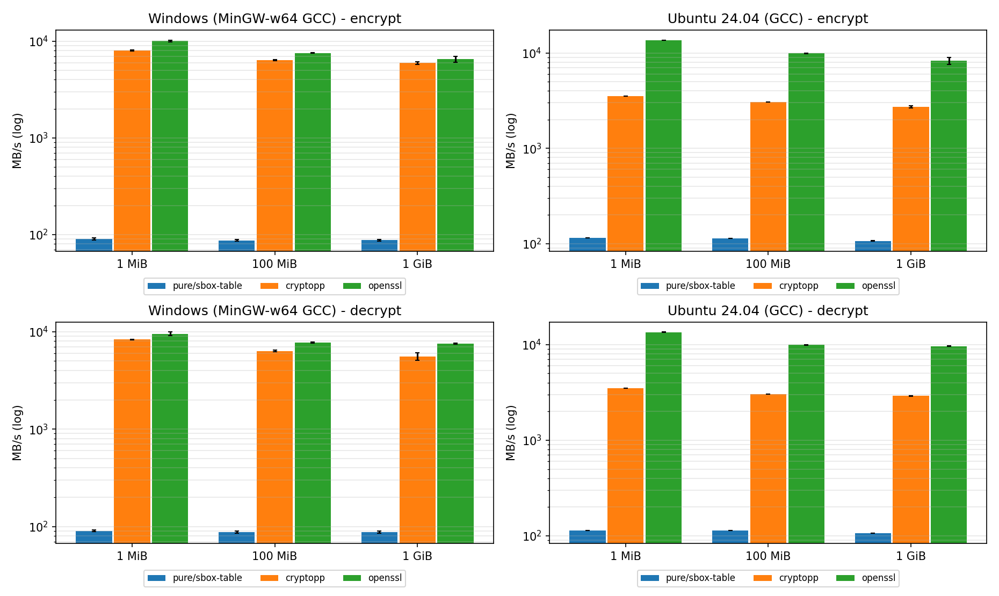
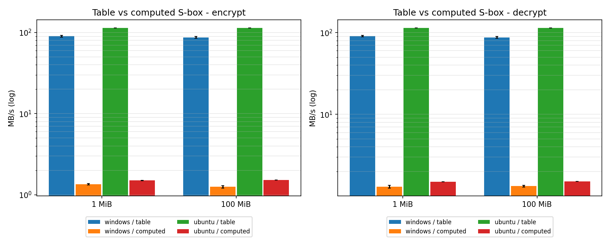

# TRƯỜNG ĐẠI HỌC CÔNG NGHỆ THÔNG TIN, ĐHQG-HCM
## KHOA MẠNG MÁY TÍNH VÀ TRUYỀN THÔNG

# BÁO CÁO THỰC HÀNH
## MÔN HỌC: MẬT MÃ HỌC VÀ ỨNG DỤNG (NT219)

# LAB 2: TỰ CÀI ĐẶT AES-128 BẰNG C++ THUẦN
### Chế độ CTR (NIST SP 800-38A), chuẩn FIPS-197

**Thông tin sinh viên thực hiện:**
- **Họ và tên:** Trần Lâm Nguyên (Feph50)
- **Mã số sinh viên (MSSV):** Feph50
- **Lớp học phần:** NT219.P11.MMTT
- **Thời gian hoàn thành:** Học kỳ I - Năm học 2026–2027

<div class="pagebreak"></div>

# 1. Mục tiêu và chuẩn đầu ra (Objective & Outcomes)

**Đã xây dựng:** công cụ dòng lệnh `aestool` cài đặt **AES-128 từ đầu bằng C++17** theo FIPS-197 (AddRoundKey, SubBytes bằng tra bảng S-box, ShiftRows, MixColumns, KeyExpansion, 10 vòng) và chế độ **CTR** theo NIST SP 800-38A, cho dữ liệu có độ dài bất kỳ, không padding. Phần bonus đã cài: AES-192/256, AES-XTS và backend AES-NI.

**Ràng buộc của đề:** không dùng thư viện mật mã ngoài; chỉ dùng STL. Dự án được tách làm hai chương trình để tuân thủ ràng buộc này mà vẫn kiểm chứng được:

| Chương trình | Liên kết với | Dùng để |
| :--- | :--- | :--- |
| `aestool` (bản nộp) | Chỉ STL và API hệ điều hành (`BCryptGenRandom` / `getrandom`) | Mã hóa/giải mã, sinh key/IV, KAT, đo hiệu năng phần tự cài |
| `aestool_ref` | `aestool` cộng OpenSSL và Crypto++ | **Chỉ** cross-validation (`xval`) và so sánh hiệu năng (`bench --ref`) |

**Chuẩn đầu ra của đề và nơi đáp ứng:**

| Chuẩn đầu ra | Mục |
| :--- | :---: |
| Cài AES-128 theo các phép biến đổi của FIPS-197 | 2.2 |
| Cài CTR đúng theo NIST SP 800-38A | 2.3 |
| Kiểm chứng bằng NIST Known Answer Tests | 3.1 |
| Lập luận về tái dùng nonce và rủi ro của stream cipher | 3.4, 5.2 |
| Đo hiệu năng AES phần mềm | 4 |
| Phân tích rò rỉ kênh kề của cài đặt dùng bảng | 4.5, 5.1 |
| Hiểu vì sao CTR cần xác thực | 3.4, 5.2 |

# 2. Thiết kế và bảo mật (Design & Security)

## 2.1. Cấu trúc mã nguồn

| Thành phần | Tệp | Vai trò |
| :--- | :--- | :--- |
| Lõi AES | `src/aes128.*`, `src/aes_tables.hpp` | AES-128 (lõi), AES-192/256 (bonus), các backend S-box |
| CTR | `src/ctr.*` | Dòng keystream, xử lý block cuối ngắn, ghi file theo luồng 1 MiB |
| AES-NI, XTS | `src/aesni.*`, `src/xts.*` | Bonus |
| Kiểm chứng | `src/kat.*`, `src/json.*`, `src/xval.*` | KAT từ JSON, cross-validation |
| Đo hiệu năng | `src/bench.*`, `src/stats.*` | Warm-up, nhiều lần lặp, mean/median/SD/CI95 |
| CLI | `src/main.cpp` | `encrypt`, `decrypt`, `keygen`, `ivgen`, `--kat`, `xval`, `bench` |

## 2.2. Lõi AES-128 (FIPS-197)

- Block 128 bit, khóa 128 bit, **10 vòng**. Trạng thái 4x4 byte xếp theo cột (`s[4*c + r]`), đúng mục 3.4 của FIPS-197.
- Mã hóa: `AddRoundKey`, rồi 9 vòng (`SubBytes`, `ShiftRows`, `MixColumns`, `AddRoundKey`), rồi vòng cuối không có `MixColumns`. Giải mã dùng các phép nghịch đảo.
- `KeyExpansion` tạo 44 từ (176 byte round key): `RotWord`, `SubWord`, XOR `Rcon`. Mã dùng chung cho AES-192/256 (Nk = 6, 8, kèm `SubWord` phụ của AES-256).
- `MixColumns` tính bằng phép nhân GF(2^8) không rẽ nhánh (`xtime` là phép dịch bit cộng XOR có điều kiện được viết bằng số học, không dùng `if`).

**Các backend `SubBytes`** (chọn bằng `--sbox`; mặc định `table`):

| Backend | Cách làm | Bảng tra |
| :--- | :--- | :--- |
| `table` (mặc định) | `S[x]` tra bảng 256 byte, đúng mô tả "S-box lookup" của đề | S-box 256 B + S-box nghịch đảo 256 B = **512 B** |
| `computed` | `S(x) = affine(x^254)` trong GF(2^8), mã không rẽ nhánh và không truy cập bộ nhớ theo dữ liệu | **0 B** |
| `ttable` | 4 bảng T (mỗi bảng 256 từ 32 bit) | 4 x 1 KiB = **4096 B** |
| `aesni` (bonus) | Lệnh phần cứng AES-NI, phát hiện CPU lúc chạy; chỉ chạy khi chọn `--sbox aesni` | Không có |

Bảng S-box của backend `table` được sinh lúc biên dịch (`constexpr`) từ định nghĩa đại số, không chép tay; `static_assert` kiểm vài phần tử đã biết (`S[0x00]=0x63`, `S[0x53]=0xED`).

## 2.3. Chế độ CTR (SP 800-38A)

Với block thứ i: `S_i = AES(K, T_i)`, `C_i = P_i XOR S_i`, `P_i = C_i XOR S_i` (mã hóa và giải mã là cùng một phép).

- **IV 128 bit** là khối đếm khởi đầu `T_1` (nonce cộng counter).
- **Endianness của counter:** toàn bộ 128 bit là một số **big-endian**; byte 15 là byte ít quan trọng nhất và được tăng trước, nhớ lan về phía byte 0 (hàm incrementing của SP 800-38A phụ lục B.1 với m = 128).
- **Tràn counter:** không bao giờ cho quay vòng. Sau khối `FF..FF`, yêu cầu thêm một khối sẽ ném lỗi `CounterOverflow` (exit 5) và xóa file đầu ra dở, thay vì lặp lại keystream (two-time pad).
- Độ dài tùy ý; khối cuối ngắn chỉ dùng phần đầu của keystream; không padding; đầu vào rỗng cho đầu ra rỗng.
- **IV/nonce:** `--iv` (file 16 byte hoặc 32 ký tự hex), `--nonce` (12 byte, IV = nonce cộng 4 byte counter bằng 0), hoặc bỏ trống để sinh ngẫu nhiên bằng CSPRNG của hệ điều hành và lưu vào `<out>.iv`; khi giải mã tự đọc `<in>.iv`. Truyền IV thủ công sẽ in cảnh báo vì người dùng phải tự bảo đảm không dùng lại.

**Quy tắc bảo mật quan trọng của đề:** IV phải duy nhất theo từng khóa; dùng lại là thảm họa (mục 5.2).

## 2.4. CLI, đầu vào/ra và fail closed

Lệnh theo đúng mẫu của đề:

```
aestool encrypt --mode ctr --key key.bin --iv iv.bin --in msg.bin --out ct.bin
aestool decrypt --mode ctr --key key.bin --iv iv.bin --in ct.bin --out msg.bin
```

- Khóa đúng 16 byte (AES-128), IV đúng 16 byte; file vào/ra là nhị phân; hex/base64 tùy chọn (`--encode`, `--in-encode`); mặc định in hex ra màn hình và ghi nhị phân vào file; `--text` nhận UTF-8.
- **Fail closed**, kết thúc bằng mã thoát riêng và **không ghi file đầu ra khi lỗi** (ghi qua file tạm rồi đổi tên): `2` sai cú pháp, `3` đầu vào không hợp lệ, `4` lỗi I/O, `5` tràn counter, `6` KAT/cross-validation thất bại.
- Đường dẫn tương đối được hiểu đúng như nó viết; công cụ **không** tìm file ở thư mục cha hay thư mục chứa chương trình (xem mục 6.2).
- Chuẩn CLI chung của môn: `--in/--text`, `--out`, `--key/--key-hex`, `--iv`, `--nonce`, `--mode`, `--encode`, `--threads` (cho `bench`), `--kat`, `--verbose`; `--aead` bị từ chối vì CTR không có thẻ xác thực.
- **Ngẫu nhiên:** key, IV và dữ liệu benchmark đều lấy từ CSPRNG của hệ điều hành; không có `rand()` hay `std::random` trong mã nguồn.

## 2.5. Bonus đã cài

| Bonus | Nội dung | Kiểm chứng |
| :--- | :--- | :--- |
| AES-192/256 | Lịch khóa đầy đủ cho Nk = 6, 8 | KAT FIPS-197 C.2/C.3, SP 800-38A F.5.3/F.5.5; cross-validation với OpenSSL và Crypto++ |
| AES-XTS | Hai khóa K1/K2, nhân tweak trong GF(2^128), ciphertext stealing | IEEE 1619-2007 vector 1, 2, 3, 15; cross-validation với OpenSSL |
| AES-NI | Lệnh `AESENC/AESDEC`, kiểm tra CPUID lúc chạy | So khớp với backend phần mềm trên khóa và khối ngẫu nhiên; chưa nằm trong bộ số đo chính của báo cáo này |

# 3. Phương pháp kiểm thử (Test Methodology)

## 3.1. Known Answer Tests

`aestool --kat kat/vectors.json` đọc vector từ JSON và in PASS/FAIL từng ca kèm tổng kết. Tệp có **31 vector**:

| Nhóm | Số vector | Nguồn |
| :--- | :---: | :--- |
| `aes128_block` | 7 | FIPS-197 Appendix B, C.1; AESAVS ECBGFSbox128 (2), ECBKeySbox128, ECBVarTxt128, ECBVarKey128 |
| `aes128_ctr` | 11 | SP 800-38A F.5.1 (4 khối) và các tiền tố 1, 15, 17, 37, 63 byte (khối cuối ngắn); đầu vào rỗng; 4 ca tràn nhớ sinh bằng OpenSSL (đánh dấu rõ là không phải vector NIST) |
| `aes128_ctr_errors` | 3 | IV toàn FF: phải báo tràn counter |
| `aes192_block`, `aes256_block` | 2 + 2 | FIPS-197 C.2, C.3; SP 800-38A F.1.3, F.1.5 (bonus) |
| `aes192_ctr`, `aes256_ctr` | 1 + 1 | SP 800-38A F.5.3, F.5.5 (bonus) |
| `aes_xts` | 4 | IEEE 1619-2007 vector 1, 2, 3, 15 (bonus) |

| Kiểm chứng | Windows MinGW | Windows MSVC | Ubuntu 24.04 |
| :--- | :--- | :--- | :--- |
| KAT (`--kat`) | Summary: 31 tests, 31 passed, 0 failed | Summary: 31 tests, 31 passed, 0 failed | chưa có (cần chạy trên Ubuntu 24.04) |
| Cross-validation (`xval`) | Summary: 1722 cross-validation cases, 0 failed | Summary: 1722 cross-validation cases, 0 failed | chưa có (cần chạy trên Ubuntu 24.04) |
| `ctest` (4 test) | 100% tests passed, 0 tests failed out of 4 | 100% tests passed, 0 tests failed out of 4 | chưa có (cần chạy trên Ubuntu 24.04) |
| Unit test Catch2 | All tests passed (3276 assertions in 32 test cases) | All tests passed (3276 assertions in 32 test cases) | chưa có (cần chạy trên Ubuntu 24.04) |

## 3.2. Cross-validation

Đề yêu cầu ciphertext **giống hệt** Crypto++ hoặc OpenSSL với cùng khóa và IV. `aestool_ref xval --ref all` so sánh bản tự cài (mọi backend) với **cả hai** thư viện trên độ dài cố định (0 đến 65537 byte), độ dài ngẫu nhiên (dưới 200000 byte), khóa/IV ngẫu nhiên và IV ép tràn nhớ counter (các byte thấp gần 2^64 và 2^32). Kết quả: **1722 ca, 0 lỗi** (AES-128/192/256-CTR so với OpenSSL và Crypto++, XTS-128/256 so với OpenSSL; log `output/<os>/xval_*.txt`). Backend `computed` chỉ được so với dữ liệu tối đa 4096 byte vì quá chậm.

## 3.3. Unit test

Catch2, chạy qua `ctest` (4 test): unit test (32 test case, 3276 assertion: khóa lịch FIPS-197 A.1, S-box, mọi backend, CTR, chunking, tràn counter, negative, hex/base64, JSON, thống kê, bonus), KAT, CLI end-to-end và cross-validation.

## 3.4. Test âm tính (Negative Tests)

Các phép thử dưới đây chạy bằng đúng một khối lệnh (`docs/TEST_EVIDENCE.md`), log nằm ở `output/<os>/negative_*.txt`. Kết quả mã thoát trên Windows MinGW: 14 lần exit 0, 3 lần exit 1, 4 lần exit 2, 10 lần exit 3, 4 lần exit 4, 1 lần exit 5; Windows MSVC: 14 lần exit 0, 3 lần exit 1, 4 lần exit 2, 10 lần exit 3, 4 lần exit 4, 1 lần exit 5; Ubuntu: chưa có log trên Ubuntu 24.04. Không có dòng `WRITTEN (BAD)` nào trên Windows (0 và 0).

| Nhóm | Phép thử | Kết quả mong đợi | Mã thoát |
| :--- | :--- | :--- | :---: |
| A | Lệnh mẫu của đề: mã hóa rồi giải mã, so khớp | Khớp từng byte (41 byte); đầu vào rỗng cho đầu ra rỗng; IV tự sinh lưu `<out>.iv` rồi giải mã được | 0 |
| B | **Sai key** khi giải mã | Giải mã "thành công" nhưng plaintext sai (khác từ byte đầu) | 0 |
| C | **Sai IV** khi giải mã | Plaintext sai | 0 |
| D | **Sửa ciphertext** (lật 1 bit ở byte 6) | Giải mã vẫn thành công; `cmp -l` cho thấy **đúng 1 byte** plaintext khác, byte 6 khác đúng 1 bit (0x20 so với 0x21): sửa không bị phát hiện | 0 |
| E | Khóa 15 byte (file), khóa 4 byte (hex), hex hỏng, IV 15 byte (file), IV `00` (hex), nonce 2 byte | Từ chối, không ghi file | 3 |
| F | IV = `FF..FF`, thông điệp 33 byte (cần 3 khối) | Báo tràn counter, không ghi file | 5 |
| G | Thiếu file vào; thiếu file khóa; file đầu ra đã tồn tại; không tìm file ở thư mục cha | Từ chối | 4 |
| G | Vào và ra là cùng một file (kể cả `--force`) | Từ chối | 3 |
| H | `--aead`, mode `des`, backend không tồn tại, `--nonce` cùng `--iv` | Từ chối | 2 |
| I | XTS: đầu vào ngắn hơn 16 byte; K1 bằng K2 | Từ chối | 3 |
| J | Tệp KAT JSON hỏng | Không báo thành công | 3 |

**Vì sao CTR không thể phát hiện việc sửa ciphertext:** CTR chỉ tạo keystream `S_i = AES(K, T_i)` độc lập với dữ liệu rồi XOR. Mọi chuỗi byte đều là một ciphertext hợp lệ của *một* plaintext nào đó, và không có thẻ xác thực hay dư thừa để kiểm tra. Lật bit j của ciphertext lật đúng bit j của plaintext, nên kẻ tấn công biết nội dung có thể sửa plaintext theo ý muốn (tính dễ bị sửa, malleability) mà bên nhận không biết. Dùng sai key cũng vậy: mọi khóa 16 byte đều cho một keystream hợp lệ, nên "giải mã sai key" không báo lỗi (test B).

# 4. Đánh giá hiệu năng (Performance)

## 4.1. Môi trường đo

| Hạng mục | Windows | Ubuntu |
| :--- | :--- | :--- |
| CPU | Intel Core i7-11800H @ 2,3 GHz, 8 nhân / 16 luồng, có AES-NI | giống (cùng máy, cài song song) |
| RAM | 31,7 GB | 31 GiB |
| Lưu trữ | SSD NVMe Samsung MZVL2512HCJQ 512 GB | cùng máy |
| Hệ điều hành | Windows 11 Pro, build 26200 | Ubuntu 24.04.2 LTS, kernel 7.0.0-43-generic |
| Compiler | MinGW-w64 GCC 16.2.0 (MSYS2), `Release` (`-O3 -DNDEBUG`) | GCC 13.3.0, `Release` (`-O3 -DNDEBUG`) |
| CMake | 4.x (MSYS2) | 3.28.3 |
| OpenSSL / Crypto++ | OpenSSL 3.6.4 / Crypto++ 8.9.0 (MSYS2) | OpenSSL 3.0.13 / Crypto++ 8.9.0-1.1build1 (apt) |
| Chế độ nguồn | High performance, cắm điện | Governor `performance` |

Cả hai hệ điều hành chạy trên **cùng một máy vật lý** (dual boot), cùng bộ lệnh và tham số.

## 4.2. Phương pháp

Theo protocol của đề: **warm-up 1,5 s** cho mỗi cấu hình và chiều; mỗi lần đo là một **khối thao tác** (`min(1000, 256 MiB / kích thước)`: 256 thao tác ở 1 MiB, 2 ở 100 MiB, 1 ở 1 GiB); **N = 30 lần lặp**; báo mean, median, độ lệch chuẩn (SD) và khoảng tin cậy 95% (phân phối Student t). Thông lượng tính bằng MB/s (1 MB = 10^6 byte), mã hóa tại chỗ trên một bộ đệm, một luồng. Khóa, IV và dữ liệu lấy từ CSPRNG. Lệnh đã dùng:

```
aestool_ref bench --bits 128 --sizes <1MiB|100MiB|1GiB> --backends table --ref all --runs 30 --csv <file>
aestool_ref bench --bits 128 --sizes <1MiB|100MiB> --backends computed --ops <2|1> --ref none --runs 30 --csv <file>
```

**Độ lệch protocol có chủ ý (ghi rõ):** backend `computed` chạy khoảng 1,3 đến 1,5 MB/s nên khối 1000 thao tác là bất khả thi (mỗi lần lặp ở 1 MiB mất khoảng 17 phút); `computed` được đo với **2 thao tác mỗi khối ở 1 MiB** và **1 thao tác mỗi khối ở 100 MiB**. Thông lượng (MB/s) không phụ thuộc số thao tác mỗi khối nên vẫn so sánh được với `table`. `computed` ở 1 GiB không khả thi (khoảng 17 phút mỗi thao tác, khoảng 17 giờ cho 30 lần lặp cả hai chiều); đề ghi 1 GiB là "nếu khả thi".

## 4.3. Kết quả

### Windows (MinGW-w64 GCC 16.2)

| Cài đặt | Chiều | Payload | Ops/khối | N | Mean (MB/s) | Median | SD | ±CI95 | Mean (ms/op) |
| :--- | :---: | :---: | ---: | ---: | ---: | ---: | ---: | ---: | ---: |
| pure/sbox-table | Enc | 1 MiB | 256 | 30 | 90.03 | 91.52 | 6.73 | ±2.51 | 11.720 |
| pure/sbox-table | Dec | 1 MiB | 256 | 30 | 90.38 | 91.31 | 4.87 | ±1.82 | 11.641 |
| cryptopp | Enc | 1 MiB | 256 | 30 | 8,039.53 | 8,140.19 | 217.57 | ±81.23 | 0.131 |
| cryptopp | Dec | 1 MiB | 256 | 30 | 8,311.62 | 8,399.53 | 190.54 | ±71.14 | 0.126 |
| openssl | Enc | 1 MiB | 256 | 30 | 10,040.24 | 10,022.88 | 583.74 | ±217.95 | 0.105 |
| openssl | Dec | 1 MiB | 256 | 30 | 9,514.06 | 9,577.40 | 1,040.60 | ±388.52 | 0.112 |
| pure/sbox-computed | Enc | 1 MiB | 2 | 30 | 1.34 | 1.35 | 0.07 | ±0.03 | 783.312 |
| pure/sbox-computed | Dec | 1 MiB | 2 | 30 | 1.30 | 1.35 | 0.13 | ±0.05 | 812.989 |
| pure/sbox-table | Enc | 100 MiB | 2 | 30 | 87.29 | 88.41 | 5.74 | ±2.14 | 1,207.376 |
| pure/sbox-table | Dec | 100 MiB | 2 | 30 | 87.53 | 88.06 | 5.43 | ±2.03 | 1,202.896 |
| cryptopp | Enc | 100 MiB | 2 | 30 | 6,366.64 | 6,413.30 | 156.11 | ±58.29 | 16.480 |
| cryptopp | Dec | 100 MiB | 2 | 30 | 6,329.71 | 6,478.27 | 363.12 | ±135.58 | 16.621 |
| openssl | Enc | 100 MiB | 2 | 30 | 7,569.15 | 7,598.76 | 122.88 | ±45.88 | 13.857 |
| openssl | Dec | 100 MiB | 2 | 30 | 7,746.43 | 7,786.32 | 201.80 | ±75.34 | 13.545 |
| pure/sbox-computed | Enc | 100 MiB | 1 | 30 | 1.25 | 1.27 | 0.11 | ±0.04 | 84,470.475 |
| pure/sbox-computed | Dec | 100 MiB | 1 | 30 | 1.32 | 1.35 | 0.10 | ±0.04 | 79,697.029 |
| pure/sbox-table | Enc | 1 GiB | 1 | 30 | 87.45 | 88.58 | 4.90 | ±1.83 | 12,316.028 |
| pure/sbox-table | Dec | 1 GiB | 1 | 30 | 87.64 | 89.63 | 6.57 | ±2.45 | 12,322.419 |
| cryptopp | Enc | 1 GiB | 1 | 30 | 5,942.08 | 5,872.05 | 473.62 | ±176.83 | 181.795 |
| cryptopp | Dec | 1 GiB | 1 | 30 | 5,564.40 | 6,361.82 | 1,338.70 | ±499.82 | 206.878 |
| openssl | Enc | 1 GiB | 1 | 30 | 6,499.06 | 7,242.00 | 1,269.51 | ±473.99 | 172.573 |
| openssl | Dec | 1 GiB | 1 | 30 | 7,560.09 | 7,615.88 | 292.65 | ±109.26 | 142.253 |

### Ubuntu 24.04 (GCC 13.3)

| Cài đặt | Chiều | Payload | Ops/khối | N | Mean (MB/s) | Median | SD | ±CI95 | Mean (ms/op) |
| :--- | :---: | :---: | ---: | ---: | ---: | ---: | ---: | ---: | ---: |
| pure/sbox-table | Enc | 1 MiB | 256 | 30 | 114.35 | 114.36 | 0.05 | ±0.02 | 9.170 |
| pure/sbox-table | Dec | 1 MiB | 256 | 30 | 114.38 | 114.39 | 0.06 | ±0.02 | 9.168 |
| cryptopp | Enc | 1 MiB | 256 | 30 | 3,540.84 | 3,541.00 | 2.78 | ±1.04 | 0.296 |
| cryptopp | Dec | 1 MiB | 256 | 30 | 3,505.43 | 3,505.32 | 2.56 | ±0.96 | 0.299 |
| openssl | Enc | 1 MiB | 256 | 30 | 13,625.33 | 13,624.28 | 20.97 | ±7.83 | 0.077 |
| openssl | Dec | 1 MiB | 256 | 30 | 13,499.86 | 13,499.13 | 19.51 | ±7.29 | 0.078 |
| pure/sbox-computed | Enc | 1 MiB | 2 | 30 | 1.50 | 1.51 | 0.02 | ±0.01 | 699.835 |
| pure/sbox-computed | Dec | 1 MiB | 2 | 30 | 1.50 | 1.50 | 0.01 | ±0.00 | 699.225 |
| pure/sbox-table | Enc | 100 MiB | 2 | 30 | 113.65 | 113.73 | 0.43 | ±0.16 | 922.648 |
| pure/sbox-table | Dec | 100 MiB | 2 | 30 | 113.91 | 113.93 | 0.06 | ±0.02 | 920.529 |
| cryptopp | Enc | 100 MiB | 2 | 30 | 3,046.18 | 3,047.39 | 5.57 | ±2.08 | 34.423 |
| cryptopp | Dec | 100 MiB | 2 | 30 | 3,040.01 | 3,049.45 | 31.79 | ±11.87 | 34.496 |
| openssl | Enc | 100 MiB | 2 | 30 | 9,927.80 | 10,031.89 | 199.88 | ±74.63 | 10.566 |
| openssl | Dec | 100 MiB | 2 | 30 | 9,949.14 | 10,045.76 | 155.12 | ±57.92 | 10.542 |
| pure/sbox-computed | Enc | 100 MiB | 1 | 30 | 1.52 | 1.52 | 0.00 | ±0.00 | 69,095.173 |
| pure/sbox-computed | Dec | 100 MiB | 1 | 30 | 1.52 | 1.52 | 0.00 | ±0.00 | 69,103.336 |
| pure/sbox-table | Enc | 1 GiB | 1 | 30 | 106.20 | 106.46 | 1.98 | ±0.74 | 10,113.577 |
| pure/sbox-table | Dec | 1 GiB | 1 | 30 | 106.87 | 107.04 | 1.23 | ±0.46 | 10,048.534 |
| cryptopp | Enc | 1 GiB | 1 | 30 | 2,713.60 | 2,830.64 | 198.74 | ±74.20 | 397.938 |
| cryptopp | Dec | 1 GiB | 1 | 30 | 2,903.62 | 2,900.82 | 19.79 | ±7.39 | 369.810 |
| openssl | Enc | 1 GiB | 1 | 30 | 8,268.71 | 9,263.54 | 1,820.62 | ±679.75 | 138.291 |
| openssl | Dec | 1 GiB | 1 | 30 | 9,643.28 | 9,666.72 | 71.99 | ±26.88 | 111.352 |



*Hình 1: Thông lượng (MB/s, trục log) của bản tự cài dùng S-box tra bảng, Crypto++ và OpenSSL ở 1 MiB, 100 MiB, 1 GiB; thanh sai số là CI95.*

## 4.4. Table-based S-box so với computed S-box

| Nền tảng | Chiều | Payload | Table (MB/s) | Computed (MB/s) | Table / Computed |
| :--- | :---: | :---: | ---: | ---: | :---: |
| Windows (MinGW-w64 GCC 16.2) | Mã hóa | 1 MiB | 90.03 ± 2.51 | 1.34 ± 0.03 | 67x |
| Windows (MinGW-w64 GCC 16.2) | Mã hóa | 100 MiB | 87.29 ± 2.14 | 1.25 ± 0.04 | 70x |
| Windows (MinGW-w64 GCC 16.2) | Giải mã | 1 MiB | 90.38 ± 1.82 | 1.30 ± 0.05 | 69x |
| Windows (MinGW-w64 GCC 16.2) | Giải mã | 100 MiB | 87.53 ± 2.03 | 1.32 ± 0.04 | 66x |
| Ubuntu 24.04 (GCC 13.3) | Mã hóa | 1 MiB | 114.35 ± 0.02 | 1.50 ± 0.01 | 76x |
| Ubuntu 24.04 (GCC 13.3) | Mã hóa | 100 MiB | 113.65 ± 0.16 | 1.52 ± 0.00 | 75x |
| Ubuntu 24.04 (GCC 13.3) | Giải mã | 1 MiB | 114.38 ± 0.02 | 1.50 ± 0.00 | 76x |
| Ubuntu 24.04 (GCC 13.3) | Giải mã | 100 MiB | 113.91 ± 0.02 | 1.52 ± 0.00 | 75x |



*Hình 2: Thông lượng của `table` và `computed` (trục log, thanh sai số là CI95).*

**Đo được:** `computed` chậm hơn `table` khoảng **66 đến 76 lần** ở mọi điểm đo, trên cả hai hệ điều hành và cả hai chiều. Thông lượng của `table` gần như **không phụ thuộc kích thước**: thông lượng ở 1 GiB bằng 97% (Windows) và 93% (Ubuntu) so với ở 1 MiB; điều này phù hợp với việc bị giới hạn bởi tính toán của CPU chứ không phải băng thông bộ nhớ (suy luận từ số đo, chưa có phép đo trực tiếp).

## 4.5. Phân tích theo yêu cầu của đề

**Bộ nhớ (đo từ mã nguồn):** `table` cần 512 byte bảng (S-box và nghịch đảo), cộng 176 byte round key; `ttable` cần 4096 byte; `computed` không có bảng, chỉ có mã. Bảng 512 byte (8 dòng cache 64 byte) và bảng 4096 byte (64 dòng) đều nhỏ hơn nhiều so với bộ nhớ đệm L1 dữ liệu của CPU.

**Hành vi cache (suy luận, không đo):** với `table`, mỗi byte trạng thái chọn một phần tử của bảng nên **địa chỉ truy cập phụ thuộc dữ liệu bí mật**: đây là nguồn của tấn công cache-timing (mục 5.1). Vì bảng 512 byte vừa trong L1, tốc độ không suy giảm theo kích thước dữ liệu (đã đo ở 4.4), nhưng kẻ tấn công cùng máy vẫn có thể quan sát dòng cache nào bị chạm. `computed` không có truy cập bộ nhớ phụ thuộc dữ liệu, nên không có kênh này. Báo cáo này **không đo** số cache-miss (cần công cụ như `perf`); các nhận định trên là suy luận từ cấu trúc mã.

**Ảnh hưởng của dự đoán nhánh (suy luận, không đo):** cả `table` lẫn `computed` đều **không có nhánh phụ thuộc dữ liệu bí mật** (vòng lặp có số lần cố định; `MixColumns` và phép nhân GF(2^8) dùng phép toán bit và số học thay cho `if`). Vì vậy bộ dự đoán nhánh gần như luôn đoán đúng và không phải nguyên nhân của chênh lệch tốc độ. Lý do `computed` chậm là **số lệnh**: mỗi byte cần khoảng 14 phép nhân GF(2^8) để tính nghịch đảo (mỗi phép gồm 8 lượt lặp) so với một lần đọc bộ nhớ của `table`; nhưng con số này là ước lượng từ mã, không phải số liệu đo.

**So sánh với Crypto++ và OpenSSL:**

| Nền tảng | Payload | Chiều | Pure table (MB/s) | Crypto++ (MB/s) | OpenSSL (MB/s) | Pure / Crypto++ | Pure / OpenSSL | Crypto++ / OpenSSL |
| :--- | :---: | :---: | ---: | ---: | ---: | :---: | :---: | :---: |
| Windows (MinGW-w64 GCC 16.2) | 1 MiB | Enc | 90.03 | 8,040 | 10,040 | 1.1% | 0.90% | 80% |
| Windows (MinGW-w64 GCC 16.2) | 1 MiB | Dec | 90.38 | 8,312 | 9,514 | 1.1% | 0.95% | 87% |
| Windows (MinGW-w64 GCC 16.2) | 100 MiB | Enc | 87.29 | 6,367 | 7,569 | 1.4% | 1.15% | 84% |
| Windows (MinGW-w64 GCC 16.2) | 100 MiB | Dec | 87.53 | 6,330 | 7,746 | 1.4% | 1.13% | 82% |
| Windows (MinGW-w64 GCC 16.2) | 1 GiB | Enc | 87.45 | 5,942 | 6,499 | 1.5% | 1.35% | 91% |
| Windows (MinGW-w64 GCC 16.2) | 1 GiB | Dec | 87.64 | 5,564 | 7,560 | 1.6% | 1.16% | 74% |
| Ubuntu 24.04 (GCC 13.3) | 1 MiB | Enc | 114.35 | 3,541 | 13,625 | 3.2% | 0.84% | 26% |
| Ubuntu 24.04 (GCC 13.3) | 1 MiB | Dec | 114.38 | 3,505 | 13,500 | 3.3% | 0.85% | 26% |
| Ubuntu 24.04 (GCC 13.3) | 100 MiB | Enc | 113.65 | 3,046 | 9,928 | 3.7% | 1.14% | 31% |
| Ubuntu 24.04 (GCC 13.3) | 100 MiB | Dec | 113.91 | 3,040 | 9,949 | 3.7% | 1.14% | 31% |
| Ubuntu 24.04 (GCC 13.3) | 1 GiB | Enc | 106.20 | 2,714 | 8,269 | 3.9% | 1.28% | 33% |
| Ubuntu 24.04 (GCC 13.3) | 1 GiB | Dec | 106.87 | 2,904 | 9,643 | 3.7% | 1.11% | 30% |

Ở 1 MiB, bản tự cài (`table`) đạt khoảng **1.1% (Windows)** và **3.2% (Ubuntu)** thông lượng của Crypto++, và **0.90% / 0.84%** của OpenSSL. Hai thư viện dùng lệnh AES-NI và triển khai đã tối ưu, còn bản tự cài chạy từng byte bằng phần mềm thuần; chênh lệch hai bậc độ lớn là đúng kỳ vọng.

## 4.6. So sánh Windows và Ubuntu

| Cài đặt | Payload | Chiều | Windows (MB/s) | Ubuntu (MB/s) | Ubuntu / Windows | Khoảng CI95 không chồng nhau |
| :--- | :---: | :---: | ---: | ---: | :---: | :---: |
| pure/sbox-table | 1 MiB | Enc | 90.03 ± 2.51 | 114.35 ± 0.02 | 1.27 | Có |
| pure/sbox-table | 1 MiB | Dec | 90.38 ± 1.82 | 114.38 ± 0.02 | 1.27 | Có |
| pure/sbox-table | 100 MiB | Enc | 87.29 ± 2.14 | 113.65 ± 0.16 | 1.30 | Có |
| pure/sbox-table | 100 MiB | Dec | 87.53 ± 2.03 | 113.91 ± 0.02 | 1.30 | Có |
| pure/sbox-table | 1 GiB | Enc | 87.45 ± 1.83 | 106.20 ± 0.74 | 1.21 | Có |
| pure/sbox-table | 1 GiB | Dec | 87.64 ± 2.45 | 106.87 ± 0.46 | 1.22 | Có |
| cryptopp | 1 MiB | Enc | 8,039.53 ± 81.23 | 3,540.84 ± 1.04 | 0.44 | Có |
| cryptopp | 1 MiB | Dec | 8,311.62 ± 71.14 | 3,505.43 ± 0.96 | 0.42 | Có |
| cryptopp | 100 MiB | Enc | 6,366.64 ± 58.29 | 3,046.18 ± 2.08 | 0.48 | Có |
| cryptopp | 100 MiB | Dec | 6,329.71 ± 135.58 | 3,040.01 ± 11.87 | 0.48 | Có |
| cryptopp | 1 GiB | Enc | 5,942.08 ± 176.83 | 2,713.60 ± 74.20 | 0.46 | Có |
| cryptopp | 1 GiB | Dec | 5,564.40 ± 499.82 | 2,903.62 ± 7.39 | 0.52 | Có |
| openssl | 1 MiB | Enc | 10,040.24 ± 217.95 | 13,625.33 ± 7.83 | 1.36 | Có |
| openssl | 1 MiB | Dec | 9,514.06 ± 388.52 | 13,499.86 ± 7.29 | 1.42 | Có |
| openssl | 100 MiB | Enc | 7,569.15 ± 45.88 | 9,927.80 ± 74.63 | 1.31 | Có |
| openssl | 100 MiB | Dec | 7,746.43 ± 75.34 | 9,949.14 ± 57.92 | 1.28 | Có |
| openssl | 1 GiB | Enc | 6,499.06 ± 473.99 | 8,268.71 ± 679.75 | 1.27 | Có |
| openssl | 1 GiB | Dec | 7,560.09 ± 109.26 | 9,643.28 ± 26.88 | 1.28 | Có |
| pure/sbox-computed | 1 MiB | Enc | 1.34 ± 0.03 | 1.50 ± 0.01 | 1.12 | Có |
| pure/sbox-computed | 1 MiB | Dec | 1.30 ± 0.05 | 1.50 ± 0.00 | 1.15 | Có |
| pure/sbox-computed | 100 MiB | Enc | 1.25 ± 0.04 | 1.52 ± 0.00 | 1.21 | Có |
| pure/sbox-computed | 100 MiB | Dec | 1.32 ± 0.04 | 1.52 ± 0.00 | 1.15 | Có |

Với bản tự cài, `table` nhanh hơn trên Ubuntu khoảng 1.27 lần ở 1 MiB; chênh lệch này ổn định và có ý nghĩa thống kê (khoảng CI95 không chồng nhau). Hai bản dùng **compiler khác phiên bản** (GCC 16.2 trên Windows, GCC 13.3 trên Ubuntu) và hệ điều hành khác nhau (lập lịch, cấp phát bộ nhớ, thư viện runtime), nên không thể quy chênh lệch này cho riêng một nguyên nhân; chưa có phép đo cô lập từng yếu tố.

Crypto++ trên Ubuntu chỉ đạt 26% thông lượng của OpenSSL, trong khi trên Windows đạt 80%. Khác biệt này nằm ở **thư viện** (bản Crypto++ 8.9.0 của gói Ubuntu so với bản MSYS2), **nguyên nhân chưa được xác định** và chưa được kiểm chứng.

# 5. Thảo luận bảo mật (Security Engineering Discussion)

## 5.1. Rủi ro của lõi AES

- **Rò rỉ thời gian của S-box dạng bảng.** Với `table`, mỗi truy cập `S[x]` có địa chỉ phụ thuộc `x` là byte trạng thái bí mật (trong vòng đầu `x = plaintext XOR key`). Thời gian truy cập phụ thuộc việc dòng cache chứa phần tử đó có sẵn hay không, nên thời gian mã hóa mang thông tin về khóa.
- **Tấn công qua cache (T-table).** `ttable` (4 bảng 1 KiB) là mục tiêu kinh điển: kẻ tấn công chạy trên cùng máy (Prime+Probe, Flush+Reload, Evict+Time) quan sát dòng cache nào bị chạm trong vòng đầu và loại dần các giả thuyết của byte khóa; Bernstein (2005) và Osvik, Shamir, Tromer (2006) đã khôi phục khóa AES theo cách này. Vì bảng nhỏ, chỉ cần quan sát một ít dòng cache là đủ để thu hẹp khóa.
- **Tầm quan trọng của mã constant-time.** Một cài đặt an toàn phải có thời gian chạy, địa chỉ bộ nhớ truy cập và nhánh rẽ **không phụ thuộc** dữ liệu bí mật. Backend `computed` thỏa các điều kiện này về cấu trúc mã (không bảng, không nhánh theo dữ liệu) nhưng đổi lấy tốc độ khoảng 66 đến 76 lần chậm hơn (mục 4.4), và **chưa được kiểm chứng** bằng công cụ constant-time chuyên dụng; trình biên dịch vẫn có thể biến đổi mã theo cách làm mất tính chất này.
- **Cài đặt này không chống side-channel.** Backend `table` và `ttable` cố ý dùng bảng để phục vụ phân tích của đề; không nên dùng để bảo vệ dữ liệu thật.

## 5.2. Rủi ro của chế độ CTR

- **Tái dùng keystream và two-time pad.** Nếu cùng `(K, IV)` mã hóa hai thông điệp `P1`, `P2`: `C1 XOR C2 = (P1 XOR S) XOR (P2 XOR S) = P1 XOR P2`. Keystream triệt tiêu, kẻ tấn công thu được `P1 XOR P2` mà không cần khóa; biết một thông điệp (hoặc đoán được cấu trúc, như tiêu đề file) là khôi phục được thông điệp kia. Unit test `Two-time pad: IV reuse leaks P1 xor P2` kiểm chứng đẳng thức này.
- **Vì sao tái dùng IV là thảm họa:** hậu quả không dừng ở một khối: toàn bộ hai thông điệp bị lộ quan hệ XOR, và hỏng ngay cả khi khóa 128 bit mạnh. Khác với một vài tấn công cần nhiều bản mã, ở đây chỉ **hai** bản mã là đủ. Phòng ngừa: IV duy nhất theo khóa (tự sinh ngẫu nhiên 96 bit kèm counter 32 bit; cảnh báo khi người dùng tự truyền IV; counter không quay vòng).
- **CTR chỉ cung cấp tính bí mật.** Không có xác thực hay toàn vẹn: lật bit ciphertext lật đúng bit plaintext (test D). Do đó **cần MAC** (hoặc dùng AEAD) để biết dữ liệu có bị sửa hay không; và nên kiểm MAC **trước** khi dùng plaintext.
- **CTR không phải AEAD.** AEAD (ví dụ AES-GCM) kết hợp mã hóa và xác thực trong một thao tác với thẻ xác thực; CTR thuần thì không có thẻ. Vì thế công cụ từ chối `--aead` thay vì giả vờ cung cấp tính năng này.

## 5.3. Tăng tốc phần cứng

- **AES-NI giảm nhiều rủi ro rò rỉ phần mềm:** lệnh `AESENC/AESDEC` thực hiện SubBytes và MixColumns trong phần cứng, thời gian không phụ thuộc dữ liệu và **không có truy cập bảng tra** nên không có kênh cache-timing của T-table.
- **Hiệu năng so với an toàn:** `table` nhanh nhưng rò rỉ; `computed` an toàn hơn về timing nhưng chậm hơn rất nhiều (mục 4.4); AES-NI vừa nhanh vừa không có bảng tra. Các thư viện Crypto++ và OpenSSL đo ở 4.5 dùng lệnh phần cứng và nhanh hơn bản tự cài hai bậc độ lớn. Backend `aesni` của dự án được kiểm chứng đúng đắn (khớp bản phần mềm), nhưng **không nằm trong bộ số đo chính** của báo cáo này nên không đưa ra con số thông lượng.

## 5.4. Mô hình đe dọa, lạm dụng, mặc định an toàn và giới hạn

- **Đối thủ được xét:** (1) đọc được file ciphertext; (2) sửa được ciphertext; (3) đo được thời gian/cache trên cùng máy; (4) người dùng vô tình dùng lại IV. Ngoài phạm vi: tấn công vật lý, malware đã chạy với quyền của người dùng.
- **Tình huống dùng sai và cách xử lý:** key/IV sai độ dài (từ chối); tái dùng IV (cảnh báo khi truyền tay; IV tự sinh); tràn counter (từ chối, không quay vòng); ghi đè file vô ý (cần `--force`); đầu vào trùng đầu ra (từ chối); file không tồn tại (từ chối, không tìm ở nơi khác); `--aead` (từ chối).
- **Mặc định an toàn:** IV ngẫu nhiên từ CSPRNG của hệ điều hành; backend `table` theo đúng mô tả của đề (không chọn AES-NI một cách ngầm); ghi file qua tệp tạm rồi đổi tên; xóa khóa/trạng thái trung gian khỏi bộ nhớ khi xong.
- **Fail closed:** mọi lỗi đều dừng với mã thoát khác 0 và không để lại file đầu ra dở (mục 3.4).
- **Giới hạn đã biết:** `table`/`ttable` không constant-time (chủ ý); `computed` chưa kiểm chứng bằng công cụ constant-time; không có cơ sở dữ liệu nonce giữa các lần chạy (không ngăn được việc người dùng tự truyền lại cùng IV); `--key-hex` có thể lộ khóa qua danh sách tiến trình hoặc lịch sử shell nên khuyến nghị `--key FILE`; số cache-miss và branch-miss không được đo.

# 6. Thảo luận (Discussion)

## 6.1. Đánh đổi

Bản tự cài đúng nhưng chậm: khoảng 90 MB/s (Windows) và 114 MB/s (Ubuntu), nghĩa là mã hóa 1 GiB mất khoảng 12 giây trên Windows, trong khi OpenSSL mất khoảng 0.2 giây. Đổi lại, nó cho thấy từng bước của FIPS-197 và cho phép so sánh các cách cài `SubBytes`.

## 6.2. Vấn đề đã tìm thấy và đã sửa trong quá trình làm

- **Tìm file ở nơi không được yêu cầu.** Bản đầu của `resolve_input_path` tự tìm file thiếu ở thư mục cha, cạnh file chạy và thư mục gốc dự án, nên `--key key.bin` có thể lặng lẽ dùng nhầm khóa khác. Đã sửa: chỉ dùng đúng đường dẫn đã cho; có test riêng (G3).
- **Tự ghi file.** `--kat`, `xval` và `bench` từng tự ghi vào thư mục `Output/` của dự án. Đã sửa: chỉ ghi khi người dùng truyền `--out` hoặc `--csv`.
- **Đường dẫn cứng trong CMake** (`D:/UIT/...`) buộc phải sửa tay trên máy khác. Đã sửa: OpenSSL và Crypto++ tự tìm; chỉ cần cho `aestool_ref`.
- **Lõi bị gắn với OpenSSL** (cùng một thư viện chứa lõi AES và mã tham chiếu). Đã tách: `aestool` không link thư viện mật mã nào (đã kiểm bằng danh sách DLL nhập và `ldd`).
- **Số liệu cũ sai protocol** (thời gian đo bằng tiến trình con, không có warm-up). Đã thay bằng `bench` gốc theo protocol 4.2.

## 6.3. Bài học

- Vì CTR không có xác thực, việc "giải mã thành công" không chứng minh dữ liệu đúng; cần MAC hoặc AEAD.
- Đo hiệu năng trên hai hệ điều hành phải giữ **đúng cùng** lệnh, tham số và cùng máy, và phải ghi rõ khác biệt về compiler và thư viện.
- Tách phần mã bị ràng buộc (không thư viện ngoài) khỏi phần kiểm chứng dùng thư viện giúp vừa tuân thủ đề vừa có đối chứng độc lập.
- Mọi kết luận về nguyên nhân (cache, nhánh, compiler) phải ghi rõ là đo hay suy luận.

# 7. Kết luận và hướng phát triển

Đã cài AES-128 theo FIPS-197 và CTR theo SP 800-38A bằng C++ thuần, đúng với 31 vector KAT và với Crypto++ và OpenSSL (1722 ca), có các kiểm tra fail-closed đầy đủ, chạy trên Windows (MinGW, MSVC) và Ubuntu 24.04. Bản `table` đạt khoảng 90 đến 114 MB/s; `computed` chậm hơn 66 đến 76 lần nhưng không có truy cập bộ nhớ phụ thuộc bí mật.

Hướng phát triển: đo cache-miss và branch-miss bằng `perf`; kiểm chứng tính constant-time của `computed` bằng công cụ chuyên dụng; đo chính thức AES-NI, AES-192/256 và XTS; bổ sung CMAC hoặc HMAC để có tính xác thực, hoặc chuyển sang GCM.

# Phụ lục

## P1. Lệnh build và kiểm thử (4 lệnh của đề)

```
mkdir build && cd build
cmake .. -DCMAKE_BUILD_TYPE=Release
cmake --build .
ctest --output-on-failure
```

MSVC cần thêm toolchain vcpkg (`-DCMAKE_TOOLCHAIN_FILE=.../vcpkg.cmake -DVCPKG_TARGET_TRIPLET=x64-windows-static -DCMAKE_MSVC_RUNTIME_LIBRARY=MultiThreaded -DCMAKE_BUILD_TYPE=Release`).

## P2. Ví dụ CLI

```
aestool keygen --out key.bin
aestool ivgen --out iv.bin
aestool encrypt --mode ctr --key key.bin --iv iv.bin --in msg.bin --out ct.bin
aestool decrypt --mode ctr --key key.bin --iv iv.bin --in ct.bin --out msg.bin
aestool encrypt --key key.bin --in msg.bin --out ct.bin          # IV tự sinh, lưu ct.bin.iv
aestool --kat kat/vectors.json
aestool_ref xval --ref all
```

## P3. Tệp bằng chứng

`output/windows/` và `output/ubuntu/`: `kat_*.txt`, `xval_*.txt`, `ctest_*.txt`, `negative_*.txt`, `env_*.txt`, `bench/*.csv`; `output/compare/*.png`. Lệnh sinh các tệp này nằm ở `docs/TEST_EVIDENCE.md`, `docs/BENCHMARK_RUNBOOK.md` và `docs/LINUX_RUNBOOK.md`.

## P4. Lưu ý về tệp KAT

Hash SHA-256 của `kat/vectors.json` ghi trong `env_windows.txt` khác `env_ubuntu.txt` chỉ vì kiểu xuống dòng (Windows CRLF do git, Ubuntu LF); nội dung giống nhau (hash của bản LF trong git trùng với Ubuntu).
